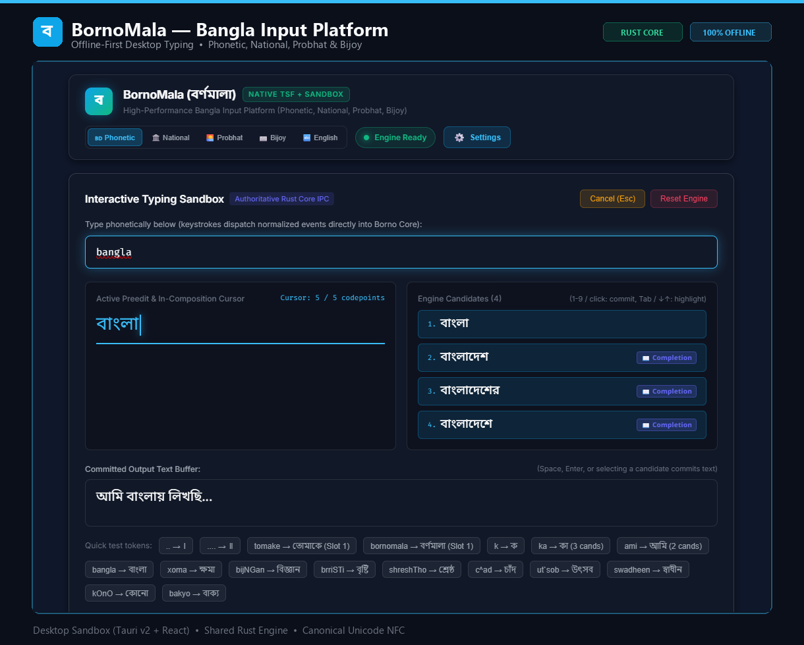
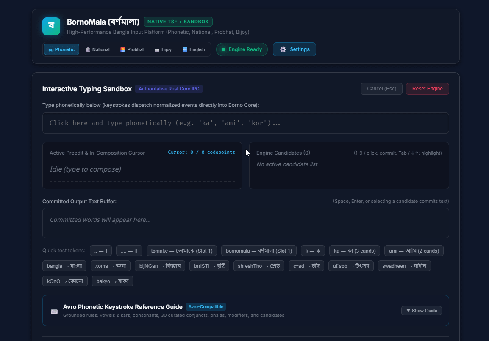
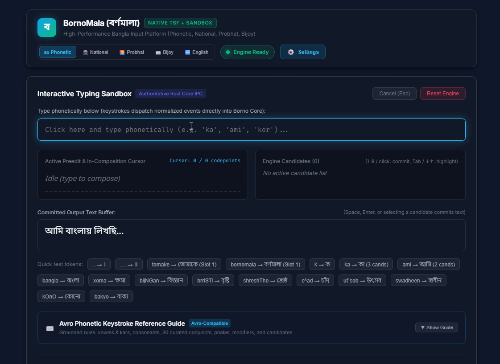
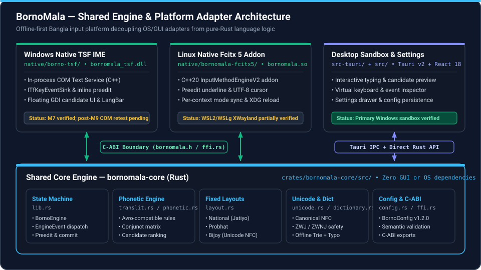

# BornoMala (বর্ণমালা) — Bangla Input Platform

[](https://www.rust-lang.org/)
[](https://tauri.app/)
[](crates/bornomala-core/src/config.rs)
[](#license)

**BornoMala (বর্ণমালা)** is a modular, offline-first Bangla input platform for desktop operating systems. It unifies **Phonetic transliteration**, **National (Jatiyo)**, **Probhat**, and **Bijoy** layouts behind a shared Rust core engine (`bornomala-core`), paired with a Tauri v2 + React desktop sandbox and native platform adapters for Windows (TSF) and Linux (Fcitx 5).

<p align="center">
  
</p>

> **Scope Note:** Visuals in this README and the [Visual Feature Guide](docs/visual-feature-guide.md) capture the **Desktop Sandbox (`bornomala-desktop`)** powered directly by `bornomala-core`. They do not represent system-wide native Windows TSF or Linux Fcitx 5 IME integration.

---

## Live Product Demonstrations

### Phonetic Typing & Candidate Selection

<p align="center">
  
</p>

*Real-time phonetic transliteration, in-composition cursor, and candidate selection (`1–9`, arrows, `Space`/`Enter`).*

### Offline Dictionary & Typo Correction

<p align="center">
  
</p>

*Prefix word completions and Levenshtein typo correction running locally without network access.*

See the [Visual Feature Guide](docs/visual-feature-guide.md) for focused views of the virtual keyboard, event latency inspector, Unicode conjunct verification, high-contrast theme, and settings drawer.

---

## Core Capabilities & Supported Layouts

### Key Capabilities

- **Shared Rust Engine (`bornomala-core`):** Pure-Rust input state machine with a C-ABI (`crates/bornomala-core/include/bornomala.h`). Historical core verification recorded `265` automated core tests across `12` test targets and sub-millisecond keystroke processing (`< 0.25 ms` average; `3.4 µs` pure core).
- **Canonical Unicode & Joiner Handling:** Enforces Unicode NFC normalization, two-part vowel sign composition, and `ZWJ`/`ZWNJ` preservation for Bangla conjuncts.
- **Offline Dictionary & Typo Correction:** Local Trie-based prefix completions and phonetic typo-correction candidates without cloud calls or telemetry.
- **Desktop Sandbox & Settings (`bornomala-desktop`):** Tauri v2 + React 18 + TypeScript application featuring an interactive virtual keyboard, deterministic event/latency inspector, and schema-versioned (`v1.2.0`) configuration drawer.
- **Offline & Private by Design:** No cloud dependencies, no telemetry, and no background keystroke logging.

### Supported Input Layouts

| Layout | Description |
| :--- | :--- |
| **Phonetic** | Avro-compatible phonetic transliteration (`ami` → `আমি`, `khoroch` → `খরচ`) with predictive completions and typo correction. |
| **National (Jatiyo)** | Bangladesh Standard BDS 1738:2018 layout with `Link (G)` conjunct chaining and `AltGr` symbols. |
| **Probhat** | Open-source fixed layout with direct independent vowel access and standard conjuncts. |
| **Bijoy** | Legacy key-mapping layout with `Link (G)` conjunct sequencing, emitting standardized Unicode NFC output. |
| **English** | Direct passthrough mode toggled via `F12` or `F4` (configurable). |

---

## Shared Rust Engine Architecture

All typing rules, layout mappings, Unicode normalization, dictionary ranking, and configuration validation live in `crates/bornomala-core/`. Platform adapters and the desktop sandbox consume the same engine through clean C-ABI or Rust IPC boundaries.

<p align="center">
  
</p>

- Detailed system overview: [System Architecture](docs/architecture.md)
- Configuration, validation, and atomic persistence flow: [Configuration Architecture](docs/visual-feature-guide.md#5-configuration--persistence-architecture)

---

## Platform Support & Verification Status

Status entries below reflect directly observed evidence documented in [`docs/platform-support.md`](docs/platform-support.md) and [`milestones/M8-revalidation-report.md`](milestones/M8-revalidation-report.md).

| Platform / Component | Current Verification Status | Notes & Scope |
| :--- | :--- | :--- |
| **Desktop Sandbox (`bornomala-desktop`)** | **Verified (Windows Sandbox)** | Built and verified locally on Windows (`src-tauri/` + `src/`). Prebuilt binaries are not distributed in Git or GitHub Releases yet. |
| **Windows Native TSF IME (`bornomala_tsf.dll`)** | **Historical M7; Retest Pending** | Built under M9; historical M7 verification covered Notepad, Sublime Text, Office, and VS Code. Post-M9 / post-remediation live system COM re-testing remains outstanding. |
| **Linux Native Fcitx 5 Addon (`bornomala.so`)** | **Partially Verified (WSL2/WSLg)** | Verified on Ubuntu 26.04.1 LTS under WSL2/WSLg (`Fcitx 5.1.19`, `XWayland` with `--disable waylandim`), GTK3 (`Gtk.Entry`), and GNOME `gedit`. Native Linux desktop sessions, native Wayland (`waylandim`), Qt5/Qt6, GTK4 live typing, and popup pointer clicks remain **unverified**. |
| **GitHub Actions CI (`ubuntu-24.04`)** | **Verified Hosted (2026-11-25)** | All three jobs (`Rust Core Tests`, `Frontend Build & Typecheck`, `Linux Fcitx 5 Addon Build & Tests`) passed on Ubuntu 24.04.5 LTS (Fcitx `5.1.7`) in [workflow `45559987709`](https://github.com/asmkhalid111/BornoMala/actions/runs/45559987709): Release `bornomala.so` build, `4/4` Release CTest targets + negative canary, `16/16` installer/harness safety tests, static privacy scan, staged/E2E install, idempotent reinstall, uninstall, and headless GUI `UNAVAILABLE` (`exit 77`). Native Linux graphical desktop and newer Fcitx runtime revalidation remain unverified. |
| **macOS** | **Deferred / Unverified** | Requires build and end-to-end execution on macOS hardware. |

---

## Getting Started

### 1. Run Automated Rust Core Tests

```powershell
cargo test -p bornomala-core
```

*(On Linux/WSL2, the Fcitx 5 adapter also includes `4` Release CMake/CTest targets and `16` script safety tests in `native/bornomala-fcitx5/tests/test_scripts.py`.)*

### 2. Launch Desktop Sandbox from Source (Windows / Tauri Dev)

Prebuilt Windows executables (`Borno-Sandbox.exe`) are excluded from Git, and no GitHub Release binary asset is currently published. With Rust and Node.js installed, launch from source:

```powershell
npm install
npm run tauri dev
```

*(Windows GNU note: workspace paths containing spaces require an external spaceless `CARGO_TARGET_DIR` for full release builds; `npm run tauri dev` or `npm run build` runs TypeScript + Vite checks directly.)*

### 3. Windows: Build & Register Native TSF IME (Read Warning First)

> **Warning — COM/TSF Registry Mutation:** Do **not** treat `native/borno-tsf/build.ps1` as a routine read-only build command. Every run builds and automatically executes `test_harness.exe`, which invokes `DllRegisterServer()` and then `DllUnregisterServer()` for CLSID `{8A57F89C-3BF7-4B9E-A79B-86DF372E4F01}`—wiping any existing COM/TSF registration on that machine if run elevated. Read [`native/borno-tsf/README.md`](native/borno-tsf/README.md) before running `build.ps1` or using `scripts/register.bat` / `scripts/unregister.bat`.

```powershell
powershell -ExecutionPolicy Bypass -File "native/borno-tsf/build.ps1"
```

After reviewing [`native/borno-tsf/README.md`](native/borno-tsf/README.md), manual elevated registration uses `native/borno-tsf/scripts/register.bat`, and `F12` cycles modes (`Phonetic`, `National`, `Probhat`, `Bijoy`, `English`).

### 4. Linux / WSL2: Build & Install Fcitx 5 Addon (User Mode)

See [`native/bornomala-fcitx5/README.md`](native/bornomala-fcitx5/README.md) for required Ubuntu/Debian packages, Release CMake/CTest commands, and troubleshooting.

```bash
# Builds bornomala-core (PIC) + Fcitx 5 addon and installs into user-owned ~/.local paths
bash native/bornomala-fcitx5/scripts/install.sh
```

`install.sh` runs strictly in user mode without `sudo`, preserves `~/.config/fcitx5/profile` by default (opt-in `--register-profile` creates a backup first), and `native/bornomala-fcitx5/scripts/uninstall.sh` removes only BornoMala-owned files. For an isolated test session without modifying your desktop profile, run `Launch-Linux-Fcitx5-Test.bat` from Windows (or `python3 -B native/bornomala-fcitx5/scripts/interactive_tester.py` in Linux/WSL2 after building).

---

## Roadmap, Documentation & Contributing

- **Visual Showcase:** [Visual Feature Guide](docs/visual-feature-guide.md)
- **Master Roadmap:** [`ROADMAP.md`](ROADMAP.md) (`M0–M7` and `M9` completed; `M8` Linux Fcitx 5 remains partially verified under WSL2/WSLg; `M10` contextual prediction optional/evidence-gated)
- **Specifications & Reports:**
  - [Platform Support Matrix](docs/platform-support.md)
  - [Design System & Usability (`UX 0.1.0`)](docs/design-system-and-usability.md)
  - [Engine Contract](docs/engine-contract.md) & [Unicode Composition Rules](docs/unicode-composition.md)
  - [Windows TSF Architecture](docs/windows-tsf-architecture.md)
  - [M8 Revalidation Report](milestones/M8-revalidation-report.md) & [Remediation Closure Report](milestones/remediation/FINAL-REMEDIATION-CLOSURE-REPORT.md)
- **Contributing:** Forks and experiments are welcome under our open-source licenses. Please review [`CONTRIBUTING.md`](CONTRIBUTING.md) before submitting large pull requests, or reach out via GitHub Discussions/Issues or `asm.khalid111@gmail.com`.

## License

Dual-licensed under either:

- **MIT License** ([`LICENSE-MIT`](LICENSE-MIT))
- **Apache License, Version 2.0** ([`LICENSE-APACHE`](LICENSE-APACHE))

at your option. Third-party attributions are documented in [`THIRD-PARTY-NOTICES.md`](THIRD-PARTY-NOTICES.md).
