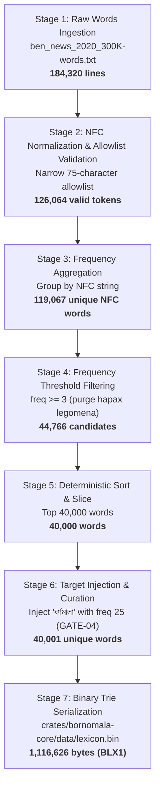

# Resources and Third-Party Licenses

> **Project:** BornoMala (Bangla Input Platform)
> **Component:** Documentation Directory Licensing & Provenance Reference
> **Authoritative Root Notice:** [THIRD-PARTY-NOTICES.md](../THIRD-PARTY-NOTICES.md)
> **Release Target:** `0.1.0-alpha`
> **Last Updated:** 2026-11-09

This document provides developer-facing architectural documentation of external data resources, linguistic asset provenance, transformation pipelines, and third-party software dependencies across the BornoMala project.

For complete, unabridged license texts (CC BY 4.0, MIT, Apache-2.0, ISC, LGPL-2.1, GCC Runtime Library Exception v3.1, BSD, Zlib, MPL-2.0, and Unicode-3.0) and official legal notices required for software distribution, refer directly to the authoritative root notice file:
👉 **[THIRD-PARTY-NOTICES.md](../THIRD-PARTY-NOTICES.md)**

---

## 1. Bengali Vocabulary and Frequency Lexicon Provenance

### 1.1 Source Corpus Archive
- **Dataset:** Leipzig Corpora Collection — Bengali News 2020 (`ben_news_2020_300K.tar.gz`)
- **Originating Institution:** Leipzig Corpora Collection, Universität Leipzig, Institut für Informatik, Abteilung Automatische Sprachverarbeitung (ASV)
- **Dataset Creators:** Dirk Goldhahn, Thomas Eckart, and Uwe Quasthoff
- **Canonical Portal URL:** https://wortschatz.uni-leipzig.de/en/download/Bengali
- **Direct Download URL:** https://downloads.wortschatz-leipzig.de/corpora/ben_news_2020_300K.tar.gz
- **Cached Archive Location:** `scripts/.cache/ben_news_2020_300K.tar.gz`
- **Verified Archive File Size:** 54,196,306 bytes (51.685 MiB)
- **Archive SHA-256 Digest:** `7624300acee975a4344510bdacb000dd63c6709aa76ef3e922805c031bc22b49`
- **Archive Contents:** 9 tar members totaling 163,261,091 uncompressed bytes, including `ben_news_2020_300K-words.txt` (6,261,986 bytes, exactly 184,320 lines). Contains no internal README, NOTICE, or LICENSE file (attribution supplied via the web portal).
- **Academic Citation:**
  D. Goldhahn, T. Eckart & U. Quasthoff: *Building Large Monolingual Dictionaries at the Leipzig Corpora Collection: From 100 to 200 Languages.* In: Proceedings of the 8th International Language Resources and Evaluation Conference (LREC'12), 2012.

### 1.2 License & Redistribution Terms
- **License:** Creative Commons Attribution 4.0 International (CC BY 4.0)
- **License Text & Legal Code:** https://creativecommons.org/licenses/by/4.0/legalcode (unabridged text provided in [THIRD-PARTY-NOTICES.md](../THIRD-PARTY-NOTICES.md))
- **Licensor Warranty Disclaimer:** The CC BY 4.0 Section 5 warranty disclaimer and limitation of liability of the Licensor is reproduced in full in [THIRD-PARTY-NOTICES.md](../THIRD-PARTY-NOTICES.md).
- **Compliance Model:** BornoMala adapts the frequency list into a static binary prefix trie (`crates/bornomala-core/data/lexicon.bin`). In compliance with CC BY 4.0 Section 3(a)(1), attribution to the creators and institution is retained, modifications are explicitly documented below and in `THIRD-PARTY-NOTICES.md`, and license references are provided.

---

## 2. Lexicon Transformation Pipeline (7 Stages & 10 Technical Operations)

The raw Leipzig word corpus is processed deterministically using [scripts/prepare_lexicon.py](../scripts/prepare_lexicon.py) to produce the production binary artifact [crates/bornomala-core/data/lexicon.bin](../crates/bornomala-core/data/lexicon.bin). The pipeline consists of **seven chronological stages** executing **ten distinct technical operations**, as recorded in [docs/lexicon_provenance.json](lexicon_provenance.json):

### 2.1 The Ten Technical Operations

1. **Member Identification:** Locates `ben_news_2020_300K-words.txt` inside the source tar archive by filename suffix.
2. **Line Parsing & Error Handling:** Reads exactly **184,320 lines** formatted as `ID \t raw_word \t freq`. Lines with fewer than 3 columns or invalid integer frequencies are rejected.
3. **Unicode NFC Normalization (UAX #15):** Normalizes every raw word via `unicodedata.normalize('NFC', raw_word)` prior to character validation to ensure canonical combining sequences.
4. **Narrow 75-Character Script Allowlist Validation:** Validates normalized words against an explicit allowlist of exactly 75 characters (67 assigned + 8 unassigned in loop ranges; zero duplicates), rejecting non-Bengali characters, Latin characters, digits, punctuation, and unapproved Vedic/Assamese signs:
   - **Independent Vowels (16):** U+0985..U+098C, U+098F, U+0990, U+0993, U+0994 (12 assigned) + U+098D, U+098E, U+0991, U+0992 (4 unassigned in ranges).
   - **Consonants (36):** 32 basic (U+0995..U+09A8, U+09AA..U+09B0, U+09B2, U+09B6..U+09B9) + 4 additional (U+09DC RRA, U+09DD RHA, U+09DF YYA, U+09CE Khanda Ta).
   - **Vowel Signs & Length Marks (16):** 12 assigned (U+09BE..U+09C4, U+09C7, U+09C8, U+09CB, U+09CC, U+09D7) + 4 unassigned (U+09C5, U+09C6, U+09C9, U+09CA).
   - **Virama / Hasant (1):** U+09CD.
   - **Modifiers (4):** U+0981 (Candrabindu), U+0982 (Anusvara), U+0983 (Visarga), U+09BC (Nukta).
   - **Joiners (2):** U+200C (ZWNJ), U+200D (ZWJ).
   - **Positional Base Rule:** Enforces `has_base == True` (must contain at least one base consonant or independent vowel; words consisting solely of vowel signs, joiners, or modifiers are rejected).
   *Resulting Count:* Exactly **126,064 valid tokens** pass validation.
5. **Frequency Aggregation:** Groups identical NFC strings and sums their observed frequencies (`freq_map[norm_word] += freq`), reducing the dataset to **119,067 unique NFC words**.
6. **Frequency Threshold Filtering (>= 3):** Discards infrequent hapax legomena with observed frequency < 3, yielding exactly **44,766 candidates**.
7. **Deterministic Sorting:** Sorts candidates descending by frequency, with lexicographical tie-breaking: `filtered_items.sort(key=lambda item: (-item[1], item[0]))`.
8. **Top-N Slicing:** Slices the top 40,000 entries: `selected_items = filtered_items[:40000]`.
9. **Target Evaluation & Linguistic Curation for 'বর্ণমালা':** Evaluates benchmark test words. While common words (`বাংলাদেশ`, `বাংলা`, `বিজ্ঞান`, `বৃষ্টি`, `কষ্ট`, `বাঙালি`, `ভাষা`, `ক্ষমা`) easily fell within the top 40,000, `বর্ণমালা` had raw corpus frequency **3**, placing it at 0-indexed position **41,527** (1-indexed rank **41,528**) among the 44,766 candidates >= 3. Because 41,527 >= 40,000, it was excluded by the slice. To satisfy `GATE-04` (Tatsama ণ-ত্ব বিধান phonetic rules in [crates/bornomala-core/tests/phonetic_tests.rs](../crates/bornomala-core/tests/phonetic_tests.rs)), `বর্ণমালা` was force-injected with a clamped frequency of 25. The final sorted vocabulary contains exactly **40,001 unique words**.
10. **Binary Prefix Trie Serialization:** Serializes the 40,001 entries into binary trie format (`BLX1` magic header) at [crates/bornomala-core/data/lexicon.bin](../crates/bornomala-core/data/lexicon.bin) (1,116,626 bytes, SHA-256 `de2ea1e227f92eca810cfe899af3b052ae7366225eedae08494fc2a8c412f9c7`), along with an export to `crates/bornomala-core/data/lexicon.tsv` for inspection.

### 2.2 Numerical Reconciliation Summary

| Pipeline Checkpoint | Entity Measured | Count / Metric | Reconciled Discrepancy Note |
|---|---|---|---|
| Raw Corpus Archive | `ben_news_2020_300K.tar.gz` | **54,196,306 bytes** | Reconciles early informal report citing 27 MB |
| Source Member | `ben_news_2020_300K-words.txt` | **184,320 lines** | Matches raw line count exactly |
| Allowlist Validation | Passed NFC 75-char validation | **126,064 tokens** | Non-Bengali, digits, and orphan marks removed |
| Frequency Aggregation | Unique NFC word strings | **119,067 unique words** | Multi-case and duplicate NFC lines merged |
| Frequency Threshold | Filtered with freq >= 3 | **44,766 candidates** | Purges hapax legomena (freq 1 and 2) |
| Top-N Slicing | Initial frequency slice | **40,000 words** | Slices top frequency candidates |
| Target Curation | Inject 'বর্ণমালা' (clamped freq 25) | **40,001 words** | Satisfies `GATE-04` Tatsama ণ-ত্ব বিধান rules |
| Compiled Binary | `crates/bornomala-core/data/lexicon.bin` | **1,116,626 bytes** | BLX1 format, SHA-256 `de2ea1e2...` |

---

## 3. Offline Orthographic Validation Oracle (Hunspell bn_BD) Isolation Analysis

### 3.1 Role & Data-Flow Boundary
- **Upstream Source:** LibreOffice Bengali Dictionary (`bn_BD.dic`, `bn_BD.aff`)
- **Upstream Repository:** https://github.com/LibreOffice/dictionaries/tree/master/bn_BD
- **Upstream License:** GPL-2.0+ / LGPL-2.1+ / MPL-1.1 tri-license
- **Offline Oracle Utilization:** `scripts/prepare_lexicon.py` optionally loads `bn_BD.dic` into an in-memory set solely to compute an informational orthographic overlap metric: 15,823 of the top 40,001 Leipzig words (39.56%) match canonical Hunspell dictionary roots.
- **Corpus Independence:** The Hunspell dictionary is not used as the source corpus for constructing the production lexicon. Download failure produces an empty oracle set and does not prevent the preprocessing pipeline from completing.

### 3.2 Architectural & Codebase Isolation Evidence
1. **Zero Runtime Linkage:** Recursive codebase search across `crates/bornomala-core/`, `src-tauri/`, `native/`, and `src/` yields zero occurrences of `hunspell` or `bn_BD`. No C++, Rust, or JavaScript binary links to Hunspell.
2. **Zero Serialization:** `lexicon.bin` and `lexicon.tsv` are serialized exclusively from the processed Leipzig candidate list. No Hunspell dictionary entries, stems, affix rules, flags, or annotations are copied or serialized into `lexicon.bin`.
3. **Zero Distribution:** No Hunspell `.dic` or `.aff` files are included in the repository, bundled into distributions, or shipped with installers.
4. **Observed Technical Data-Flow Boundary:** Repository inspection found no Hunspell runtime linkage, no copying of Hunspell dictionary entries into the production lexicon, and no serialization of the Hunspell dictionary into `lexicon.bin`. The Hunspell dictionary therefore remains an isolated validation input in the inspected pipeline. This describes the observed technical data-flow boundary and is not a legal opinion on all possible uses or distributions of Hunspell materials.

---

## 4. Third-Party Software Dependency Inventory

BornoMala classifies third-party software dependencies across explicit architectural categories. For unabridged license texts and legal notices, consult [THIRD-PARTY-NOTICES.md](../THIRD-PARTY-NOTICES.md).

### 4.1 Direct Runtime Rust Dependencies (`bornomala-core`, `bornomala-desktop`)
| Component | Manifest Location | Version (Lock) | Declared License | Linkage / Role |
|---|---|---|---|---|
| `serde` | `bornomala-core`, `src-tauri` | `1.0.229` | MIT OR Apache-2.0 | Statically linked Rust data serialization |
| `serde_json` | `bornomala-core`, `src-tauri` | `1.0.154` | MIT OR Apache-2.0 | Statically linked JSON serialization |
| `unicode-normalization` | `bornomala-core` | `0.1.26` | (MIT OR Apache-2.0) AND Unicode-3.0 | Statically linked Unicode NFC normalization |
| `unicode-segmentation` | `bornomala-core` | `1.13.3` | MIT OR Apache-2.0 | Statically linked grapheme cluster boundary analysis |
| `semver` | `src-tauri` | `1.0.28` | MIT OR Apache-2.0 | Statically linked version parsing in desktop app |
| `tauri` | `src-tauri` | `2.12.4` | MIT OR Apache-2.0 | Desktop application windowing & IPC framework |
| `tauri-plugin-opener` | `src-tauri` | `2.7.2` | MIT OR Apache-2.0 | Desktop URL opener plugin |

### 4.2 Transitive Runtime Dependencies & Weak-Copyleft (`option-ext`)
- **Permissive Transitive Crates:** Transitive dependencies resolved in `Cargo.lock` are governed by permissive licenses (MIT, Apache-2.0, BSD-3-Clause, Unicode-3.0, Zlib, Unlicense). Where package metadata provides alternative license options (disjunctive `OR` or legacy `/`), BornoMala's selected license option is documented in the authoritative root notice. Depending on the package expression, the selected terms may include MIT (e.g. for `MIT OR Apache-2.0`, `Unlicense OR MIT`, `0BSD OR MIT OR Apache-2.0`, and triple-choice `Zlib`), Apache-2.0 (e.g. for `CC0-1.0 OR MIT-0 OR Apache-2.0`), or BSD-3-Clause (e.g. for `BSD-3-Clause/MIT`). Cumulative `AND` expressions remain subject to all applicable terms. Full license texts covering these crates are reproduced in [THIRD-PARTY-NOTICES.md](../THIRD-PARTY-NOTICES.md).
- **Weak-Copyleft Dependency (`option-ext` 0.2.0):** Incorporated transitively via `dirs-sys` under the **Mozilla Public License Version 2.0 (`MPL-2.0`)**.
  - *Status:* Incorporated in unmodified form as an independent component in separate files.
  - *Source Code Availability:* Upstream source references are https://github.com/soc/option-ext and https://crates.io/crates/option-ext/0.2.0.
  - *License Provisions:* Under MPL-2.0 §3.2 (Distribution of Executable Form), distributing executables requires making the corresponding source code available and informing recipients how to obtain it. Under MPL-2.0 §3.3 (Distribution of a Larger Work), BornoMala distributes the combined application under its own terms without relicensing independent BornoMala source files under MPL-2.0, while ensuring MPL-2.0 obligations for `option-ext` are respected.

### 4.3 Production Frontend Webview Bundle Dependencies
Bundle assets audited from `package.json` and resolved in `package-lock.json`:
| Package | Resolved Version | License | Copyright Notice Holder |
|---|---|---|---|
| `react` | `18.3.1` | MIT | Facebook, Inc. and its affiliates |
| `react-dom` | `18.3.1` | MIT | Facebook, Inc. and its affiliates |
| `scheduler` | `0.23.2` | MIT | Facebook, Inc. and its affiliates |
| `@tauri-apps/api` | `2.12.4` | Apache-2.0 OR MIT | Tauri Apps Contributors |
| `@tauri-apps/plugin-opener` | `2.7.2` | MIT OR Apache-2.0 | Tauri Apps Contributors |
| `loose-envify` | `1.4.0` | MIT | Andres Suarez |
| `js-tokens` | `4.0.0` | MIT | Simon Lydell |

### 4.4 Build-Time and Development Dependencies (Not Distributed in Runtime Binaries)
- **Rust Build Scripts:** `tauri-build` (MIT OR Apache-2.0) executes during host compilation.
- **Frontend Development:** `vite`, `@vitejs/plugin-react`, `typescript`, `@types/react`, `@types/react-dom` (MIT / Apache-2.0).
- **Build Generators:** CMake 3.16+ (BSD-3-Clause) for Linux Fcitx 5 module.
- **Compiler Toolchain:** MinGW-w64 GCC (GPLv3+ with Runtime Exception) on Windows.

### 4.5 Host-Provided Platform Libraries (Dynamic Linkage / Not Redistributed)
- **Microsoft Windows System DLLs:** Dynamically links `KERNEL32.dll`, `USER32.dll`, `ADVAPI32.dll`, `GDI32.dll`, `ole32.dll`, `OLEAUT32.dll`, and Universal CRT runtime DLLs (`api-ms-win-crt-*.dll`).
- **Linux Host Shared Libraries:** Dynamically links host system libraries (`libFcitx5Core.so`, `libFcitx5Utils.so`, `libc.so.6`, `libstdc++.so.6`, `libgcc_s.so.1`).
  - *Fcitx 5 Licensing:* Upstream Fcitx 5 is licensed under `LGPL-2.1-or-later`.
  - *Distribution Model:* BornoMala distributes only its own open-source module (`bornomala.so`) without bundling Fcitx 5 shared library binaries, relying on the shared-library mechanism described in LGPL-2.1 §6(b). Notice and license texts are provided in [THIRD-PARTY-NOTICES.md](../THIRD-PARTY-NOTICES.md).

### 4.6 Native Toolchain Components Redistributed in Windows DLL
The Windows TSF COM DLL (`bornomala_tsf.dll`) is compiled with MinGW-w64 GCC (`-static-libgcc -static-libstdc++`):
- **GCC Runtime Library Exception (v3.1):** Governs statically linked `libgcc.a` and `libstdc++.a`. An Eligible Compilation Process allows distribution of the resulting DLL under terms of choice without GPL copyleft attachment.
- **MinGW-w64 CRT:** Statically incorporates `libmingw32.a` and `libmingwex.a` under permissive terms (Public Domain disclaimer, ZPL 2.1, BSD-style).
  *Open Review Item (RV-11):* The specific `libmingwex.a` archive has not undergone exhaustive object-by-object attribution verification; tracking continues under review item `RV-11`.

---

## 5. Evidence Boundaries, Distribution Scope & Packaging Rules

1. **Audited Platform Scope:** Dependency and artifact audits establish the Windows x64 MSVC desktop production graph (`x86_64-pc-windows-msvc`) and the unbundled Linux Fcitx 5 plugin dynamic linking model. Coverage does not claim universal cross-platform verification across unverified Linux desktop distribution packages or macOS environments.
2. **Authoritative Notice Navigation:** Documentation in `docs/` serves as an architectural guide and provenance record; the authoritative, unabridged notice file required for software distribution is [THIRD-PARTY-NOTICES.md](../THIRD-PARTY-NOTICES.md).
3. **Documented Standalone Windows TSF Distribution Requirement:** Standalone Windows TSF deployment packages (when assembled) must bundle `THIRD-PARTY-NOTICES.md` alongside `bornomala_tsf.dll` and registration scripts (`register.bat`, `unregister.bat`).
4. **Documented Linux Packaging Guidance & Installation Requirements:** For Linux environments, the project relies on dynamic linking against host-provided Fcitx 5 shared libraries under LGPL-2.1 §6(b). Future packaging and build configurations (`native/bornomala-fcitx5/CMakeLists.txt`, `scripts/install.sh`) are specified to install `THIRD-PARTY-NOTICES.md` into the standard documentation path (`${CMAKE_INSTALL_DATADIR}/doc/bornomala/`). These are documented distribution requirements and guidance; actual Linux package generation (e.g. deb, rpm, AppImage, Flatpak) and runtime installation have not been executed or tested on target Linux hosts and remain unverified.
5. **Future Packaging Obligations:** When release packaging (installers, portable zips) is established, recipient-facing notices informing users of source code availability for weak-copyleft components (`option-ext` under MPL-2.0 §3.2) must accompany the distributed executables. Offline distribution packages must verify that source code remains obtainable through the disclosed means.
6. **Open Object-Level Verification Limitation (RV-11):** The specific `libmingwex.a` CRT archive statically incorporated in `bornomala_tsf.dll` has not undergone exhaustive object-by-object attribution verification; tracking continues under project review item `RV-11`.
