# BornoMala — Visual Feature Guide

This guide highlights the **BornoMala Desktop Sandbox (`bornomala-desktop`)** user interface, diagnostics, themes, and configuration architecture. All screenshots below are captured directly from the running Tauri v2 + React application backed by `bornomala-core`.

> **Scope Note:** These captures demonstrate the standalone Desktop Sandbox and settings UI. System-wide OS input integration (Windows TSF COM and Linux Fcitx 5) is documented separately in [Platform Support](platform-support.md).

---

## 1. Phonetic Sandbox & Keystroke Reference

| Phonetic Composition & Candidates | Avro Phonetic Keystroke Reference |
| :---: | :---: |
| 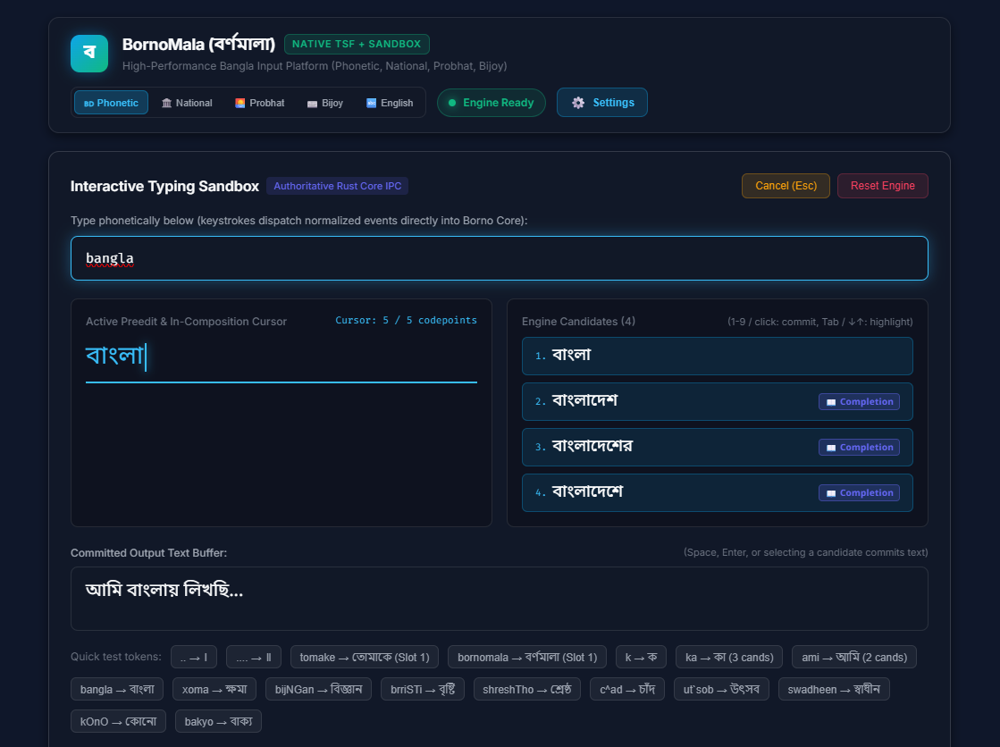 | 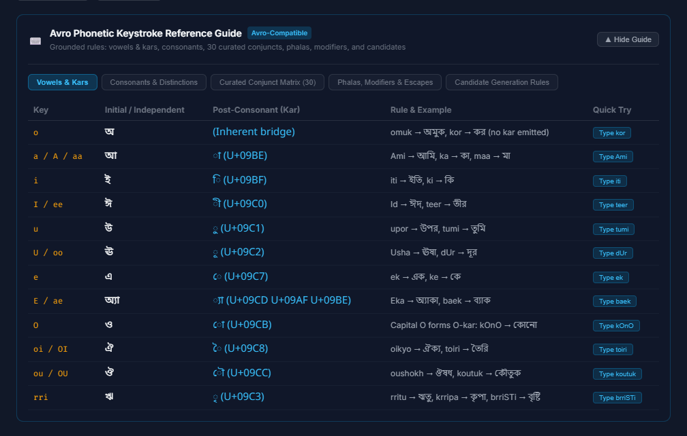 |
| *Live preedit (`বাংলা`), completion candidates, and committed output buffer.* | *Built-in phonetic keystroke reference for vowels, consonants, conjuncts, and phalas.* |

---

## 2. Unicode & Conjunct Shaping Verification

  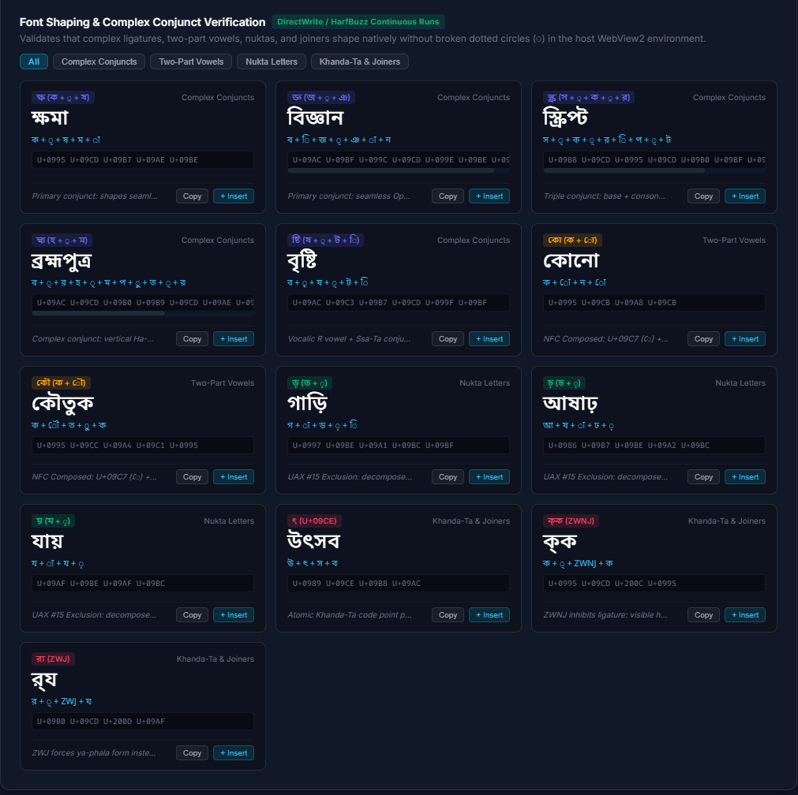

*Interactive verification of complex Bangla conjuncts, two-part vowel NFC composition, nukta letters, Khanda-Ta, and `ZWJ`/`ZWNJ` joiner behavior.*

---

## 3. Interactive Virtual Keyboard & Event Inspector

### Interactive Virtual Keyboard

  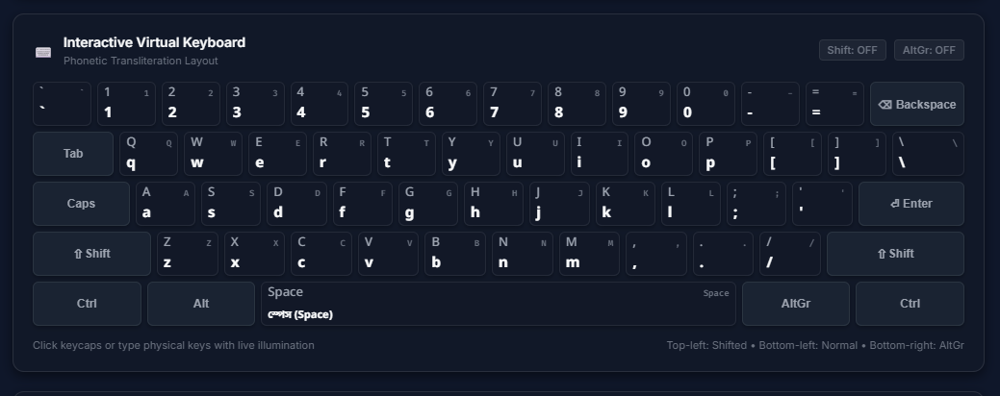

*Physical key-mapping preview with live illumination and `Shift`/`AltGr` toggles.*

### Normalized Event & State Inspector

  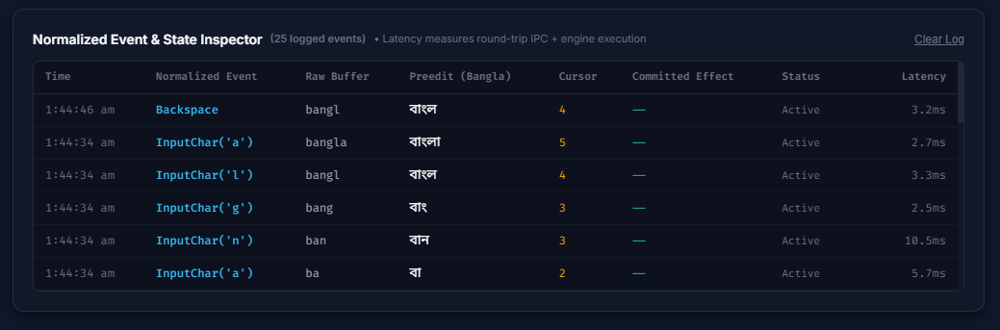

*Deterministic event log showing raw buffer, Bangla preedit, cursor position, and round-trip IPC latency.*

View combined Virtual Keyboard, M0 Verification Gate, and Event Inspector capture

  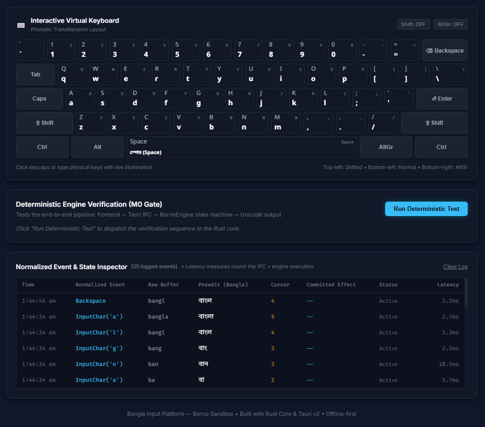

---

## 4. High-Contrast Theme

  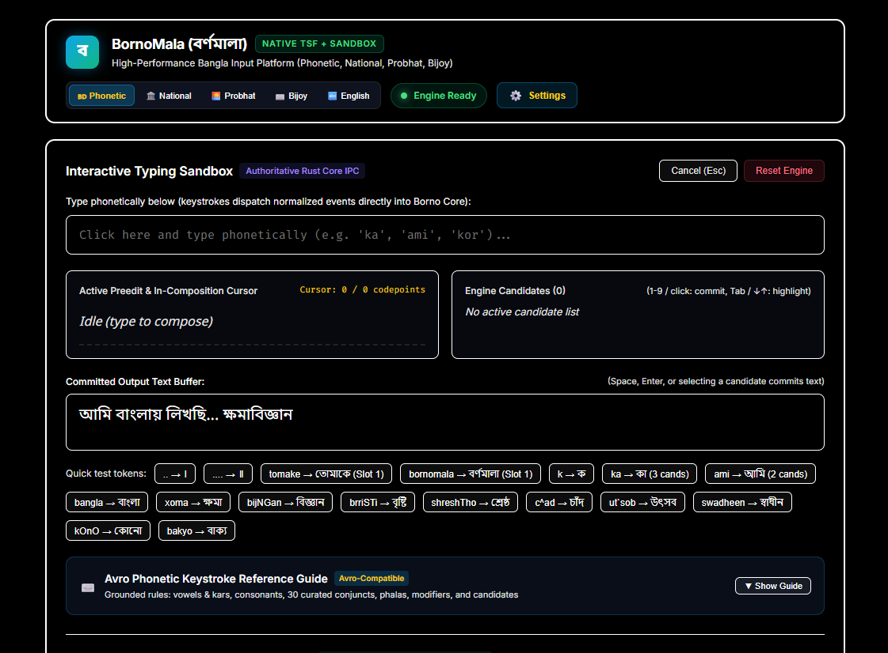

*High-contrast theme (`high-contrast` in `BornoConfig`) removing translucent blur and increasing foreground and border contrast.*

---

## 5. Configuration & Persistence Architecture

  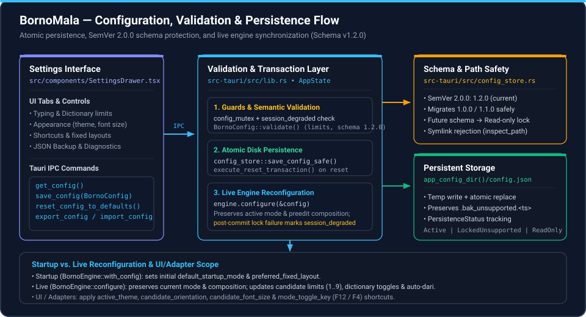

The Settings Drawer (`src/components/SettingsDrawer.tsx`) manages schema-versioned (`v1.2.0`) configuration across five tabs; four operational tabs are illustrated below (the fifth tab covers About and Third-Party Notices):

| Typing & Punctuation | Appearance & Themes |
| :---: | :---: |
| 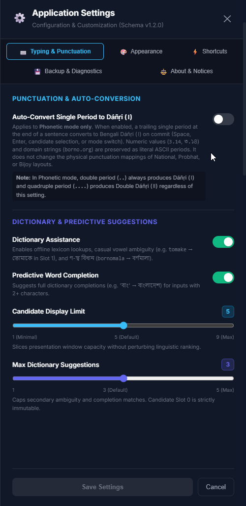 | 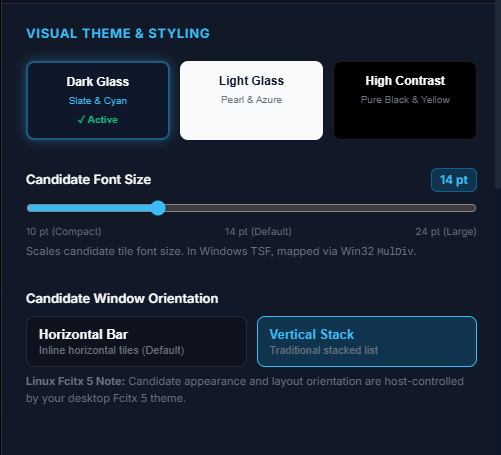 |
| *Candidate display limit (`1–9`), dictionary assistance, word completion, and Dari (`. → ।`) toggle.* | *Theme selector (`dark-glass`, `light-glass`, `high-contrast`), candidate orientation, and font size.* |

| Shortcuts & Fixed Layouts | Persistence & Diagnostics |
| :---: | :---: |
| 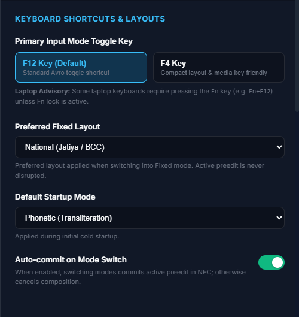 | 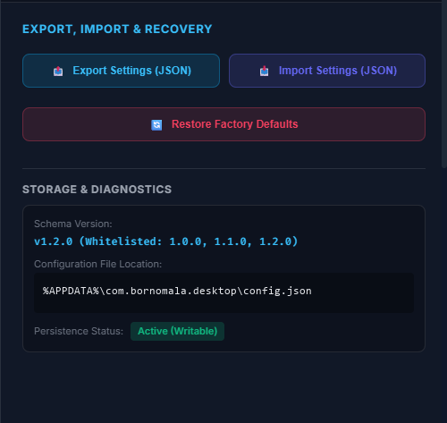 |
| *Default startup mode, preferred fixed layout (`National`, `Probhat`, `Bijoy`), and mode toggle hotkey (`F12` / `F4`).* | *JSON export/import, factory reset, schema version status, and persistence diagnostics.* |

---

Back to [README](../README.md).
