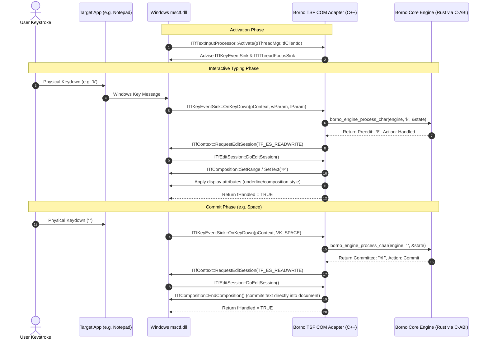

# Windows Text Services Framework (TSF) Architecture & Integration Strategy

> **Project:** Bangla Input Platform  
> **Document Role:** Technical specification of Windows TSF integration path, COM interfaces, registration permissions, architecture boundaries, and success levels.  
> **Milestone:** M0.1 — Native Integration Feasibility  
> **Author/Status:** Antigravity / Implementation Baseline (2026-10-17)

---

## 1. Executive Summary & Objective

The primary objective of the Windows native input adapter is to allow users to type Bangla across all native Windows applications (Win32, UWP, WPF, Chromium/Electron, and terminal hosts) via a modern, system-level input method.

On Windows, the standard architecture for modern input methods is the **Text Services Framework (TSF)**, which replaced the legacy Input Method Manager (IMM32). TSF operates as an in-process Component Object Model (COM) server loaded directly into the target application's process space by the Windows TSF runtime (`msctf.dll`).

To minimize technical risk and protect engine portability, this document defines:
1. The explicit TSF success levels (from compilation to real typing).
2. The core COM interfaces and composition lifecycle.
3. The registration mechanisms and actual permission requirements.
4. The boundary contract between the C++/COM adapter and the shared Rust core (`borno-core`).

---

## 2. Explicit TSF Verification Levels

To avoid false claims of "working input method" based solely on successful code compilation, native integration progress must be evaluated across six distinct, verifiable levels:

| Level | Designation | Required Verifiable Evidence | Status in M0.1 |
|---|---|---|---|
| **Level 1** | **Compilation & Linking** | In-process COM DLL (`.dll`) compiles and links cleanly against available Win32/TSF headers with zero unresolved symbols. | Target of M0.1 |
| **Level 2** | **Export Validation** | Required COM DLL entry points (`DllGetClassObject`, `DllCanUnloadNow`, `DllRegisterServer`, `DllUnregisterServer`) are verified present via `dumpbin` or `objdump`. | Target of M0.1 |
| **Level 3** | **Class Factory Validation** | An external test harness loads the DLL via `LoadLibrary`, calls `DllGetClassObject`, and successfully instantiates `IClassFactory` and `ITfTextInputProcessor`. | Target of M0.1 |
| **Level 4** | **TSF Profile Registration** | The text service GUID, language profile (Bangla `0x0445`), and categories are registered in Windows TSF registries or via `ITfInputProcessorProfiles`. | Evaluated in M0.1 (permission test) |
| **Level 5** | **Profile Activation** | Windows Language Bar / Input Switcher (`Win + Space`) lists the input method; switching to it causes `msctf.dll` to call `ITfTextInputProcessor::Activate`. | Out of scope for M0.1 (Requires M7) |
| **Level 6** | **End-to-End System Typing** | Keystrokes in a separate target process (e.g. Notepad, Word) invoke `ITfKeyEventSink::OnKeyDown`, initiate `ITfComposition`, and commit verified Bangla Unicode text. | Out of scope for M0.1 (Target of M7) |

---

## 3. Core TSF COM Interfaces & Input Lifecycle



### Essential COM Interfaces

1. **`ITfTextInputProcessor` / `ITfTextInputProcessorEx`:**
   - Entry point called by `msctf.dll`.
   - `Activate(ITfThreadMgr *ptim, TfClientId tid)`: Initializes the text service for a thread, saves client ID, and hooks event sinks.
   - `Deactivate()`: Cleans up sinks and releases references when switching away or when thread ends.

2. **`ITfThreadMgr`:**
   - Central manager object provided by TSF to the text service.
   - Used to install event sinks via `ITfSource::AdviseSink`.

3. **`ITfKeyEventSink`:**
   - Receives keystrokes before the target application processes them:
     - `OnSetFocus`: Notified when an edit context receives keyboard focus.
     - `OnTestKeyDown` / `OnKeyDown`: Evaluates whether the key belongs to composition; if handled (`*pfEaten = TRUE`), the host application ignores it.
     - `OnTestKeyUp` / `OnKeyUp`: Handles key releases.

4. **`ITfContext` & `ITfEditSession`:**
   - TSF strictly enforces document lock safety. All reads and modifications of preedit text and document ranges must occur within an `ITfEditSession::DoEditSession` callback requested asynchronously or synchronously via `ITfContext::RequestEditSession`.

5. **`ITfComposition` & `ITfCompositionSink`:**
   - Represents an active composition (preedit string) in the document.
   - Manages composition boundaries, replacement of composing text, terminating/committing compositions, and receiving notification if the user clicks away (`OnCompositionTerminated`).

---

## 4. Registration Requirements & Permission Architecture

A TSF text service must be registered in two distinct subsystems:

### 4.1 COM In-Process Server Registration
The DLL must register its Class ID (`CLSID`):
- **Traditional System Registration:**  
  `HKEY_LOCAL_MACHINE\Software\Classes\CLSID\{CLSID_BORNO_TEXT_SERVICE}\InprocServer32`  
  *Permissions required:* Local Administrator elevation.
- **Per-User COM Registration:**  
  `HKEY_CURRENT_USER\Software\Classes\CLSID\{CLSID_BORNO_TEXT_SERVICE}\InprocServer32`  
  *Permissions required:* Standard user account (no elevation required).

### 4.2 TSF Profile & Category Registration
The Windows TSF runtime needs to know that this COM object is a Text Service and which language profile it handles:
- **Interfaces Used:**
  - `ITfInputProcessorProfiles::Register(CLSID_BORNO_TEXT_SERVICE)`
  - `ITfInputProcessorProfiles::AddLanguageProfile(CLSID_BORNO_TEXT_SERVICE, langid, ...)`
  - `ITfCategoryMgr::RegisterCategory(CLSID_BORNO_TEXT_SERVICE, GUID_TFCAT_TIP_KEYBOARD, ...)`
- **Permissions Reality on Windows 10/11:**
  - In legacy Windows versions (XP/7), TSF profile registration strictly wrote to `HKLM\SOFTWARE\Microsoft\CTF\TIP`, requiring administrator elevation.
  - On modern Windows 10 and 11, per-user input profile APIs (`Install-Language`, `ITfInputProcessorProfilesEx`, and user-scoped registry hives) exist, but the standard `ITfInputProcessorProfiles::Register` API often still attempts writes to machine-wide registry locations.
  - **M0.1 Investigation Rule:** We must empirically test whether `ITfInputProcessorProfiles::Register` succeeds under a standard user account or returns `E_ACCESSDENIED` (`0x80070005`), and document the exact result.

---

## 5. Architectural Boundaries: Native C++ Adapter vs Shared Rust Core

```
┌────────────────────────────────────────────────────────┐
│ Target Application Process (e.g., Notepad, Chrome)     │
│                                                        │
│  ┌──────────────────────────────────────────────────┐  │
│  │ Windows TSF Runtime (msctf.dll)                  │  │
│  └────────────────────────┬─────────────────────────┘  │
│                           │ COM Vtable Calls           │
│  ┌────────────────────────▼─────────────────────────┐  │
│  │ borno-tsf.dll (C++ In-Process Adapter)           │  │
│  │                                                  │  │
│  │ - Implements ITfTextInputProcessorEx            │  │
│  │ - Implements ITfKeyEventSink                     │  │
│  │ - Manages ITfEditSession & ITfComposition        │  │
│  │ - Translates Win32 Virtual Keys to Unicode/Events│  │
│  └────────────────────────┬─────────────────────────┘  │
│                           │ C-ABI (extern "C")         │
│  ┌────────────────────────▼─────────────────────────┐  │
│  │ borno-core (Shared Rust Core)                    │  │
│  │                                                  │  │
│  │ - Stateless or Stateful BornoEngine              │  │
│  │ - Preedit composition calculation                │  │
│  │ - Candidate generation                           │  │
│  │ - Deterministic Unicode text conversion          │  │
│  │ - UTF-8 string allocation and explicit free      │  │
│  └──────────────────────────────────────────────────┘  │
└────────────────────────────────────────────────────────┘
```

### Boundary Design Principles

1. **Keep the Native Adapter Thin:**
   The C++ adapter does NOT know phonetic transliteration rules, layout mappings, or Bangla Unicode conjunct rules. It only manages Win32/COM lifecycle and translates events.
2. **Deterministic C-ABI:**
   All interactions cross the boundary using basic primitive types (`u32`, `i32`, pointers) and UTF-8 null-terminated strings (`*const c_char`, `*mut c_char`).
3. **Strict Memory Ownership:**
   - Any string passed from C++ to Rust is borrowed (`*const c_char`) and read without taking ownership.
   - Any string returned from Rust to C++ is allocated by the Rust allocator and MUST be released by calling `borno_string_free(*mut c_char)`. C++ must never call `free()` or `delete` on a Rust-allocated pointer.
4. **Structured Error Codes:**
   Functions return integer status codes: `0 = BORNO_OK`, negative numbers for error conditions (e.g. `BORNO_ERR_NULL_PTR`, `BORNO_ERR_INVALID_UTF8`).

---

## 6. Identified Risks and Mitigations

| Risk | Impact | Mitigation Strategy |
|---|---|---|
| **Bitness Mismatch:** 64-bit target apps cannot load a 32-bit TSF DLL (and vice versa). | Text service will not appear or activate in apps of differing bitness. | Build 64-bit (`x86_64`) primary DLL for Windows x64 development; document 32-bit multi-arch requirement for packaging in M12. |
| **AppContainer / UWP Sandbox:** Windows UWP apps (Settings, modern Notepad) enforce sandbox restrictions. | TSF DLL fails to load in UWP apps if dependent DLLs cannot be found or IPC fails. | Ensure the core engine is compiled statically into the TSF DLL (`borno-core` staticlib or direct link) so no external DLL dependencies or network calls are needed. |
| **Registration Permissions:** Standard user shell cannot write to `HKLM`. | Local automated testing cannot register system-wide without elevation. | Test per-user registration APIs; if blocked by elevation, clearly document the permission barrier and provide an automated COM class-factory unit harness that validates Level 1–3 without requiring system registration. |
