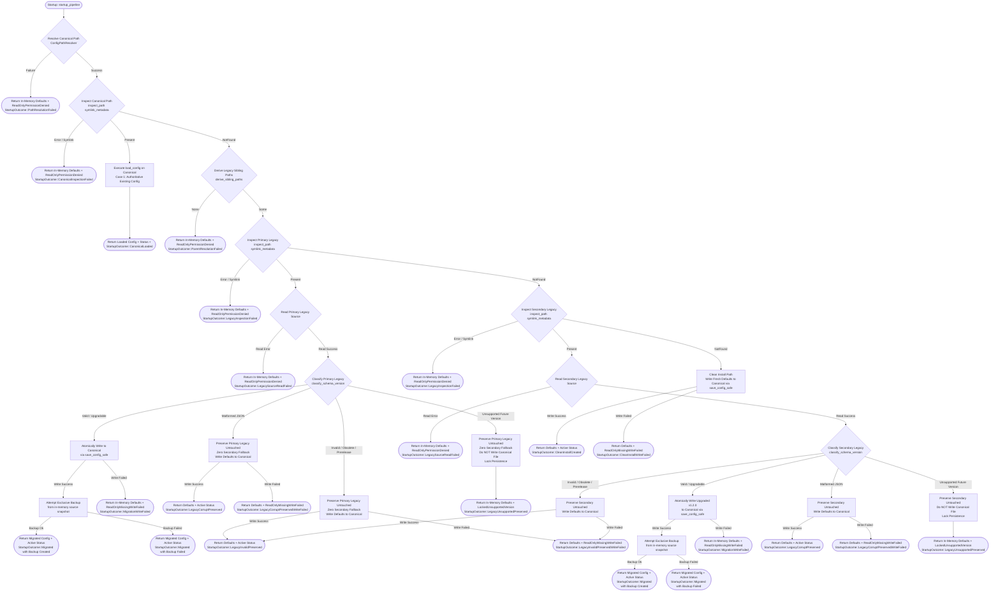

# WP-05 Specification — Desktop Application Identifier Migration & Configuration Unification

> **Work Package:** WP-05 (Remediation)\
> **Target Subsystem:** Desktop Application Configuration & Persistence (`src-tauri/`)\
> **Status:** Draft — Implementation-Ready Specification (Technical Closure Reconciliation)\
> **Target Canonical Namespace:** `com.bornomala.desktop`\
> **Legacy Namespaces:** `com.bornomala.sandbox` (primary), `com.borno.sandbox` (secondary)\
> **Operating Environments:** Windows 11 (x64 primary), Linux (Fcitx 5 default), macOS (future)\
> **Author:** Antigravity Coding Agent\
> **Date:** 2026-11-04

---

## 1. Executive Summary & Objective

The objective of **WP-05: Desktop Application Identifier Migration & Configuration Unification** is to unify the desktop application's configuration storage namespace with the native operating-system input method adapters (Windows TSF and Linux Fcitx 5), eliminating a critical runtime disconnect where settings saved in the desktop settings interface never reach native typing sessions.

This work package:
1. Replaces the legacy Tauri bundle identifier `"com.bornomala.sandbox"` in `src-tauri/tauri.conf.json` with the canonical identifier `"com.bornomala.desktop"`.
2. Implements a unified, failure-safe, and idempotent startup orchestration function `startup_pipeline` (with deterministic test seam `startup_pipeline_with_seams`) in `src-tauri/src/config_store.rs` that detects existing user settings from legacy sibling directories (`com.bornomala.sandbox` and `com.borno.sandbox`), validates and semantically upgrades them to schema `1.2.0`, and safely replaces the canonical destination while preserving legacy source files intact.
3. Establishes a single authoritative path resolution architecture: `ConfigPathResolver` resolves only the canonical path, while legacy paths are derived via a pure sibling derivation helper `derive_sibling_paths` that validates canonical directory naming (`com.bornomala.desktop`) and uses single-source legacy namespace constants.
4. Uses `std::fs::symlink_metadata()` to inspect both configuration files and parent application container directories, explicitly rejecting symbolic links and non-regular entries to prevent redirection attacks, while permitting standard external ancestor folder redirection.
5. Distinguishes genuine file absence (`ErrorKind::NotFound`) from permission, metadata, or filesystem errors during canonical and legacy path inspection, preventing unsafe migration or clean-install default writes when path status cannot be verified.
6. Completely removes the unsafe fallback to the current working directory (`PathBuf::from(".")`) when Tauri cannot resolve the application configuration directory, entering a safe read-only in-memory mode instead.
7. Enforces strict persistence-lock checks across all configuration-writing IPC commands (`save_config`, `reset_config`, `import_config`) respecting all non-active persistence statuses (`LockedUnsupportedVersion`, `ReadOnlyPermissionDenied`, `ReadOnlyMissingWriteFailed`).
8. Implements exclusive, collision-safe backup creation with partial-file cleanup: uses OS-level exclusive creation (`create_new(true)`), guarantees existing backups are never overwritten or removed, and attempts immediate cleanup of partial files if streaming or syncing fails.
9. Decouples canonical configuration writing from backup creation so that a backup failure on an unwritable legacy volume does not roll back, truncate, or delete a successful canonical migration.
10. Enforces a complete SemVer schema classification policy: checks prereleases before range comparisons, normalizes build metadata, and distinguishes malformed strings from future schemas.
11. Protects malformed canonical configuration during recovery: guarantees that if creating a `.corrupt` or `.invalid` backup fails, the original malformed canonical file is NEVER overwritten with defaults; and introduces distinct, truthful outcome variants (`CorruptRecoveryWriteFailed`, `InvalidRecoveryWriteFailed`) when backup succeeds but default writing fails.
12. Mandates an exclusive pre-rewrite backup (`.bak_normalize_<version>.<timestamp>` or `.bak_upgrade_<old>.<timestamp>`) prior to any canonical normalization or schema upgrade operation to guarantee historical preservation of unrecognized properties.
13. Establishes `reset_config` as an explicit user recovery transaction: revalidates disk state before reset, introduces dedicated `ResetFaultInjection` for all failure points, and defines a safe degraded-session policy if disk replacement succeeds but runtime engine or state synchronization fails.
14. Adds automated migration and persistence safety tests in `src-tauri/src/bin/persistence_suite.rs` with deterministic failure injection seams, executed strictly within isolated temporary directories without touching real `%APPDATA%` or the Windows registry.
15. Updates living design and backlog documentation (`docs/design-system-and-usability.md` and `docs/usability-and-linguistic-backlog.md`).

---

## 2. Problem Statement & Confirmed Evidence

### 2.1 The Configuration Disconnect
The BornoMala platform architecture specifies that the desktop application is the single user-facing configuration writer, while the native platform adapters are read-only consumers. In Milestone M9, the configuration schema was upgraded to `v1.2.0` to support candidate orientation, themes, typography, and punctuation options.

However, an audit of the codebase revealed that the desktop writer and native readers resolve completely different physical filesystem paths:

```
┌────────────────────────────────────────────────────────┐
│   Desktop Application (src-tauri/tauri.conf.json)      │
│   Identifier: "com.bornomala.sandbox"                  │
└───────────────────────────┬────────────────────────────┘
                            │ Writes settings to
                            ▼
      %APPDATA%\com.bornomala.sandbox\config.json
                    ≠ [DISCONNECTED]
      %APPDATA%\com.bornomala.desktop\config.json
                            ▲
                            │ Reads settings from
┌───────────────────────────┴────────────────────────────┐
│   Windows TSF IME (native/borno-tsf/borno_tsf.cpp:86)  │
│   Linux Fcitx 5   (native/bornomala-fcitx5/bornomala.cpp)│
└────────────────────────────────────────────────────────┘
```

### 2.2 Host Inspection Findings (Verified 2026-11-04)
A read-only filesystem inspection of the developer's Windows development environment (`%APPDATA%`, `C:\Users\AsmKhalid-HP15\AppData\Roaming`) confirmed:
1. **Primary Legacy Configuration Present:** `%APPDATA%\com.bornomala.sandbox\config.json` exists (460 bytes), conforming to schema `1.2.0` and containing active user customizations (`"active_theme": "high-contrast"`, `"mode_toggle_key": "F4"`).
2. **Canonical Target Directory Absent:** `%APPDATA%\com.bornomala.desktop` does **not exist**.
3. **Secondary Legacy Configuration Present:** `%APPDATA%\com.borno.sandbox\config.json` exists (288 bytes), conforming to schema `1.1.0` from Milestone M5.

**Consequence:** Because `%APPDATA%\com.bornomala.desktop` does not exist, the native Windows TSF IME (`borno_tsf.cpp:101`) fails `GetFileAttributesExW` on every keystroke check and falls back permanently to hardcoded engine defaults. Settings adjusted in the desktop GUI have zero effect on native typing.

### 2.3 Scope Boundaries & Non-Goals
To protect stability and adhere to `AGENTS.md` §1.1 (One Milestone at a Time), WP-05 is strictly confined to configuration namespace alignment, startup persistence orchestration, and failure-safe migration.

**Strictly Outside Scope:**
- **No Rust Core Engine Changes:** `crates/bornomala-core` is pure and path-agnostic; it receives configurations as in-memory structs or JSON strings and contains zero filesystem calls. It must not be modified.
- **No C-ABI Modifications:** All C-ABI symbols (`borno_*`) and headers (`bornomala.h`, `borno.h`) remain frozen and untouched.
- **No Native Adapter Code Changes:** `native/borno-tsf/borno_tsf.cpp:86` and `native/bornomala-fcitx5/bornomala.cpp:15` already target `com.bornomala.desktop`. They must not be modified in WP-05.
- **No Native TSF Keystroke / COM Refactoring:** Moving the TSF configuration check off the keystroke path or replacing its C++ JSON parser is an adapter hardening task (governed by `RV-03` §4.3 and `RV-04`), not an identifier migration task.
- **No Frontend UI Redesign:** `src/` React/TypeScript components invoke Tauri IPC commands (`get_config`, `save_config`, `get_config_path`) and do not manage physical filesystem paths.
- **No Standalone Binary Renaming:** `Borno-Sandbox.exe` and root launcher batch files remain untouched.
- **No Installer Packaging:** Native `.msi`, `.nsis`, or `.deb` bundle generation belongs to release engineering (`RV-11`).

---

## 3. Identifier Inventory & Platform Compatibility Analysis

### 3.1 Namespace Alignment
The single runtime configuration namespace change in WP-05 is:

| Configuration Setting | File | Current Value | Target Value | Impact |
|---|---|---|---|---|
| Tauri Application Identifier | `src-tauri/tauri.conf.json:5` | `"com.bornomala.sandbox"` | `"com.bornomala.desktop"` | Changes `app.path().app_config_dir()` resolution across Windows, Linux, and macOS to the canonical directory. |

### 3.2 Unchanged Identifiers & Distinction of Roles
WP-05 explicitly distinguishes between the configuration namespace and unrelated project identifiers:

1. **Cargo Package Name (`bornomala-desktop`):** Defined in `src-tauri/Cargo.toml:2`. Matches the intended product identity and remains untouched.
2. **Library Crate Name (`bornomala_desktop_lib`):** Defined in `src-tauri/Cargo.toml:9`. Entry point for `main.rs`; remains untouched.
3. **Frontend Package Name (`bornomala-sandbox`):** Defined in `package.json:2`. Internal npm build metadata with zero runtime path influence; remains untouched to avoid lockfile churn.
4. **C-ABI Function and Type Prefixes (`borno_*`):** Public C-ABI exports (`borno_engine_new`, `BornoStatusC`, etc.) are protected under `AGENTS.md` and WP-04. They must never be renamed.
5. **Standalone Binary Name (`Borno-Sandbox.exe`):** Pre-compiled standalone portable Windows executable in repository root. Remains untouched.
6. **Historical Documentation References:** Retained in audit documents and revision proposals (`AUDIT-2026-10-23.md`, `RV-03.md`, etc.) as historical context.

### 3.3 No-Leak Criterion Definition
The "no-leak" criterion applies strictly to **active runtime configuration destinations**:
- Once WP-05 is implemented, no active code in `src-tauri/` or `native/` may use `com.bornomala.sandbox` as the target for saving, creating, or actively updating configuration.
- References to `com.bornomala.sandbox` are permitted only in:
  1. Automated migration discovery code in `config_store.rs` (inspecting legacy source locations).
  2. Automated tests in `persistence_suite.rs` (validating migration from legacy fixtures).
  3. Historical documentation and completion reports.

### 3.4 Platform Path Resolution & Linux Adapter Root Compatibility Analysis
A rigorous review of native adapter source code and Tauri's path resolution mechanics establishes the exact cross-platform path behavior:

1. **Windows Static Agreement:**
   - **Tauri Runtime (`src-tauri`):** Resolves `app.path().app_config_dir()` via standard Windows Known Folders (`FOLDERID_RoamingAppData`), yielding `%APPDATA%\com.bornomala.desktop`.
   - **Native Windows TSF (`native/borno-tsf/borno_tsf.cpp:82-90`):**
     ```cpp
     if (GetEnvironmentVariableW(L"APPDATA", appData, MAX_PATH) > 0) {
         path = appData;
         path += L"\\com.bornomala.desktop\\config.json";
     }
     ```
   - **Status:** Static source alignment verified; runtime execution verified during Tier 6 live-host gated protocol.

2. **Linux Default Environment Parity:**
   - **Tauri Runtime (`src-tauri`):** Adheres to XDG Base Directory specification via `dirs::config_dir()`. When `$XDG_CONFIG_HOME` is unset or empty, defaults to `$HOME/.config/com.bornomala.desktop`.
   - **Native Linux Fcitx 5 (`native/bornomala-fcitx5/bornomala.cpp:12-18`):**
     ```cpp
     static std::string GetLinuxConfigPath() {
         const char* home = std::getenv("HOME");
         if (home) {
             return std::string(home) + "/.config/com.bornomala.desktop/config.json";
         }
         return "";
     }
     ```
   - **Status:** Static source alignment verified for default environments (`$HOME/.config`).

3. **Linux Custom `XDG_CONFIG_HOME` Divergence (Cataloged Adapter Limitation):**
   - If an end user explicitly sets `$XDG_CONFIG_HOME` to a custom path (e.g. `/custom/xdg`), Tauri resolves `/custom/xdg/com.bornomala.desktop/config.json`, whereas `bornomala.cpp` only inspects `$HOME` and resolves `$HOME/.config/com.bornomala.desktop/config.json`.
   - **WP-05 Scoped Decision:** `native/bornomala-fcitx5` remains unmodified in WP-05. This divergence is formally cataloged as a known native adapter limitation and deferred to a dedicated Linux adapter remediation task.

---

## 4. Deterministic Migration Architecture & Precedence Matrix

### 4.1 Authoritative Path Resolution Architecture
To eliminate competing sources of truth, configuration path resolution is strictly separated into:
1. **Canonical Path Resolution:** Governed by `ConfigPathResolver`. Resolves ONLY the canonical configuration file path.
2. **Deterministic Legacy Sibling Derivation:** Derived strictly via `derive_sibling_paths` from the shared parent of the canonical path using single-source namespace constants.

```rust
pub const CANONICAL_APP_DIR_NAME: &str = "com.bornomala.desktop";
pub const PRIMARY_LEGACY_DIR_NAME: &str = "com.bornomala.sandbox";
pub const SECONDARY_LEGACY_DIR_NAME: &str = "com.borno.sandbox";
pub const CONFIG_FILE_NAME: &str = "config.json";

/// Abstraction for resolving the canonical configuration file path.
pub trait ConfigPathResolver {
    fn resolve_canonical_path(&self) -> Result<PathBuf, String>;
}

#[derive(Debug, Clone, PartialEq, Eq)]
pub struct DerivedLegacyPaths {
    pub primary_legacy_path: PathBuf,
    pub secondary_legacy_path: PathBuf,
}

/// Pure helper deriving legacy sibling paths from canonical path's shared parent.
/// Validates that canonical directory name matches CANONICAL_APP_DIR_NAME and file name matches CONFIG_FILE_NAME.
pub fn derive_sibling_paths(canonical_path: &Path) -> Option<DerivedLegacyPaths> {
    if canonical_path.file_name()? != CONFIG_FILE_NAME {
        return None;
    }
    let canonical_dir = canonical_path.parent()?;
    if canonical_dir.file_name()? != CANONICAL_APP_DIR_NAME {
        return None;
    }
    let shared_parent = canonical_dir.parent()?;
    let primary_legacy_path = shared_parent.join(PRIMARY_LEGACY_DIR_NAME).join(CONFIG_FILE_NAME);
    let secondary_legacy_path = shared_parent.join(SECONDARY_LEGACY_DIR_NAME).join(CONFIG_FILE_NAME);
    Some(DerivedLegacyPaths {
        primary_legacy_path,
        secondary_legacy_path,
    })
}
```

If `canonical_path` lacks the expected directory structure (e.g. root, top-level relative path, or directory not matching `com.bornomala.desktop`), `derive_sibling_paths` returns `None`. The startup pipeline aborts migration and clean install, entering safe read-only in-memory mode with `StartupOutcome::ParentResolutionFailed`.

### 4.2 Filesystem Inspection, Symlink Rejection & Status Mapping
Relying on `std::fs::metadata()` is unsafe because it follows symbolic links, potentially opening redirection attacks in shared directories.

To ensure strict security and correctness, `inspect_path()` uses `std::fs::symlink_metadata()` to validate both the target file and its parent container directory, explicitly rejecting symbolic links and non-regular entries:

```rust
#[derive(Debug)]
pub enum PathStatus {
    Present,
    NotFound,
    Error(std::io::Error),
}

pub fn inspect_path(path: &Path) -> PathStatus {
    // 1. Inspect parent application directory if present
    if let Some(parent) = path.parent() {
        if !parent.as_os_str().is_empty() {
            match std::fs::symlink_metadata(parent) {
                Ok(meta) => {
                    let ft = meta.file_type();
                    if ft.is_symlink() {
                        return PathStatus::Error(std::io::Error::new(
                            std::io::ErrorKind::InvalidInput,
                            format!("Application directory {} is a symbolic link; symbolic links are rejected for configuration containers", parent.display()),
                        ));
                    }
                    if !ft.is_dir() {
                        return PathStatus::Error(std::io::Error::new(
                            std::io::ErrorKind::InvalidInput,
                            format!("Application container {} exists but is not a directory", parent.display()),
                        ));
                    }
                }
                Err(e) if e.kind() == std::io::ErrorKind::NotFound => {
                    // Parent does not exist yet (clean install scenario); safe to proceed to target check
                }
                Err(e) => return PathStatus::Error(e),
            }
        }
    }

    // 2. Inspect target configuration file
    match std::fs::symlink_metadata(path) {
        Ok(meta) => {
            let file_type = meta.file_type();
            if file_type.is_symlink() {
                PathStatus::Error(std::io::Error::new(
                    std::io::ErrorKind::InvalidInput,
                    format!("Path {} is a symbolic link; symbolic links are rejected for configuration files", path.display()),
                ))
            } else if file_type.is_file() {
                PathStatus::Present
            } else {
                PathStatus::Error(std::io::Error::new(
                    std::io::ErrorKind::InvalidInput,
                    format!("Path {} exists but is not a regular file", path.display()),
                ))
            }
        }
        Err(e) if e.kind() == std::io::ErrorKind::NotFound => PathStatus::NotFound,
        Err(e) => PathStatus::Error(e),
    }
}
```

#### Filesystem Boundary & Threat-Model Limitations:
1. **Application Container Boundary (Enforced for Pre-existing Entries):** Protection inspects both the configuration file (`config.json`) and the immediate application container directory (`com.bornomala.desktop`, `com.bornomala.sandbox`, `com.borno.sandbox`) via `std::fs::symlink_metadata()`. Any pre-existing symbolic link, directory junction, or non-regular filesystem entry (directory, socket, FIFO, device) at either level is unconditionally rejected with `ErrorKind::InvalidInput`.
2. **Ancestor Directory Boundary (External Policy / Permitted Redirection):** Directories above the resolved application container (such as `%APPDATA%`, `Roaming`, `C:\Users\<user>`, or `/home/<user>/.config`) are external environment configurations. Standard enterprise folder redirection on Windows (NTFS junctions redirecting `AppData\Roaming` to network shares) and user mount points on Linux are permitted by design. The application does not recursively audit ancestors to filesystem roots, as doing so would cause false positives on enterprise profile redirection.
3. **Explicit Threat-Model Boundary & Local Process Race Limitations:**
   - **Pre-Existing Entry Detection Only:** The symlink and file-type inspections detect static, pre-existing filesystem entries at the designated application boundary at inspection time.
   - **No Race-Free Concurrent Manipulation Guarantee:** These checks do not provide race-free protection against an active, concurrent local process or adversary dynamically altering, replacing, or symlinking directory entries or files between the inspection call and subsequent read/write operations (Time-of-Check to Time-of-Use race window).
   - **No Claim of Complete Local Adversary Hardening:** Borno does not claim complete immunity against malicious local processes operating under the same user privileges that can manipulate directory entries concurrently. Hardening against arbitrary local process race conditions would require kernel-level exclusive handle locks or transactional filesystem semantics, which are neither portable across Windows and Linux nor desirable for external editor interoperability.

#### Precise Status Mapping Policy & Compatibility Compromise:
The existing four public variants of `PersistenceStatus` (`Active`, `ReadOnlyMissingWriteFailed`, `ReadOnlyPermissionDenied`, `LockedUnsupportedVersion`) are strictly preserved to maintain 100% frontend serialization compatibility (`src/types.ts:32-36`).

To prevent misleading users and tests:
1. **Actual Write Failures:** Mapped strictly to `ReadOnlyMissingWriteFailed(String)`. Used ONLY when a write operation was genuinely attempted and failed (clean install write, migration canonical write, recovery default write).
2. **Access Denied (Permission Errors):** When OS error is `ErrorKind::PermissionDenied`, mapped to `ReadOnlyPermissionDenied(format!("Access denied at {}: {}", path.display(), err))`.
3. **General Filesystem I/O Errors:** When OS error is another I/O failure (e.g. disk I/O, device error), mapped to `ReadOnlyPermissionDenied(format!("Filesystem I/O error ({:?}) at {}: {}", err.kind(), path.display(), err))`.
4. **Invalid Filesystem Entry (Symlink / Directory):** When path or its parent is a symlink or non-regular file, mapped to `ReadOnlyPermissionDenied(format!("Invalid filesystem entry at {}: not a regular file or symbolic link rejected", path.display()))`.
5. **Path Resolution Failure:** When Tauri fails to resolve directory, mapped to `ReadOnlyPermissionDenied(format!("Path resolution failed: {}", err))`. No write was attempted.
6. **Compatibility Compromise Documented:** Because `PersistenceStatus` lacks a dedicated `ReadOnlyIoError` variant, non-permission inspection and resolution errors route to `ReadOnlyPermissionDenied` with the exact OS `ErrorKind` and diagnostic message preserved in the string payload. Uncompromised distinction is carried by `StartupOutcome` and `LoadOutcome`.

---

### 4.3 Precise SemVer Schema Classification & Ordering Rules

To eliminate classification gaps and ordering ambiguities, WP-05 implements a strict, order-dependent classification algorithm using the `semver` crate.

#### Exact Evaluation Order:
1. **JSON Syntax Parse:**
   Parse raw JSON string via `serde_json::from_str`. If parsing fails $\to$ `SchemaClassification::MalformedJson(err)`.
2. **Metadata Presence & Type:**
   Inspect `raw_val.get("schema_version")`:
   - If key is absent $\to$ `SchemaClassification::InvalidMetadata` (missing).
   - If value is not a JSON string (integer, bool, array, null) $\to$ `SchemaClassification::InvalidMetadata` (non-string type).
3. **Exact Supported String Match:**
   Let string value be `s`:
   - If `s == "1.2.0"` $\to$ `SchemaClassification::SupportedCurrent`.
   - If `s == "1.1.0"` $\to$ `SchemaClassification::SupportedLegacyMigratable("1.1.0")`.
   - If `s == "1.0.0"` $\to$ `SchemaClassification::SupportedLegacyMigratable("1.0.0")`.
4. **SemVer Syntax Parse:**
   If `s` is not in the exact supported set, parse `ver = semver::Version::parse(s)`:
   - If `Err(_)` (fails SemVer syntax, e.g. `"abc"`, `""`, `"v1.2.0"`, `"1.2"`, `"1.2.3.4"`) $\to$ `SchemaClassification::InvalidSemVerFormat(s)`.
   - If `Ok(ver)`:
     - **Rule A (Prerelease Evaluation — Checked FIRST):**
       If `!ver.pre.is_empty()`:
       Construct base version `base = Version::new(ver.major, ver.minor, ver.patch)`.
       - If `base > Version::new(1, 2, 0)` (e.g. `"1.3.0-alpha.1"`, `"1.2.1-alpha.1"`, `"2.0.0-rc.1"`):
         $\to$ `SchemaClassification::UnsupportedFuturePrerelease(s)`.
         *Precedence Guarantee:* In SemVer 2.0.0, `1.2.1-alpha.1 > 1.2.0` (because `1.2.1 > 1.2.0`). This is strictly a future version.
         *Action:* Canonical and legacy files are preserved byte-for-byte; zero default writes; `PersistenceStatus::LockedUnsupportedVersion { version: s }`.
       - Else (`base <= Version::new(1, 2, 0)`, e.g. `"1.2.0-rc.1"`, `"1.1.0-rc.1"`, `"1.0.0-beta"`, `"0.9.0-alpha"`):
         $\to$ `SchemaClassification::UnsupportedDevelopmentPrerelease(s)`.
         *Semantics:* These represent unfinalized development builds of current, legacy, or pre-v1 milestones.
         *Action:* On canonical: `.invalid` backup created, recovered with defaults. On legacy: preserved byte-for-byte, zero secondary fallback, defaults written to canonical.
     - **Rule B (Build Metadata Evaluation — Checked SECOND):**
       If `!ver.build.is_empty()`:
       Construct base version `base = Version::new(ver.major, ver.minor, ver.patch)`.
       Under SemVer 2.0.0 item 10, build metadata does not alter version precedence.
       - If `base == Version::new(1, 2, 0)` (e.g. `"1.2.0+build.5"`):
         $\to$ `SchemaClassification::SupportedCurrentWithBuildMetadata(s)`.
         *Action:* Valid schema 1.2.0 configuration. **Creates pre-rewrite backup** `.bak_normalize_1.2.0+build.5.<timestamp>`, normalizes in-memory to exact `"1.2.0"`, and saves to canonical; `PersistenceStatus::Active`.
       - If `base == Version::new(1, 1, 0)` or `base == Version::new(1, 0, 0)` (e.g. `"1.1.0+build.5"`):
         $\to$ `SchemaClassification::SupportedLegacyWithBuildMetadata(s)`.
         *Action:* **Creates pre-rewrite backup** `.bak_upgrade_<version>.<timestamp>`, upgrades in-memory to `"1.2.0"` with schema defaults, and saves; `PersistenceStatus::Active`.
       - If `base > Version::new(1, 2, 0)` (e.g. `"2.0.0+build.1"`, `"1.3.0+build.5"`):
         $\to$ `SchemaClassification::UnsupportedFutureStable(s)`. Locked!
       - Else (`base < Version::new(1, 0, 0)` or intermediate e.g. `"1.0.1+build.5"`):
         $\to$ Categorized by base version as obsolete or intermediate; `.invalid` backup created, recovered with defaults.
     - **Rule C (Numeric Version Ranges for Clean Releases):**
       (At this point, `ver` has no prerelease tags and no build metadata):
       - If `ver > Version::new(1, 2, 0)` (e.g. `"1.3.0"`, `"2.0.0"`, `"9.9.9"`):
         $\to$ `SchemaClassification::UnsupportedFutureStable(s)`.
         *Action:* Preserved byte-for-byte; zero default writes; `LockedUnsupportedVersion`.
       - If `ver < Version::new(1, 0, 0)` (e.g. `"0.9.0"`, `"0.1.0"`):
         $\to$ `SchemaClassification::UnsupportedObsolete(s)`.
         *Action:* On canonical: `.invalid` backup created, recovered with defaults. On legacy: preserved byte-for-byte, falls through to defaults.
       - If `ver >= Version::new(1, 0, 0)` and `ver < Version::new(1, 2, 0)` (e.g. `"1.0.1"`, `"1.1.1"`):
         $\to$ `SchemaClassification::UnsupportedIntermediate(s)`.
         *Semantics:* Syntactically valid SemVers between milestones that were never released as official schemas.
         *Action:* On canonical: `.invalid` backup created, recovered with defaults. On legacy: preserved byte-for-byte, falls through to defaults.

---

### 4.4 Structural, Semantic & Data Preservation Policies

#### 1. Structural Deserialization vs Semantic Validation vs Unknown Properties:
* **Structural Deserialization Failure (`serde_json::from_value` fails):**
  Occurs when JSON syntax is valid and schema string is supported, but field types are incorrect (e.g. `"candidate_display_limit": "five"`) or enum variants are invalid (e.g. `"active_theme": "neon-green"`).
  *Recovery Policy:* Treated as structurally invalid. Original file preserved in `.invalid.<timestamp>` backup before replacing with defaults. Outcome: `RecoveredInvalid`.
* **Semantic Validation Failure (`config.validate()` fails):**
  Occurs when JSON types match, but values violate application domain rules (e.g. `candidate_display_limit` is 0 or 10, font size is out of 10..24 pt range).
  *Recovery Policy:* Treated as semantically invalid. Original file preserved in `.invalid.<timestamp>` backup before replacing with defaults. Outcome: `RecoveredInvalid`.
* **Unknown Additional JSON Properties:**
  Serde ignores unrecognized properties by default during deserialization. Re-serializing `BornoConfig` back to disk would silently discard them.

#### 2. Mandatory Pre-Rewrite Backup Policy:
Before executing ANY operation that deserializes and rewrites an existing canonical configuration file, `config_store` MUST create an exclusive pre-rewrite backup:
- For `1.2.0+build.5` normalization: `config.json.bak_normalize_<version>.<timestamp>`.
- For `1.0.0+build.5` or `1.1.0+build.5` upgrade: `config.json.bak_upgrade_<version>.<timestamp>`.
- For exact `1.0.0` or `1.1.0` upgrade: `config.json.bak_upgrade_<old_version>.<timestamp>`.

**Pre-Rewrite Backup Failure Behavior:** If creating the pre-rewrite backup fails (e.g. disk full, permission denied), **the rewrite is aborted immediately**. The canonical file on disk is left **100% byte-for-byte untouched**, and startup reports `PersistenceStatus::ReadOnlyPermissionDenied`.

#### 3. Legacy Migration Preservation:
During legacy migration, the original legacy file in `com.bornomala.sandbox` or `com.borno.sandbox` is NEVER modified. A raw byte snapshot backup (`config.json.bak_migrated.<timestamp>`) is created in the legacy directory, preserving all unknown properties byte-for-byte.

---

### 4.5 Orchestrated Decision Flow Diagram


---

### 4.6 Verified Atomic-Write Guarantees and Limitations (`save_config_safe`)

A rigorous source-level audit of `src-tauri/src/config_store.rs:56-101` and the Rust standard library establishes the exact guarantees and limitations of `save_config_safe`:

1. **Validation & Serialization:** Validates `BornoConfig` invariants in memory (`config.validate()?`) and serializes pretty JSON before touching the filesystem.
2. **Parent Directory Creation:**
   ```rust
   if let Some(parent) = dest_path.parent() {
       if !parent.as_os_str().is_empty() {
           std::fs::create_dir_all(parent)
               .map_err(|e| format!("Failed to create directory {}: {e}", parent.display()))?;
       }
   }
   ```
   - Directory creation executes strictly **before** temporary file path generation and `File::create`.
   - If directory creation fails, `save_config_safe` returns `Err` immediately without creating any temporary files.
3. **Same-Directory Placement & Unique Naming:** Temporary file path `dest_path.with_file_name(format!("config.json.tmp.{pid}_{now}_{counter}"))` resides in the **exact same directory and physical volume** as `dest_path`, fulfilling the essential prerequisite for atomic file replacement.
4. **Flushing & Synchronization:** Executes `file.flush()?` and `file.sync_all()?`, followed by explicit `drop(file)` before replacement, committing bytes to physical storage and avoiding Windows sharing violations.
5. **Replacement Semantics:**
   - **POSIX:** `rename()` provides atomic namespace replacement for concurrent readers, avoiding partial-file visibility. Parent directory entry persistence across system crashes requires a directory fsync (which `std::fs::rename` does not perform).
   - **Windows:** Win32 `MoveFileExW` with `MOVEFILE_REPLACE_EXISTING`. Atomic from NTFS directory perspective for reader handles, but fails with `ERROR_ACCESS_DENIED` if another process locks destination without `FILE_SHARE_DELETE`.
6. **Failure & Rollback Behavior:** Temporary file is unlinked on any error; destination file is never unlinked or modified prior to replacement. If cleanup of the temporary file fails (best-effort cleanup), it is logged, but original destination remains intact. Lingering temporary files (`config.json.tmp.*`) do not compromise configuration integrity.
7. **Directory Metadata Synchronization Limitation:** Rust standard library does not sync parent directory metadata; `sync_all()` commits file data and inode/file attributes to physical storage, but directory-entry durability across sudden power loss depends on underlying filesystem journaling and directory commit semantics.

---

### 4.7 Backup Guarantees: Exclusive Creation with Partial-File Cleanup

The backup creation mechanism provides **exclusive destination creation with non-atomic publication and partial-file cleanup**:

1. **Property 1 (Exclusive Destination Creation):** Destination handle is opened exclusively via `create_new(true)` (`CREATE_NEW` on Windows; `O_CREAT | O_EXCL` on POSIX). Existing files cannot be overwritten at the creation step.
2. **Property 2 (Collision Handling Without Overwrite):** If creation returns `ErrorKind::AlreadyExists`, appends monotonic counter `_<counter>` and retries up to 1,000 candidate names. Pre-existing backup files are **never overwritten, truncated, or removed**.
3. **Property 3 (Consistency Guarantee — Raw Byte Snapshot):** Backups write the exact in-memory raw byte slice read during candidate evaluation. Source-read errors are handled during candidate inspection, completely decoupled from the backup procedure. If an external process modifies the source file concurrently after read, the backup preserves the snapshot read and validated by Borno.
4. **Property 4 (Non-Atomic Publication & Cleanup):** If copying, flushing, or syncing fails, the handle is dropped immediately, and `std::fs::remove_file(&candidate_path)` deletes ONLY the partial file created by that specific attempt. Pre-existing backups are never touched. If removal of the partial backup fails (best-effort cleanup), it is logged without failing the broader operation.
5. **Property 5 (Decoupled Canonical Success):** Canonical write occurs first. Backup failure does not roll back, truncate, or delete a successfully migrated canonical configuration.
6. **Crash Window & User Data Preservation:** If power failure occurs between canonical migration write and legacy backup completion, canonical configuration exists on disk; the legacy source file remains intact and untouched on disk; only the historical backup was omitted. User configuration settings are preserved in the legacy file for subsequent migration.

---

## 5. Implementation Design & Reconciled Rust Types

### 5.1 `src-tauri/tauri.conf.json`
Update line 5:
```json
{
  "$schema": "https://schema.tauri.app/config/2",
  "productName": "BornoMala Bangla Sandbox",
  "version": "0.1.0",
  "identifier": "com.bornomala.desktop",
  "build": { ... }
}
```

### 5.2 Reconciled Type Inventory

#### 1. Existing Types Reused from Source:
- **`PersistenceStatus`** (`src-tauri/src/config_store.rs:16-21`): 4 variants preserved for frontend serialization compatibility.
- **`BornoConfig`** (`crates/bornomala-core/src/config.rs:224-304`).
- **`ConfigError`** and **`ConfigValidationError`** (`crates/bornomala-core/src/config.rs:170-222`).

#### 2. Reconciled `LoadOutcome` (`config_store.rs:25-35`):
```rust
#[derive(Debug, Clone, PartialEq, Eq)]
pub enum LoadOutcome {
    LoadedOk,
    CreatedDefault,
    MissingFileWriteFailed(String),
    ReadFailed(String),
    UnsupportedVersionPreserved { version: String },
    RecoveredCorrupt { backup_path: String },
    RecoveredInvalid { backup_path: String },
    CorruptBackupFailed(String),
    InvalidBackupFailed(String),
    CorruptRecoveryWriteFailed { backup_path: String, error: String },
    InvalidRecoveryWriteFailed { backup_path: String, error: String },
}
```

#### 3. New Types & Seams to be Implemented in WP-05:
```rust
/// Detailed diagnostic failure reasons for backup creation and cleanup.
#[derive(Debug, Clone, PartialEq, Eq)]
pub enum BackupFailureDetail {
    CreationError(String),
    WriteFailedCleanedUp {
        error: String,
        candidate_path: PathBuf,
    },
    WriteFailedCleanupFailed {
        write_error: String,
        cleanup_error: String,
        candidate_path: PathBuf,
    },
    CollisionExhaustion {
        attempts: usize,
    },
}

/// Detailed outcome of legacy backup creation.
#[derive(Debug, Clone, PartialEq, Eq)]
pub enum BackupOutcome {
    Created(PathBuf),
    Failed(BackupFailureDetail),
}

/// Detailed outcome of the unified startup load-or-migrate workflow.
#[derive(Debug, Clone, PartialEq, Eq)]
pub enum StartupOutcome {
    CanonicalLoaded(LoadOutcome),
    CleanInstallCreated,
    CleanInstallWriteFailed(String),
    Migrated {
        source_path: PathBuf,
        backup_outcome: BackupOutcome,
    },
    MigrationWriteFailed {
        source_path: PathBuf,
        error: String,
    },
    LegacySourceReadFailed {
        source_path: PathBuf,
        error: String,
    },
    LegacyCorruptPreserved {
        source_path: PathBuf,
        error: String,
    },
    LegacyCorruptPreservedWriteFailed {
        source_path: PathBuf,
        error: String,
        write_error: String,
    },
    LegacyInvalidPreserved {
        source_path: PathBuf,
        error: String,
    },
    LegacyInvalidPreservedWriteFailed {
        source_path: PathBuf,
        error: String,
        write_error: String,
    },
    LegacyUnsupportedPreserved {
        source_path: PathBuf,
        version: String,
    },
    PathResolutionFailed(String),
    ParentResolutionFailed(String),
    CanonicalInspectionFailed(String),
    LegacyInspectionFailed {
        source_path: PathBuf,
        error: String,
    },
}

/// Fault injection seams for isolated, deterministic testing of the complete startup pipeline.
#[derive(Debug, Clone, Copy, PartialEq, Eq, Default)]
pub struct StartupFaultInjection {
    pub canonical_inspection_fault: bool,
    pub primary_legacy_inspection_fault: bool,
    pub secondary_legacy_inspection_fault: bool,
    pub primary_legacy_source_read_fault: bool,
    pub secondary_legacy_source_read_fault: bool,
    pub migration_write_fault: bool,
    pub clean_install_write_fault: bool,
    pub canonical_recovery_fault: Option<CanonicalFaultInjection>,
    pub migration_backup_fault: Option<BackupFaultInjection>,
}

#[derive(Debug, Clone, Copy, PartialEq, Eq, Default)]
pub struct BackupFaultInjection {
    pub fail_creation: bool,
    pub fail_write_midstream: bool,
    pub fail_cleanup: bool,
    pub exhaust_collisions: bool,
}

#[derive(Debug, Clone, Copy, PartialEq, Eq, Default)]
pub struct CanonicalFaultInjection {
    pub fail_read: bool,
    pub fail_backup: bool,
    pub fail_default_write: bool,
}

#[derive(Debug, Clone, Copy, PartialEq, Eq, Default)]
pub struct ResetFaultInjection {
    pub fail_backup: bool,
    pub fail_default_write: bool,
    pub fail_engine_lock: bool,
    pub fail_effective_config_lock: bool,
    pub fail_persistence_status_lock: bool,
}
```

#### 4. Complete Startup Pipeline Implementation Contract:
```rust
pub fn startup_pipeline(
    resolver: &impl ConfigPathResolver,
) -> (BornoConfig, PersistenceStatus, StartupOutcome, PathBuf) {
    startup_pipeline_with_seams(resolver, None)
}

pub fn startup_pipeline_with_seams(
    resolver: &impl ConfigPathResolver,
    seams: Option<&StartupFaultInjection>,
) -> (BornoConfig, PersistenceStatus, StartupOutcome, PathBuf) {
    // 1. Resolve canonical path via resolver
    let canonical_path = match resolver.resolve_canonical_path() {
        Ok(p) => p,
        Err(e) => {
            return (
                BornoConfig::default(),
                PersistenceStatus::ReadOnlyPermissionDenied(format!("Path resolution failed: {e}")),
                StartupOutcome::PathResolutionFailed(e),
                PathBuf::new(),
            );
        }
    };

    // 2. Canonical Path Inspection (symlink_metadata explicitly rejects symlinks)
    if seams.map_or(false, |s| s.canonical_inspection_fault) {
        return (
            BornoConfig::default(),
            PersistenceStatus::ReadOnlyPermissionDenied(format!("Simulated canonical inspection error at {}", canonical_path.display())),
            StartupOutcome::CanonicalInspectionFailed("Simulated canonical inspection error".to_string()),
            canonical_path,
        );
    }

    match inspect_path(&canonical_path) {
        PathStatus::Present => {
            // Authoritative canonical loader and recovery pipeline
            let (config, status, outcome) = if let Some(canon_fault) = seams.and_then(|s| s.canonical_recovery_fault) {
                load_config_with_seam(&canonical_path, canon_fault)
            } else {
                load_config(&canonical_path)
            };
            return (config, status, StartupOutcome::CanonicalLoaded(outcome), canonical_path);
        }
        PathStatus::Error(e) => {
            return (
                BornoConfig::default(),
                PersistenceStatus::ReadOnlyPermissionDenied(format!("Filesystem I/O error ({:?}) inspecting canonical path {}: {e}", e.kind(), canonical_path.display())),
                StartupOutcome::CanonicalInspectionFailed(e.to_string()),
                canonical_path,
            );
        }
        PathStatus::NotFound => {
            // Proceed to derive legacy candidates
        }
    }

    // 3. Derive legacy sibling paths strictly from shared parent
    let legacy_paths = match derive_sibling_paths(&canonical_path) {
        Some(p) => p,
        None => {
            return (
                BornoConfig::default(),
                PersistenceStatus::ReadOnlyPermissionDenied(format!("Cannot derive sibling paths from canonical path {} (unexpected directory name or no shared parent)", canonical_path.display())),
                StartupOutcome::ParentResolutionFailed(format!("Canonical path has invalid structure: {}", canonical_path.display())),
                canonical_path,
            );
        }
    };

    let primary_legacy_path = legacy_paths.primary_legacy_path;
    let secondary_legacy_path = legacy_paths.secondary_legacy_path;

    // 4. Primary Legacy Evaluation
    if seams.map_or(false, |s| s.primary_legacy_inspection_fault) {
        return (
            BornoConfig::default(),
            PersistenceStatus::ReadOnlyPermissionDenied(format!("Simulated primary legacy inspection error at {}", primary_legacy_path.display())),
            StartupOutcome::LegacyInspectionFailed { source_path: primary_legacy_path, error: "Simulated inspection error".to_string() },
            canonical_path,
        );
    }

    match inspect_path(&primary_legacy_path) {
        PathStatus::Present => {
            return evaluate_and_migrate_legacy_candidate(
                &primary_legacy_path,
                &canonical_path,
                seams.map_or(false, |s| s.primary_legacy_source_read_fault),
                seams.map_or(false, |s| s.migration_write_fault),
                seams.and_then(|s| s.migration_backup_fault),
            );
        }
        PathStatus::Error(e) => {
            return (
                BornoConfig::default(),
                PersistenceStatus::ReadOnlyPermissionDenied(format!("Filesystem I/O error ({:?}) inspecting primary legacy path {}: {e}", e.kind(), primary_legacy_path.display())),
                StartupOutcome::LegacyInspectionFailed { source_path: primary_legacy_path, error: e.to_string() },
                canonical_path,
            );
        }
        PathStatus::NotFound => {
            // Fall through to secondary legacy candidate
        }
    }

    // 5. Secondary Legacy Evaluation
    if seams.map_or(false, |s| s.secondary_legacy_inspection_fault) {
        return (
            BornoConfig::default(),
            PersistenceStatus::ReadOnlyPermissionDenied(format!("Simulated secondary legacy inspection error at {}", secondary_legacy_path.display())),
            StartupOutcome::LegacyInspectionFailed { source_path: secondary_legacy_path, error: "Simulated inspection error".to_string() },
            canonical_path,
        );
    }

    match inspect_path(&secondary_legacy_path) {
        PathStatus::Present => {
            return evaluate_and_migrate_legacy_candidate(
                &secondary_legacy_path,
                &canonical_path,
                seams.map_or(false, |s| s.secondary_legacy_source_read_fault),
                seams.map_or(false, |s| s.migration_write_fault),
                seams.and_then(|s| s.migration_backup_fault),
            );
        }
        PathStatus::Error(e) => {
            return (
                BornoConfig::default(),
                PersistenceStatus::ReadOnlyPermissionDenied(format!("Filesystem I/O error ({:?}) inspecting secondary legacy path {}: {e}", e.kind(), secondary_legacy_path.display())),
                StartupOutcome::LegacyInspectionFailed { source_path: secondary_legacy_path, error: e.to_string() },
                canonical_path,
            );
        }
        PathStatus::NotFound => {
            // Fall through to clean installation
        }
    }

    // 6. Clean Installation Path
    if seams.map_or(false, |s| s.clean_install_write_fault) {
        return (
            BornoConfig::default(),
            PersistenceStatus::ReadOnlyMissingWriteFailed(format!("Simulated clean install write fault at {}", canonical_path.display())),
            StartupOutcome::CleanInstallWriteFailed("Simulated clean install write fault".to_string()),
            canonical_path,
        );
    }

    let default_config = BornoConfig::default();
    match save_config_safe(&canonical_path, &default_config) {
        Ok(()) => (
            default_config,
            PersistenceStatus::Active,
            StartupOutcome::CleanInstallCreated,
            canonical_path,
        ),
        Err(e) => (
            default_config,
            PersistenceStatus::ReadOnlyMissingWriteFailed(e.clone()),
            StartupOutcome::CleanInstallWriteFailed(e),
            canonical_path,
        ),
    }
}
```

---

### 5.3 Complete Writer Inventory & Qualified Concurrency Audit

#### Complete Writer Inventory:

| Writer Entry Point | Subsystem / Location | Policy & Persistence Lock Rules |
|---|---|---|
| **`save_config`** | Tauri IPC Command (`src-tauri/src/lib.rs:73`) | Delegates to `apply_and_persist_config`. Requires `PersistenceStatus::Active`, non-empty `config_path`, and `!session_degraded`. Strictly rejects when `LockedUnsupportedVersion`, `ReadOnlyPermissionDenied`, or `ReadOnlyMissingWriteFailed`. |
| **`import_config`** | Tauri IPC Command (`src-tauri/src/lib.rs:158`) | Delegates directly to shared internal helper `apply_and_persist_config`. Strictly inherits all persistence lock and degraded-session checks; cannot bypass locks. |
| **`reset_config`** | Tauri IPC Command (`src-tauri/src/lib.rs:109`) | **Explicit User Recovery Transaction:** Revalidates disk state before reset. Permitted when disk is unsupported. Strictly rejects when `ReadOnlyPermissionDenied`, `ReadOnlyMissingWriteFailed`, `config_path` is empty, or `session_degraded`. |
| **`reset_config_to_defaults`** | Tauri IPC Command (`src-tauri/src/lib.rs:141`) | Forwards directly to `reset_config`. Inherits recovery transaction and lock checks. |
| **`export_config`** | Tauri IPC Command (`src-tauri/src/lib.rs:146`) | Writes only to explicit user-provided `export_path`. Does NOT write to `config_path` or alter persistence status. Not an application configuration writer. |
| **Migration Startup Writer** | `config_store::startup_pipeline` | Writes canonical configuration via `save_config_safe` during valid migration or clean install. Writes defaults if legacy is corrupt/invalid. Strictly refrains from writing canonical file if legacy schema is unsupported (`LockedUnsupportedVersion`). |
| **Canonical Recovery Writer** | `config_store::load_config` | Writes defaults via `save_config_safe` during corrupt/invalid recovery. Strictly refrains from writing if backup creation failed. Strictly refrains from writing if canonical schema is unsupported (`LockedUnsupportedVersion`). |

#### `AppState` Update in `src-tauri/src/lib.rs`:
To enforce the degraded-session policy and prevent race conditions or stale rewrites after post-commit synchronization failures, `AppState` is extended with an explicit atomic flag:

```rust
pub struct AppState {
    pub engine: Mutex<BornoEngine>,
    pub config_mutex: Mutex<()>,
    pub config_path: PathBuf,
    pub persistence_status: Mutex<config_store::PersistenceStatus>,
    pub effective_config: Mutex<BornoConfig>,
    pub session_degraded: std::sync::atomic::AtomicBool, // Initialized to false at startup
}
```

#### Qualified Concurrency & Lock Hierarchy Audit:
A complete source audit of all 9 IPC commands and startup routines in `src-tauri/src/lib.rs` confirms:
1. **Lock Acquisition Hierarchy:** Configuration management transactions follow a strict global acquisition order:
   `state.config_mutex` (outer transaction gate) $\to$ `state.engine` $\to$ `state.effective_config` $\to$ `state.persistence_status`.
2. **Sequential Acquisition / Zero Inversion:** In `save_config`, `import_config`, and `reset_config`, `config_mutex` is held throughout the transaction. The inner locks (`engine`, `effective_config`, and `persistence_status`) are acquired sequentially and released immediately after their respective updates; they are never nested concurrently.
3. **Evidence-Based Finding (Audited Scope Only):** Within the audited configuration persistence and typing engine entry points of `src-tauri/src/lib.rs`, deadlock risk among these four mutexes is eliminated by this strict hierarchy because no two inner locks are ever held simultaneously. **Scope Qualification:** This deadlock-free guarantee applies strictly to the audited IPC commands and internal helpers in `src-tauri/src/lib.rs`. It does NOT make an unqualified global claim for external background threads, unmanaged async tasks, or future native plugin hooks.

#### Mutex Poisoning & Subsystem Operability Breakdown:
Standard library `Mutex::lock()` returns `PoisonError` if another thread panics while holding the lock. The specification distinguishes the exact runtime consequences for each subsystem:
1. **`engine` Mutex Poisoning (`fail_engine_lock`):**
   - **Audited Call Sites:** `send_engine_event` (`lib.rs:43`), `get_engine_status` (`lib.rs:37`), `reset_engine` (`lib.rs:50`), and `run_deterministic_test` (`lib.rs:174`).
   - **Impact on Typing:** Because every desktop typing event routes through `state.engine.lock()`, **typing in the desktop sandbox application is completely disabled** if the engine mutex is poisoned.
   - **Policy:** The application cannot continue typing. It returns an explicit error: `"Settings reset on disk, but active typing engine is unresponsive (mutex poisoned). Restart required."` Immediate application restart is mandatory.
2. **`effective_config` Mutex Poisoning (`fail_effective_config_lock`):**
   - **Audited Call Sites:** `get_config` (`lib.rs:57`) and `export_config` (`lib.rs:147`).
   - **Impact on Typing:** `send_engine_event` does NOT acquire `effective_config`. Therefore, **desktop typing remains operational** using the already-configured engine.
   - **Impact on Configuration:** Configuration queries fail. All configuration writes are strictly blocked by `session_degraded`. Application restart is required to re-synchronize in-memory config with disk.
3. **`persistence_status` Mutex Poisoning (`fail_persistence_status_lock`):**
   - **Audited Call Sites:** `get_config` (`lib.rs:58`).
   - **Impact on Typing:** `send_engine_event` does NOT acquire `persistence_status`. Therefore, **desktop typing remains operational**.
   - **Impact on Configuration:** Status queries fail. All configuration writes are blocked by `session_degraded`. Application restart is required.

#### Degraded-Session Write-Blocking Invariant:
To guarantee that post-commit disk defaults cannot be overwritten with stale in-memory state:
1. `save_config`, `import_config`, and `reset_config` inspect `state.session_degraded.load(Ordering::SeqCst)` at their very first line, before attempting any lock acquisitions or filesystem operations.
2. If `session_degraded` is `true`, the write is rejected immediately: `Err("Cannot modify configuration: session is in a degraded state. Restart the application.")`.
3. This unconditionally protects the committed disk file from corruption or regression until the application is restarted and cleanly initializes from disk.

---

### 5.4 Reconciled Reset Transaction & Degraded-Session Policy

The reset transaction defines the complete execution flow across 4 discrete failure points, revalidates disk state, uses `ResetFaultInjection`, and enforces a safe degraded-session runtime policy:

```rust
pub fn execute_reset_transaction(
    state: &AppState,
    faults: Option<ResetFaultInjection>,
) -> Result<ConfigResponse, String> {
    // 1. Acquire coarse-grained configuration mutex
    let _guard = state.config_mutex.lock().map_err(|e| e.to_string())?;

    // 2. Reject if session is already degraded from prior post-commit failure
    if state.session_degraded.load(std::sync::atomic::Ordering::SeqCst) {
        return Err("Cannot reset configuration: session is in a degraded state following a previous partial-commit failure. Restart the application.".to_string());
    }

    // 3. Reject empty path upfront
    if state.config_path.as_os_str().is_empty() {
        return Err("Cannot reset configuration: configuration path is empty (unresolved).".to_string());
    }

    // 4. Confirm in-memory persistence status permits recovery
    let status_guard = state.persistence_status.lock().map_err(|e| e.to_string())?;
    match *status_guard {
        config_store::PersistenceStatus::ReadOnlyMissingWriteFailed(ref err) => {
            return Err(format!("Cannot reset configuration: persistence is read-only (missing write failed: {err})"));
        }
        config_store::PersistenceStatus::ReadOnlyPermissionDenied(ref err) => {
            return Err(format!("Cannot reset configuration: persistence is read-only (permission denied: {err})"));
        }
        _ => {}
    }
    drop(status_guard);

    // 5. Revalidate disk file state before attempting reset
    let disk_bytes = match std::fs::read(&state.config_path) {
        Ok(bytes) => bytes,
        Err(e) if e.kind() == std::io::ErrorKind::NotFound => {
            // File was deleted on disk; reset will write clean defaults
            Vec::new()
        }
        Err(e) => {
            return Err(format!("Cannot reset configuration: failed to inspect current configuration on disk: {e}"));
        }
    };

    let is_unsupported_on_disk = if !disk_bytes.is_empty() {
        if let Ok(content_str) = std::str::from_utf8(&disk_bytes) {
            match config_store::classify_schema_version(content_str) {
                config_store::SchemaClassification::UnsupportedFutureStable(_) |
                config_store::SchemaClassification::UnsupportedFuturePrerelease(_) => true,
                _ => false,
            }
        } else {
            false
        }
    } else {
        false
    };

    // 6. Execute disk reset:
    // If unsupported, creates `.bak_unsupported.<timestamp>` using exact in-memory `disk_bytes`
    // via exclusive creation (`create_new(true)`) with collision retry, followed by atomic default replacement.
    let (default_config, backup_path) = config_store::reset_config_safe_with_faults(
        &state.config_path,
        if is_unsupported_on_disk { Some(&disk_bytes) } else { None },
        faults.map_or(false, |f| f.fail_backup),
        faults.map_or(false, |f| f.fail_default_write),
    )?;

    // --- POINT OF DISK COMMIT ---
    // At this point, canonical file on disk has been replaced with defaults!

    // 7. Reconfigure running engine under engine lock
    let engine_fail = faults.map_or(false, |f| f.fail_engine_lock);
    let engine_res = (|| -> Result<(), String> {
        if engine_fail {
            return Err("Simulated engine lock/poison failure".to_string());
        }
        let mut engine = state.engine.lock().map_err(|_| {
            "Settings reset on disk, but active typing engine is unresponsive (mutex poisoned). Restart required.".to_string()
        })?;
        engine.configure(&default_config);
        Ok(())
    })();

    if let Err(e) = engine_res {
        // Degraded Session State: Disk is committed, runtime engine sync failed!
        state.session_degraded.store(true, std::sync::atomic::Ordering::SeqCst);
        let _ = state.persistence_status.lock().map(|mut s| {
            *s = config_store::PersistenceStatus::ReadOnlyPermissionDenied(
                "Degraded session: disk reset to defaults, but runtime engine sync failed. Restart required.".to_string()
            );
        });
        return Err(format!("Configuration reset to defaults on disk, but active typing engine failed to reconfigure ({e}). The session is now degraded. Restart required."));
    }

    // 8. Update effective in-memory configuration
    let eff_fail = faults.map_or(false, |f| f.fail_effective_config_lock);
    let eff_res = (|| -> Result<(), String> {
        if eff_fail {
            return Err("Simulated effective_config lock/poison failure".to_string());
        }
        let mut eff = state.effective_config.lock().map_err(|_| {
            "Settings reset on disk, but in-memory configuration mutex is poisoned. Restart required.".to_string()
        })?;
        *eff = default_config.clone();
        Ok(())
    })();

    if let Err(e) = eff_res {
        state.session_degraded.store(true, std::sync::atomic::Ordering::SeqCst);
        return Err(format!("Configuration reset to defaults on disk, but in-memory state update failed ({e}). Restart required."));
    }

    // 9. Update persistence status to Active
    let status_fail = faults.map_or(false, |f| f.fail_persistence_status_lock);
    let status_res = (|| -> Result<(), String> {
        if status_fail {
            return Err("Simulated persistence_status lock/poison failure".to_string());
        }
        let mut status = state.persistence_status.lock().map_err(|_| {
            "Settings reset on disk, but persistence status mutex is poisoned. Restart required.".to_string()
        })?;
        *status = config_store::PersistenceStatus::Active;
        Ok(())
    })();

    if let Err(e) = status_res {
        state.session_degraded.store(true, std::sync::atomic::Ordering::SeqCst);
        return Err(format!("Configuration reset to defaults on disk, but persistence status update failed ({e}). Restart required."));
    }

    // 10. Return truthful success response
    Ok(ConfigResponse {
        config: default_config,
        status: config_store::PersistenceStatus::Active,
        config_path: state.config_path.to_string_lossy().to_string(),
        backup_created: backup_path,
    })
}
```

#### Disk Revalidation, Threat Model & TOCTOU Boundary:
1. **Byte-Snapshot Consistency:** In unsupported-schema recovery, `execute_reset_transaction` reads `disk_bytes` directly from disk into memory, classifies the schema against those exact bytes, and passes `Some(&disk_bytes)` to the reset routine. The `.bak_unsupported` backup is populated directly from this memory snapshot, ensuring that the backup preserves the exact byte snapshot read and evaluated by the application, not necessarily any later external modification.
2. **Filesystem TOCTOU Window & Threat Model (Documented Limitation):**
   - If an external process modifies or deletes `state.config_path` between the initial read and the atomic rename (`MoveFileExW` / `rename`), `save_config_safe` will atomically establish the default configuration over the current destination file.
   - The backup retains the evaluated snapshot read by the application.
   - Consistent with the threat model defined in §4.2, user-space file operations without kernel-level exclusive file locking cannot eliminate concurrent external modifications. The reset transaction guarantees internal state consistency based on the inspected snapshot without claiming race-free protection against active concurrent local adversaries.

#### Reset Failure Points & Degraded-Session Matrix:

| Failure Point | Stage | Disk State | Runtime State | Session State | Returned Error | Recovery Behavior |
| :--- | :--- | :--- | :--- | :--- | :--- | :--- |
| **FP-1: Backup Failure** | Pre-Commit | Unsupported canonical file **100% byte-for-byte untouched**; no backup created. | Engine unchanged; in-memory config unchanged. | Normal (Non-Degraded) | `Err("Failed to create backup: ... Reset aborted.")` | **Clean Failure:** Zero state changes. System remains locked; retry permitted. |
| **FP-2: Default Write Failure** | Pre-Commit | Unsupported canonical file **100% byte-for-byte untouched**; `.bak_unsupported` exists. | Engine unchanged; in-memory config unchanged. | Normal (Non-Degraded) | `Err("Failed to write default configuration: ...")` | **Pre-Commit Persistence Failure:** Disk has backup; canonical file intact; retry permitted. |
| **FP-3: Engine Lock Failure** | Post-Commit | **Committed:** Canonical file now has defaults; `.bak_unsupported` exists. | Active typing engine mutex is poisoned (`state.engine.lock()` returns `PoisonError`). | **Degraded Session** (`session_degraded = true`) | `Err("Configuration reset to defaults on disk, but active typing engine failed to reconfigure... Restart required.")` | **Degraded-Session:** Active desktop typing is completely disabled (engine mutex poisoned). Subsequent writes blocked. Immediate restart required to reload engine and reset defaults. |
| **FP-4: State / Status Lock Failure** | Post-Commit | **Committed:** Canonical file has defaults; `.bak_unsupported` exists. | Engine has defaults; in-memory state or status lock poisoned. | **Degraded Session** (`session_degraded = true`) | `Err("Configuration reset to defaults on disk, but in-memory state update failed... Restart required.")` | **Degraded-Session:** Typing remains operational with new defaults. Configuration reads fail; subsequent writes blocked. Restart required to re-synchronize in-memory config and status. |

---

## 6. Multi-Tier Verification Plan & Test Matrix

Verification must be executed across distinct, isolated levels without conflating synthetic tests with real host mutation.

### 6.1 Tier 1: Static Source & Identifier Inspection
- Inspect `src-tauri/tauri.conf.json`: confirm `"identifier": "com.bornomala.desktop"`.
- Run automated grep audit: confirm zero occurrences of `com.bornomala.sandbox` in active runtime destination paths.

### 6.2 Tier 2: Isolated Automated Migration Unit & Integration Tests
Executed via `cargo run -p bornomala-desktop --bin persistence_suite` in temporary directories (`TestTempDir`). All tests MUST NOT touch real `%APPDATA%`, user home directories, or registry paths.

#### Clear Test Separation & Implementation Status:
- **Existing Baseline Tests Retained (8 Tests):** Currently implemented in `src-tauri/src/bin/persistence_suite.rs` and passing in the repository.
- **Proposed Migration, Recovery, and Safety Tests (64 Tests):** New tests defined in the matrix below to be implemented as part of WP-05. Current status: **`Proposed (Not Started / Pending Implementation Approval)`**. They MUST NOT be reported as existing or passed until implemented and executed.
- **Total Planned Tests in `persistence_suite.rs`:** **72 tests**.

#### Existing Baseline Tests Retained (8 Tests in `src-tauri/src/bin/persistence_suite.rs`):
1. `test_persistence_initializes_default_on_missing_file`
2. `test_persistence_save_and_reload_roundtrip`
3. `test_persistence_atomic_replacement_of_existing_file`
4. `test_persistence_replacement_failure_preserves_existing_config`
5. `test_persistence_corrupted_json_recovers_and_backs_up`
6. `test_persistence_unsupported_schema_version_is_preserved_byte_for_byte`
7. `test_persistence_unsupported_schema_reset_creates_backup_and_restores_defaults` *(Renamed from historical `_requires_force_` name to accurately reflect `is_unsupported_version: bool` implementation)*
8. `test_persistence_migration_upgrades_to_v1_2_0_and_adds_defaults`

#### Complete Matrix of Proposed Migration, Recovery, and Safety Tests (64 Tests to Implement):

| Test ID | Test Name | Injected Precondition / Seam | Expected Behavior | Verification Assertions |
|---|---|---|---|---|
| **TEST-MIG-01** | `test_schema_canonical_malformed_json_recovers_and_backs_up` | Malformed JSON syntax in canonical file | Creates `.corrupt` backup; recovers defaults; status `Active` | Canonical file now defaults; backup exists and matches corrupt bytes |
| **TEST-MIG-02** | `test_schema_canonical_missing_schema_version_recovers_and_backs_up` | Canonical JSON parses but lacks `schema_version` key | Creates `.invalid` backup; recovers defaults; status `Active` | Canonical file now defaults; backup exists and matches original bytes |
| **TEST-MIG-03** | `test_schema_canonical_non_string_schema_version_recovers` | Canonical has `"schema_version": 123` | Creates `.invalid` backup; recovers defaults; status `Active` | Canonical file now defaults; backup exists and matches original bytes |
| **TEST-MIG-04** | `test_schema_canonical_malformed_semver_string_not_future` | Canonical has `"schema_version": "abc"` | Categorized as invalid SemVer (not future); `.invalid` backup; defaults recovered | Not locked; status `Active`; `.invalid` backup matches original |
| **TEST-MIG-05** | `test_schema_canonical_structural_type_mismatch_recovers` | Canonical has `"candidate_display_limit": "invalid_string"` | Deserialization fails; `.invalid` backup created; defaults recovered | Canonical file now defaults; backup matches original |
| **TEST-MIG-06** | `test_schema_canonical_semantic_validation_failure_recovers` | Canonical has `"candidate_display_limit": 99` | Semantic validation fails; `.invalid` backup created; defaults recovered | Canonical file now defaults; backup matches original |
| **TEST-MIG-07** | `test_schema_canonical_obsolete_semver_recovers` | Canonical has `"schema_version": "0.9.0"` | Categorized as obsolete; `.invalid` backup; defaults recovered | Not locked; status `Active`; `.invalid` backup created |
| **TEST-MIG-08** | `test_schema_canonical_intermediate_semver_recovers` | Canonical has `"schema_version": "1.0.1"` | Categorized as invalid/intermediate; `.invalid` backup; defaults recovered | Not locked; status `Active`; `.invalid` backup created |
| **TEST-MIG-09** | `test_schema_canonical_prerelease_semver_recovers` | Canonical has `"schema_version": "1.2.0-rc.1"` | Categorized as invalid development prerelease; `.invalid` backup; defaults recovered | Not locked; status `Active`; `.invalid` backup created |
| **TEST-MIG-10** | `test_schema_canonical_build_metadata_normalization_preserves_unknown_properties_in_backup` | Canonical has `"schema_version": "1.2.0+build.5"`, plus `"custom_key": 42` | Pre-normalization backup `.bak_normalize` created with custom key; normalized to `"1.2.0"`; saved; `Active` | Backup contains custom key; canonical normalized to `"1.2.0"`; status `Active` |
| **TEST-MIG-11** | `test_schema_canonical_legacy_build_metadata_upgrade_preserves_unknown_properties_in_backup` | Canonical has `"schema_version": "1.1.0+build.5"`, plus `"plugin_data": true` | Pre-upgrade backup `.bak_upgrade` created with plugin data; upgraded to `"1.2.0"`; saved; `Active` | Backup contains plugin data; canonical is `"1.2.0"`; status `Active` |
| **TEST-MIG-12** | `test_schema_canonical_supported_v1_0_0_creates_preupgrade_backup` | Canonical has `"schema_version": "1.0.0"` | Pre-upgrade backup created; upgraded to `"1.2.0"`; status `Active` | `.bak_upgrade_1.0.0` backup exists and matches original; canonical is `"1.2.0"` |
| **TEST-MIG-13** | `test_schema_canonical_supported_v1_1_0_creates_preupgrade_backup` | Canonical has `"schema_version": "1.1.0"` | Pre-upgrade backup created; upgraded to `"1.2.0"`; status `Active` | `.bak_upgrade_1.1.0` backup exists and matches original; canonical is `"1.2.0"` |
| **TEST-MIG-14** | `test_canonical_v1_0_0_upgrade_backup_failure_prevents_replacement` | Canonical has `"schema_version": "1.0.0"`; pre-upgrade backup fails | Upgrade aborts; canonical file remains `"1.0.0"` byte-for-byte; read-only status | Canonical file untouched; returns `ReadOnlyPermissionDenied` |
| **TEST-MIG-15** | `test_canonical_v1_1_0_upgrade_backup_failure_prevents_replacement` | Canonical has `"schema_version": "1.1.0"`; pre-upgrade backup fails | Upgrade aborts; canonical file remains `"1.1.0"` byte-for-byte; read-only status | Canonical file untouched; returns `ReadOnlyPermissionDenied` |
| **TEST-MIG-16** | `test_schema_canonical_future_semver_preserves_and_locks` | Canonical has `"schema_version": "2.0.0"` | Preserved byte-for-byte; zero default writes; `LockedUnsupportedVersion` | Canonical untouched; persistence locked; in-memory defaults |
| **TEST-MIG-17** | `test_schema_canonical_future_prerelease_preserves_and_locks` | Canonical has `"schema_version": "1.3.0-alpha.1"` | Future SemVer $> 1.2.0$; preserved byte-for-byte; `LockedUnsupportedVersion` | Canonical untouched; persistence locked |
| **TEST-MIG-18** | `test_schema_canonical_future_prerelease_patch_preserves_and_locks` | Canonical has `"schema_version": "1.2.1-alpha.1"` | Future SemVer $> 1.2.0$; preserved byte-for-byte; `LockedUnsupportedVersion` | Canonical untouched; persistence locked |
| **TEST-MIG-19** | `test_schema_canonical_future_semver_with_build_metadata_locked` | Canonical has `"schema_version": "2.0.0+build.1"` | Future SemVer with metadata; preserved byte-for-byte; `LockedUnsupportedVersion` | Canonical untouched; persistence locked |
| **TEST-MIG-20** | `test_migration_canonical_precedence_over_legacy` | Both canonical and primary legacy exist with conflicting settings | Canonical is loaded; legacy untouched; `StartupOutcome::CanonicalLoaded` | Canonical settings active; primary legacy byte-for-byte unchanged |
| **TEST-MIG-21** | `test_migration_primary_precedence_over_secondary` | Canonical absent; both primary and secondary legacy exist | Primary migrated to canonical; secondary completely untouched | Canonical matches primary; secondary legacy byte-for-byte unchanged |
| **TEST-MIG-22** | `test_migration_secondary_migrated_when_primary_absent` | Canonical absent; primary absent; secondary valid | Secondary migrated to canonical; secondary backup created | Canonical matches secondary; secondary legacy byte-for-byte unchanged |
| **TEST-MIG-23** | `test_migration_resolve_legacy_sibling_paths` | Canonical at `<tmp>/com.bornomala.desktop/config.json` | `derive_sibling_paths` resolves exact sibling paths under shared `<tmp>` | `primary == <tmp>/com.bornomala.sandbox/config.json`; `secondary == <tmp>/com.borno.sandbox/config.json` |
| **TEST-MIG-24** | `test_derive_sibling_paths_rejects_invalid_canonical_directory_name` | Canonical path at `<tmp>/wrong_directory_name/config.json` | `derive_sibling_paths` returns `None`; validates canonical directory name | Returns `None`; startup safely enters read-only mode |
| **TEST-MIG-25** | `test_filesystem_symlink_canonical_rejected` | Canonical file is a symbolic link | `symlink_metadata` detects symlink; rejected as `PathStatus::Error` | Returns `ReadOnlyPermissionDenied`; symlink target untouched |
| **TEST-MIG-26** | `test_filesystem_symlink_legacy_rejected` | Primary legacy file is a symbolic link | `symlink_metadata` detects symlink; rejected as `PathStatus::Error` | Returns `ReadOnlyPermissionDenied`; legacy symlink untouched |
| **TEST-MIG-27** | `test_migration_corrupt_primary_legacy_falls_through_to_defaults` | Canonical absent; primary malformed JSON; secondary valid | Primary preserved untouched; zero secondary fallback; defaults to canonical | Primary byte-for-byte unchanged; secondary untouched; defaults in canonical |
| **TEST-MIG-28** | `test_migration_corrupt_secondary_legacy_falls_through_to_defaults` | Canonical absent; primary absent; secondary malformed JSON | Secondary preserved untouched; defaults written to canonical | Secondary byte-for-byte unchanged; defaults in canonical |
| **TEST-MIG-29** | `test_migration_invalid_primary_missing_schema_preserved` | Canonical absent; primary JSON lacks `schema_version` | Primary preserved untouched; zero secondary fallback; defaults to canonical | Primary byte-for-byte unchanged; defaults in canonical |
| **TEST-MIG-30** | `test_migration_invalid_secondary_non_string_schema_preserved` | Canonical absent; primary absent; secondary has `"schema_version": 99` | Secondary preserved untouched; defaults written to canonical | Secondary byte-for-byte unchanged; defaults in canonical |
| **TEST-MIG-31** | `test_migration_invalid_secondary_malformed_semver_preserved` | Canonical absent; primary absent; secondary has `"schema_version": "invalid"` | Secondary preserved untouched; defaults written to canonical | Secondary byte-for-byte unchanged; defaults in canonical |
| **TEST-MIG-32** | `test_migration_obsolete_primary_legacy_preserved` | Canonical absent; primary has `"schema_version": "0.9.0"` | Primary preserved untouched; zero secondary fallback; defaults to canonical | Primary byte-for-byte unchanged; defaults in canonical |
| **TEST-MIG-33** | `test_migration_future_primary_legacy_preserved_and_locked` | Canonical absent; primary has `"schema_version": "2.0.0"` | Primary preserved byte-for-byte; canonical NOT written; persistence locked | Primary byte-for-byte unchanged; canonical absent; status locked |
| **TEST-MIG-34** | `test_migration_future_secondary_legacy_preserved_and_locked` | Canonical absent; primary absent; secondary has `"schema_version": "2.0.0"` | Secondary preserved byte-for-byte; canonical NOT written; persistence locked | Secondary byte-for-byte unchanged; canonical absent; status locked |
| **TEST-MIG-35** | `test_startup_primary_legacy_source_read_failure_aborts` | Seam: `primary_legacy_source_read_fault: true` | Reading primary fails; aborts without secondary fallback or clean install | Canonical file not created; returns `ReadOnlyPermissionDenied`; outcome `LegacySourceReadFailed` |
| **TEST-MIG-36** | `test_startup_secondary_legacy_source_read_failure_aborts` | Seam: `secondary_legacy_source_read_fault: true` | Reading secondary fails; aborts without clean install | Canonical file not created; returns `ReadOnlyPermissionDenied`; outcome `LegacySourceReadFailed` |
| **TEST-MIG-37** | `test_startup_canonical_inspection_error_aborts` | Seam: `canonical_inspection_fault: true` | Startup aborts; clean install defaults NOT written; read-only mode | Canonical file not created; returns `ReadOnlyPermissionDenied` |
| **TEST-MIG-38** | `test_canonical_read_failure_after_inspection_reports_readonly` | Canonical exists, but reading fails (TOCTOU read fault seam) | In-memory defaults returned; status `ReadOnlyPermissionDenied`; disk untouched | Canonical file untouched on disk; returns `LoadOutcome::ReadFailed` |
| **TEST-MIG-39** | `test_startup_primary_legacy_inspection_error_aborts` | Seam: `primary_legacy_inspection_fault: true` | Aborts without secondary fallback; returns in-memory defaults | Canonical file not created; returns `ReadOnlyPermissionDenied` |
| **TEST-MIG-40** | `test_startup_secondary_legacy_inspection_error_aborts` | Seam: `secondary_legacy_inspection_fault: true` | Aborts without clean install; returns in-memory defaults | Canonical file not created; returns `ReadOnlyPermissionDenied` |
| **TEST-MIG-41** | `test_startup_clean_install_parent_dir_creation_failure` | Canonical destination blocked by creating regular file at parent dir path | `save_config_safe` fails; returns `CleanInstallWriteFailed`; read-only | Returns `ReadOnlyMissingWriteFailed`; no temp file left behind |
| **TEST-MIG-42** | `test_startup_migration_write_failure_preserves_legacy` | Canonical destination blocked by regular file; primary legacy valid | Canonical write fails; migration aborts; legacy untouched | Primary legacy byte-for-byte unchanged; `ReadOnlyMissingWriteFailed` |
| **TEST-MIG-43** | `test_persistence_temp_file_cleanup_on_write_failure` | Write fails midstream during save | Temporary file unlinked; destination unchanged | No temp file in directory; destination preserved |
| **TEST-MIG-44** | `test_persistence_temp_file_cleanup_on_rename_failure` | Rename fails during safe replacement | Temporary file unlinked; destination unchanged | No temp file in directory; destination preserved |
| **TEST-MIG-45** | `test_startup_migration_backup_creation_failure_decoupled` | Seam: `fail_creation: true` during backup; primary legacy valid | Canonical migration succeeds; legacy intact; reports `BackupOutcome::Failed` | Canonical exists and valid; primary legacy intact; status `Active` |
| **TEST-MIG-46** | `test_startup_migration_backup_midstream_write_failure_cleaned_up` | Seam: `fail_write_midstream: true` during backup streaming | Partial backup file is deleted via `remove_file`; legacy intact | Partial backup file does not exist; legacy file byte-for-byte intact |
| **TEST-MIG-47** | `test_startup_migration_backup_cleanup_failure_reports_accurately` | Seam: `fail_write_midstream: true`, `fail_cleanup: true` | Reports `WriteFailedCleanupFailed` with candidate path; legacy intact | Truthful failure detail; legacy file byte-for-byte intact |
| **TEST-MIG-48** | `test_backup_collision_loop_preserves_preexisting_backup_files` | Existing backup file present; migration creates next collision candidate | Candidate `_1` created; pre-existing backup byte-for-byte unchanged | Both backup files exist; pre-existing file byte-for-byte intact |
| **TEST-MIG-49** | `test_startup_migration_backup_collision_exhaustion` | Seam: `exhaust_collisions: true` (1,000 collisions simulated) | Reports `CollisionExhaustion`; canonical migration succeeds; legacy intact | Pre-existing backups unchanged; legacy intact; status `Active` |
| **TEST-MIG-50** | `test_canonical_corrupt_recovery_backup_failure_preserves_corrupt_file` | Canonical corrupt; seam: `fail_backup: true` | Corrupt canonical file is NOT overwritten with defaults; halts | Corrupt file byte-for-byte intact on disk; `CorruptBackupFailed` |
| **TEST-MIG-51** | `test_canonical_invalid_recovery_backup_failure_preserves_invalid_file` | Canonical invalid; seam: `fail_backup: true` | Invalid canonical file is NOT overwritten with defaults; halts | Invalid file byte-for-byte intact on disk; `InvalidBackupFailed` |
| **TEST-MIG-52** | `test_canonical_corrupt_recovery_default_write_failure_reports_readonly` | Canonical corrupt; backup succeeds; seam: `fail_default_write: true` | Returns `ReadOnlyMissingWriteFailed` and `CorruptRecoveryWriteFailed` | Backup exists; corrupt file intact; status `ReadOnlyMissingWriteFailed` |
| **TEST-MIG-53** | `test_canonical_invalid_recovery_default_write_failure_reports_readonly` | Canonical invalid; backup succeeds; seam: `fail_default_write: true` | Returns `ReadOnlyMissingWriteFailed` and `InvalidRecoveryWriteFailed` | Backup exists; invalid file intact; status `ReadOnlyMissingWriteFailed` |
| **TEST-MIG-54** | `test_reset_recovery_under_unsupported_schema_success` | Canonical has `"schema_version": "9.9.9"`. Invoke `execute_reset_transaction` | `.bak_unsupported` backup created; defaults written; status becomes `Active` | Backup matches unsupported bytes; canonical now defaults; status `Active` |
| **TEST-MIG-55** | `test_reset_revalidates_disk_detects_stale_in_memory_status` | In-memory status is `LockedUnsupportedVersion`, but disk file is valid defaults | Revalidation checks disk; resets cleanly without claiming unsupported recovery | Canonical file defaults; status `Active` |
| **TEST-MIG-56** | `test_reset_recovery_backup_failure_preserves_unsupported_file` | Canonical has `"schema_version": "9.9.9"`; seam: `fail_backup: true` | Reset aborts with `Err`; unsupported canonical file untouched; lock remains | Unsupported file untouched; defaults NOT written; lock remains |
| **TEST-MIG-57** | `test_reset_recovery_default_write_failure_preserves_file_and_lock` | Canonical unsupported; backup succeeds; seam: `fail_default_write: true` | Reset returns `Err`; unsupported file untouched; lock remains | Backup exists; unsupported file untouched; lock remains |
| **TEST-MIG-58** | `test_reset_recovery_rejected_under_readonly_missing_write_failed` | Status is `ReadOnlyMissingWriteFailed` | Reset returns `Err` upfront without touching filesystem | Disk untouched; returns explicit `Err` |
| **TEST-MIG-59** | `test_reset_recovery_rejected_under_readonly_permission_denied` | Status is `ReadOnlyPermissionDenied` | Reset returns `Err` upfront without touching filesystem | Disk untouched; returns explicit `Err` |
| **TEST-MIG-60** | `test_reset_transaction_disk_success_engine_failure_degraded_session` | Canonical unsupported; reset writes defaults to disk; seam: `fail_engine_lock: true` | Disk committed; returns `Err` advising restart; session degraded | Disk has defaults; session degraded; subsequent `save_config` blocked |
| **TEST-MIG-61** | `test_reset_transaction_disk_success_state_failure_degraded_session` | Reset writes defaults to disk; seam: `fail_effective_config_lock: true` | Disk committed; returns `Err` advising restart; session degraded | Disk has defaults; session degraded; subsequent writes blocked |
| **TEST-MIG-62** | `test_reset_transaction_disk_success_status_failure_degraded_session` | Reset writes defaults to disk; seam: `fail_persistence_status_lock: true` | Disk committed; returns `Err` advising restart; session degraded | Disk has defaults; session degraded; subsequent writes blocked |
| **TEST-MIG-63** | `test_ipc_save_config_command_enforces_lock` | `save_config` IPC entry point invoked when status is `LockedUnsupportedVersion` | Returns explicit `Err`; disk untouched; lock remains | Save rejected; file untouched; lock remains |
| **TEST-MIG-64** | `test_startup_path_resolution_failure_disables_persistence` | Isolated resolver returns `Err("Simulated Tauri path failure")` | Enters read-only mode; `ReadOnlyPermissionDenied`; zero writes to `.` | No file created in current directory; `PathResolutionFailed` |

#### Test Inventory & Current Verification Status:
- **Retained Baseline Tests:** 8 tests (Status: `Verified in Prior Milestones`).
- **Proposed Migration, Recovery, and Safety Tests:** 64 tests (Status: `Proposed (Not Started / Pending Implementation Approval)`).
- **Total Planned Tests in `persistence_suite.rs`:** **72 tests**.

#### Standalone Runner Architecture & Strict Accounting Contract:
`src-tauri/src/bin/persistence_suite.rs` is a custom standalone test binary with `fn main()`. To ensure CI gate integrity, eliminate silent test omissions, and provide mathematically verifiable execution accounting:
1. **Isolated Execution:** Every test function runs inside its own isolated `TestTempDir`, preventing cross-test state leakage.
2. **Panic & Failure Collection:** Test assertions are evaluated. The runner logs individual test execution (`✓` on success, `✗` on failure with panic message / diagnostic context).
3. **Strict Accounting Invariants & Truthful Metric Reporting:**
   - **All 72 Required Tests Registered:** The runner registers exactly 72 required tests (8 baseline tests + 64 migration, recovery, and safety tests).
   - **All 72 Required Tests Executed:** All 72 registered tests must be executed. **No required test may be silently skipped or omitted.**
   - **Mathematical Balance Invariant:** The runner verifies and asserts that `passed + failed == executed`.
   - **Separate Accounting for Skipped Tests:** Any optional or conditional test skipped must be reported separately with explicit technical justification. Skipped tests do not count toward `passed` and cannot satisfy a required test execution.
   - **Truthful Status Reporting:** The runner MUST NOT report proposed tests as implemented or passing before they actually exist in the codebase and have been executed.
   - **Standard Terminal Output Contract:**
     ```
     [Persistence Suite] Execution Summary:
     Registered Tests: 72 (8 Baseline + 64 Proposed)
     Executed Tests:   72
     Passed Tests:     <P>
     Failed Tests:     <F>
     Skipped Tests:    <S>
     Balance Invariant: Passed (<P>) + Failed (<F>) == Executed (<72>) [OK]
     ```
4. **Mandatory Non-Zero Exit Code on Failure or Omission:**
   - If any test fails (`failed > 0`), OR
   - If any required test was omitted or skipped (`executed < 72`), OR
   - If the accounting balance fails (`passed + failed != executed`),
   the runner **MUST explicitly call `std::process::exit(1)`**, guaranteeing that `cargo run --bin persistence_suite` fails CI and build pipeline gates.
5. **Acceptance Gate Output Verification:** The milestone acceptance gate requires verifying actual runner stdout and process exit code from executable invocation, never merely inspecting test declarations in documentation.

### 6.3 Tier 3: Rust Core Baseline Regression Gate
Execute `cargo test -p bornomala-core` on Windows GNU:
- **Baseline Expectation:** Expected provisional baseline is ~252 tests across 11 targets (subject to actual discovery at gate execution).
- **Reporting Requirement:** Execution output must explicitly log tests discovered, executed, passed, failed, and skipped.

### 6.4 Tier 4: Desktop Application Compilation & Persistence Test Gate
Execute `cargo check -p bornomala-desktop` and `cargo run -p bornomala-desktop --bin persistence_suite`:
- Desktop crate compiles cleanly with zero warnings or errors.
- All 72 registered persistence and migration tests pass cleanly.

### 6.5 Tier 5: Desktop & Native Adapter Path-Parity Verification
- Verify Windows TSF adapter path parity against `native/borno-tsf/borno_tsf.cpp:86` (`%APPDATA%\com.bornomala.desktop\config.json`).
- Verify Linux Fcitx 5 adapter path parity against `native/bornomala-fcitx5/bornomala.cpp:15` (`$HOME/.config/com.bornomala.desktop/config.json`) under default environment. Document custom `XDG_CONFIG_HOME` divergence limitation.

### 6.6 Tier 6: Live-Host Migration Protocol (Gated & Reversible)
**Strict Isolation Rule:** Live-host migration on the developer's real machine (`%APPDATA%`) MUST NOT be executed during routine CI or automated test commands.

If live-host interactive verification is explicitly requested by the developer:
1. **Pre-Run Hashes & Archive:** Compute SHA-256 hashes of `%APPDATA%\com.bornomala.sandbox\config.json` and `%APPDATA%\com.borno.sandbox\config.json`. Manually archive both directories to a safe backup folder.
2. **Execute Desktop Application:** Run `bornomala-desktop`.
3. **Verify Creation:** Confirm `%APPDATA%\com.bornomala.desktop\config.json` is created and contains the migrated schema `1.2.0` settings (`"active_theme": "high-contrast"`, `"mode_toggle_key": "F4"`).
4. **Verify Legacy Preservation:** Confirm `%APPDATA%\com.bornomala.sandbox\config.json` matches pre-run SHA-256 hash byte-for-byte.
5. **Verify Backup Creation Conditionally:**
   - If `outcome` reported `BackupOutcome::Created(backup_path)`: confirm the backup file exists and matches pre-run SHA-256 hash.
   - If `outcome` reported `BackupOutcome::Failed(detail)`: confirm the warning was logged, confirm canonical configuration remains valid, and confirm legacy file remains intact.
6. **Verify TSF Readability:** Confirm `native/borno-tsf`'s `GetConfigFilePath()` resolves the newly created file.
7. **Prohibition of Unsafe Harnesses:** Live-host verification MUST NOT run any script that unregisters the Windows TSF text service.

---

## 7. Acceptance Criteria

- [ ] **AC-1 (Tauri Identifier Alignment):** `src-tauri/tauri.conf.json` specifies `"identifier": "com.bornomala.desktop"`.
- [ ] **AC-2 (Runtime No-Leak Guarantee):** Zero active runtime code or configuration files in `src-tauri/` or `native/` use `com.bornomala.sandbox` as an active configuration destination.
- [ ] **AC-3 (Authoritative Path Resolution):** `ConfigPathResolver` resolves only the canonical configuration path; legacy paths are derived via `derive_sibling_paths` using single-source constants (`CANONICAL_APP_DIR_NAME`, `PRIMARY_LEGACY_DIR_NAME`, `SECONDARY_LEGACY_DIR_NAME`, `CONFIG_FILE_NAME`). If sibling paths cannot be derived or directory structure is unexpected, startup safely halts in read-only mode without invalid writes.
- [ ] **AC-4 (Filesystem Symlink & Non-Regular Entry Rejection):** `inspect_path()` uses `std::fs::symlink_metadata()` to validate pre-existing entries at both the configuration file and its parent application directory, explicitly rejecting symbolic links and non-regular entries (directories, FIFOs, devices) with `PathStatus::Error`, while permitting legitimate external ancestor folder redirection. Threat model explicitly documents no race-free protection against active concurrent local process manipulation.
- [ ] **AC-5 (Complete SemVer Classification & Ordering):** Migration engine classifies all schema versions: checks prereleases before range comparisons, normalizes build metadata, and distinguishes malformed strings from future schemas.
- [ ] **AC-6 (Pre-Rewrite Backup Preservation):** Any operation that normalizes or upgrades an existing canonical configuration file creates an exclusive pre-rewrite backup (`.bak_normalize_<version>.<timestamp>` or `.bak_upgrade_<version>.<timestamp>`) prior to replacement, preventing accidental discarding of unrecognized JSON properties.
- [ ] **AC-7 (Parent Directory Creation & Safe Replacement):** `save_config_safe` creates missing parent directories before temp file creation, commits file contents and attributes via `sync_all()`, safely replaces destination via atomic rename, unlinks temp file on any error path, preserves destination file intact if replacement fails, and documents parent directory metadata sync limitations across power loss.
- [ ] **AC-8 (Exclusive Backup Safety & Byte Snapshot Guarantee):** Legacy backup creation uses exclusive creation (`create_new(true)`), writes raw byte snapshots from candidate evaluation, unlinks partial candidate files if streaming fails, never overwrites pre-existing backups, and decouples backup failure from canonical migration success.
- [ ] **AC-9 (Safe Path Resolution Fallback):** Path resolution failure in Tauri setup does not fall back to `PathBuf::from(".")`, but enters a safe read-only in-memory mode with `ReadOnlyPermissionDenied`, rejecting subsequent IPC saves.
- [ ] **AC-10 (Comprehensive Persistence Lock Enforcement):** All configuration-writing IPC commands (`save_config`, `reset_config`, `import_config`) strictly enforce persistence locks when `PersistenceStatus` is not `Active`, when `config_path` is empty, or when `session_degraded` is active. Ordinary saves under `LockedUnsupportedVersion` are blocked, while `reset_config` is permitted as an explicit recovery transaction.
- [ ] **AC-11 (Reset Revalidation, Partial-Commit & Degraded-Session Policy):** Reset transaction revalidates disk state, populates `.bak_unsupported` from evaluated memory bytes, and enforces a strict failure model: pre-commit failures leave disk and lock untouched; post-commit synchronization failures mark session degraded and block subsequent writes until restart. If engine mutex is poisoned, active typing is disabled and immediate restart required; if state/status lock is poisoned, typing continues but writes remain blocked.
- [ ] **AC-12 (Canonical Recovery Hardening & Malformed Protection):** `config_store::load_config` guarantees that if creating a recovery backup fails, the malformed canonical file is never overwritten with defaults; and if default writing fails, reports `ReadOnlyMissingWriteFailed` along with `CorruptRecoveryWriteFailed` or `InvalidRecoveryWriteFailed`.
- [ ] **AC-13 (Isolated Automated Tests & Strict Accounting Gate):** All persistence and migration tests in `persistence_suite.rs` (8 retained baseline tests + 64 proposed migration, recovery, and safety tests = 72 total tests) pass cleanly in isolated temporary directories. The test runner strictly enforces that all 72 required tests are registered and executed, `passed + failed == executed`, no required test is silently skipped or omitted, and any failure or omission produces a non-zero exit code (exit code 1). Gate verification requires evaluating real executable runner stdout and return code.
- [ ] **AC-14 (Rust Core Regression Gate):** All core test targets in `crates/bornomala-core` pass with zero regressions, reporting exact discovered/executed/passed tallies.
- [ ] **AC-15 (Desktop & Native Path Parity):** Desktop configuration namespace matches Windows TSF (`native/borno-tsf/borno_tsf.cpp:86`) and Linux Fcitx 5 (`native/bornomala-fcitx5/bornomala.cpp:15`) namespace (`com.bornomala.desktop`); path parity is 100% on Windows and standard Linux (`XDG_CONFIG_HOME` unset/default), with custom Linux `XDG_CONFIG_HOME` divergence documented as a scoped adapter limitation.
- [ ] **AC-16 (Documentation Alignment):** `docs/design-system-and-usability.md` and `docs/usability-and-linguistic-backlog.md` reflect the canonical `com.bornomala.desktop` namespace and record resolution of BACKLOG-07.

---

## 8. Implementation-Readiness Checklist & Verdict

| Verification Item | Status | Technical Evidence / Rationale |
|---|---|---|
| **Source Assumptions Verified** | **Resolved** | All types, line references, and call chains verified directly against `config_store.rs`, `lib.rs`, `bornomala-core/config.rs`, `bornomala-core/lib.rs` (`configure` API), `borno_tsf.cpp`, and `src/types.ts`. |
| **Authoritative Path Resolution Single Source** | **Resolved** | `ConfigPathResolver` resolves only canonical path; pure `derive_sibling_paths` calculates legacy paths using shared constants (`CANONICAL_APP_DIR_NAME`, `PRIMARY_LEGACY_DIR_NAME`, `SECONDARY_LEGACY_DIR_NAME`, `CONFIG_FILE_NAME`). Validates expected directory structure. |
| **Symlink Rejection Verified** | **Resolved** | `inspect_path()` uses `std::fs::symlink_metadata()` to reject pre-existing symbolic links (`file_type.is_symlink()`) and non-regular entries on configuration files and immediate application container directories. Ancestor folder redirection permitted. Threat-model boundary documents that concurrent local filesystem races are outside user-space protection. |
| **Schema Classification Unambiguous** | **Resolved** | Prereleases evaluated before range checks; build metadata normalized; obsolete `< 1.0.0` and intermediate versions distinguished; future schemas locked. |
| **Pre-Rewrite Data Preservation Policy Safe** | **Resolved** | Pre-rewrite backup (`.bak_normalize` / `.bak_upgrade`) created prior to overwriting any canonical file with build metadata or legacy schema, preventing loss of unrecognized properties. |
| **Parent Directory Creation Verified** | **Resolved** | `save_config_safe` verifies parent directory creation precedes temp file creation; skips empty parent paths; cleans up temp file on failure; shared across clean install, migration, and recovery. |
| **Reset Recovery Transaction & Degraded-Session Safe** | **Resolved** | Revalidates disk bytes before reset; populates backup from exact evaluated snapshot; 5 discrete failure points defined with dedicated `ResetFaultInjection`; engine lock failure disables typing with mandatory restart; state/status lock failure preserves typing but blocks writes; `session_degraded` blocks all writes until restart. |
| **Persistence Status Error Semantics Correct** | **Resolved** | 4 public variants preserved; inspection errors mapped to `ReadOnlyPermissionDenied` with exact `ErrorKind` preserved in payload; path resolution mapped to `ReadOnlyPermissionDenied`; write errors strictly mapped to `ReadOnlyMissingWriteFailed`. Compatibility compromise documented. |
| **Lock Hierarchy & Concurrency Qualified** | **Resolved** | Global lock order `config_mutex` $\to$ `engine` $\to$ `effective_config` $\to$ `persistence_status` verified across all 9 audited IPC entry points in `lib.rs`. Inner locks released immediately; deadlock risk eliminated for audited paths. Scope explicitly qualified. |
| **Backup Behavior Accurately Specified** | **Resolved** | Characterized truthfully as exclusive creation (`create_new(true)`) with raw byte snapshot consistency, monotonic collision retry, and partial candidate cleanup. Source-read stage decoupled from backup writer. |
| **Atomic-Write Claims Verified** | **Resolved** | Same-directory temp file placement, full `sync_all()`, and Windows `MoveFileExW` delete-share sharing limitations documented factually. Directory metadata sync limitation noted. Absolute zero-data-loss claims replaced with technically defensible preservation guarantees. |
| **All Persistent Writers Covered** | **Resolved** | Complete writer inventory covers `save_config`, `import_config`, `reset_config`, `reset_config_to_defaults`, `export_config`, and startup writers. |
| **Startup Seams & Pipeline Testable** | **Resolved** | Fully specified `startup_pipeline_with_seams` exercises all failure modes (resolution, canonical/legacy inspection, legacy source read, migration write, backup faults, collision exhaustion, recovery faults) without mocking Tauri. |
| **Test Matrix Complete & Counted** | **Resolved** | Exactly 8 existing baseline tests (status: `Verified`) + 64 proposed migration/safety tests (status: `Proposed`) = **72 total tests** in `persistence_suite.rs`. Standalone runner enforces strict accounting (`passed + failed == executed == 72`, no silent skips), logs truthful metrics, and exits with code 1 upon failure or omission. Gate requires verifying real executable output. |
| **Platform Claims Appropriately Qualified** | **Resolved** | Universal path parity claimed for Windows and default Linux. Custom Linux `$XDG_CONFIG_HOME` divergence documented as a known native adapter limitation. |
| **No Unresolved Contradictions** | **Resolved** | Flowchart, decision cases, type definitions, test table, and acceptance criteria are 100% synchronized. |

**Final Readiness Verdict:** **IMPLEMENTATION-READY (Awaiting Developer Approval).** All technical blockers, single-source path resolution, symlink rejection across files and container directories, schema edge cases, pre-rewrite backups, reset partial-commit degraded sessions with accurate subsystem operability models, parent directory creation guarantees, strict test-runner accounting, and testability seams are fully resolved and grounded in source evidence. Implementation can proceed immediately upon developer authorization.
