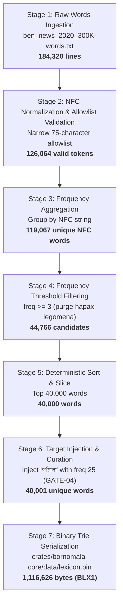
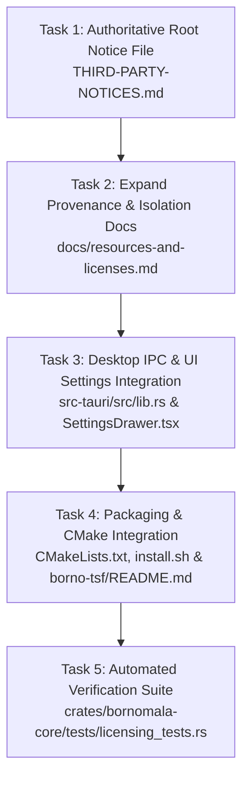

# Work Package Specification: WP-06 Licensing Compliance & Third-Party Notices

> **Milestone:** Remediation / Governance  
> **Status:** Implementation Ready — Awaiting Developer Authorization  
> **Target Release:** BornoMala 0.1.0-alpha  
> **Operating Environment:** Windows (x64) with pwsh; Linux (x64) with CMake / Fcitx 5  
> **Master Roadmap Reference:** `ROADMAP.md` (WP-06 under Remediation Track); `milestones/remediation/INDEX.md`  
> **Governing Policy:** `AGENTS.md` (Scope Control, Evidence-Based Development, Shared Rust Core)

---

## 1. Executive Summary & Scope Boundaries

### 1.1 Objective and Compliance Gap
BornoMala distributes a shared Rust core engine (`bornomala-core`), a desktop application (`src-tauri` / `bornomala-desktop`), a Windows Text Services Framework text input processor (`bornomala_tsf.dll`), and a Linux Fcitx 5 input method module (`bornomala.so`). The core engine embeds a compiled binary lexicon (`crates/bornomala-core/data/lexicon.bin`) derived from the Leipzig Corpora Collection.

Currently, the repository does not provide a centralized third-party license notice file, does not ship formal attribution or complete license texts with binary distributions, and lacks comprehensive documentation of the provenance, transformation pipeline, and licensing constraints of its embedded linguistic assets.

Under the Creative Commons Attribution 4.0 International license (CC BY 4.0), downstream distribution of material derived from licensed works requires retention of attribution elements *if supplied by the Licensor with the Licensed Material* (§3(a)(1)(A)), an indication of modifications (§3(a)(1)(B)), a link to the license (§3(a)(1)(C)), and a reference to warranty disclaimers (§3(a)(1)(A)(iv)). Furthermore, permissive open-source licenses governing runtime Rust crates, C++ runtime libraries, and frontend packages (MIT, Apache-2.0, ISC, and the GCC Runtime Library Exception) require redistribution of copyright notices and license texts alongside binary or source distributions.

The absence of these notices represents a **licensing compliance gap**. The purpose of WP-06 is to establish complete, legally accurate, self-contained, and auditable licensing compliance across all distributed components without modifying binary behavior or invalidating existing phonetic models.

### 1.2 Boundary of Scope
WP-06 authorizes the following deliverables:
1. **Authoritative Notice File:** Create `THIRD-PARTY-NOTICES.md` at the repository root covering all direct runtime dependencies, grouped coverage of transitive runtime crates, runtime C++ libraries, datasets, and complete unabridged license texts (no placeholders or ellipses).
2. **Lexicon Provenance Documentation:** Expand `docs/resources-and-licenses.md` to document the verified 7-stage chronological pipeline (and its 10 detailed operations) from the raw Leipzig corpus archive to `lexicon.bin`, explicitly reconciling all historical count discrepancies, detailing frequency thresholds, explaining the Tatsama orthography curation rationale, and proving Hunspell isolation.
3. **Desktop Compile-Time Embedding & UI Exposure:** Embed `THIRD-PARTY-NOTICES.md` into `src-tauri` using Rust's compile-time `include_str!("../../THIRD-PARTY-NOTICES.md")`, expose it through a read-only Tauri IPC command `get_third_party_notices`, and display it in the existing `src/components/SettingsDrawer.tsx` component under a dedicated "About & Notices" tab.
4. **Platform Packaging & Installation Rules:**
   - Document the mandatory distribution rule requiring standalone Windows TSF deployment packages (directories or archives) to bundle `THIRD-PARTY-NOTICES.md` alongside `bornomala_tsf.dll` and registration scripts (`register.bat`, `unregister.bat`).
   - Update `native/bornomala-fcitx5/CMakeLists.txt` to install `THIRD-PARTY-NOTICES.md` into `${CMAKE_INSTALL_DATADIR}/doc/bornomala/` with a mandatory configuration-time existence check (`FATAL_ERROR` if missing), and update `native/bornomala-fcitx5/scripts/install.sh` to install notices into `${XDG_DATA_HOME:-~/.local/share}/doc/bornomala/`.
5. **Automated Verification Suite:** Implement an automated test suite in `crates/bornomala-core/tests/licensing_tests.rs` that validates repository-level notice existence using manifest-relative paths, asserts `lexicon.bin` binary structural integrity (byte count, header magic, record count) without introducing external crypto crates, validates trie lookup behavior (`PrefixTrie::get_frequency`), and asserts dataset isolation.

### 1.3 Out-of-Scope Items
- **No Lexicon Rebuilding:** `lexicon.bin` is a stable, committed binary artifact. WP-06 does NOT rerun `prepare_lexicon.py`, re-hash the vocabulary, or modify the binary trie structure.
- **No In-Tree Windows Installer Creation:** WP-06 does not author an MSI, WiX, or InnoSetup installer for the Windows TSF module. Standalone TSF packaging is established as a documented distribution requirement.
- **No CI Cargo-Deny Workflow:** CI automation using `cargo-deny` is deferred to `RV-10` (Release Verification & Security Audit).
- **No Icon Asset Licensing Overhaul:** Application icons in `src-tauri/icons/` and `native/bornomala-fcitx5/data/` are internal project assets; formal third-party artistic provenance is tracked in project backlog.

---

## 2. Verified Lexicon Provenance & Transformation Pipeline

The embedded linguistic dataset in `crates/bornomala-core/data/lexicon.bin` provides prefix-matching frequency ranking for candidate suggestion ordering. The source archive, code, and committed artifacts have been audited directly:

### 2.1 Source Corpus Archive
- **Archive Path:** `scripts/.cache/ben_news_2020_300K.tar.gz` (cached on disk)
- **Verified File Size:** **54,196,306 bytes** (51.685 MiB)  
  *(Note: An earlier conversational report cited 27,249,603 bytes; physical inspection confirms the on-disk file size is 54,196,306 bytes).*
- **SHA-256 Digest:** `7624300acee975a4344510bdacb000dd63c6709aa76ef3e922805c031bc22b49` (computed directly from the 54,196,306-byte file; matches `docs/lexicon_provenance.json`).
- **Source Authority:** Leipzig Corpora Collection, Universität Leipzig, Institut für Informatik, Abteilung Automatische Sprachverarbeitung (ASV).
- **Canonical Download URL:** `https://wortschatz.uni-leipzig.de/en/download/Bengali`
- **Direct Archive URL:** `https://downloads.wortschatz-leipzig.de/corpora/ben_news_2020_300K.tar.gz`
- **Dataset Description:** 300,000 sentences from Bengali news media crawled in 2020.

### 2.2 Archive Members & Attribution Evidence
The archive `ben_news_2020_300K.tar.gz` contains exactly 9 members with a total uncompressed size of 163,261,091 bytes (155.70 MiB):
1. `ben_news_2020_300K` (directory, 0 bytes)
2. `ben_news_2020_300K/ben_news_2020_300K-co_n.txt` (3,053,673 bytes)
3. `ben_news_2020_300K/ben_news_2020_300K-inv_w.txt` (55,006,192 bytes)
4. `ben_news_2020_300K/ben_news_2020_300K-inv_so.txt` (3,542,836 bytes)
5. `ben_news_2020_300K/ben_news_2020_300K-words.txt` (6,261,986 bytes, exactly **184,320 lines**)
6. `ben_news_2020_300K/ben_news_2020_300K-co_s.txt` (23,512,240 bytes)
7. `ben_news_2020_300K/ben_news_2020_300K-import.sql` (5,887 bytes)
8. `ben_news_2020_300K/ben_news_2020_300K-sentences.txt` (68,529,710 bytes)
9. `ben_news_2020_300K/ben_news_2020_300K-sources.txt` (3,348,567 bytes)

**Attribution Finding:** The archive contains **no internal `README`, `NOTICE`, or `LICENSE` text file**. All attribution, academic citations, and license statements were supplied exclusively on the Leipzig web portal.

### 2.3 The 7-Stage Transformation Pipeline (Covering 10 Specification Parameters)
The preprocessing pipeline executed by `scripts/prepare_lexicon.py` consists of **seven chronological stages** embodying **ten distinct technical operations**:



#### Verification of the 10 Detailed Specification Parameters:
1. **Source Member Identification:** Member `ben_news_2020_300K-words.txt` is located by suffix (`member.name.endswith("-words.txt")`).
2. **Line Parsing & Error Handling:** The member contains exactly **184,320 lines** (`raw_entries_count = 184320`). Each line is parsed as `ID \t raw_word \t freq`. Lines with $< 3$ columns or non-integer frequencies are skipped.
3. **Unicode Normalization:** `unicodedata.normalize('NFC', raw_word)` is executed **before** script validation.
4. **Narrow Allowlist Script Validation (`VALID_BENGALI_CHARS`):**
   - The script does **not** accept the entire Unicode Bengali block (U+0980..U+09FF has 128 codepoints).
   - `VALID_BENGALI_CHARS` contains a **narrow explicit allowlist of exactly 75 characters**:
     - **Independent Vowels (16 codepoints):** 12 assigned vowels (U+0985..U+098C, U+098F, U+0990, U+0993, U+0994) + 4 unassigned codepoints included by range loop (U+098D, U+098E, U+0991, U+0992).
     - **Consonants (36 codepoints, all assigned):** 32 basic (U+0995..U+09A8, U+09AA..U+09B0, U+09B2, U+09B6..U+09B9) + 4 additional (U+09DC RRA, U+09DD RHA, U+09DF YYA, U+09CE Khanda Ta).
     - **Vowel Signs & Length Marks (16 codepoints):** 12 assigned (U+09BE..U+09C4, U+09C7, U+09C8, U+09CB, U+09CC, U+09D7) + 4 unassigned codepoints included by range loop (U+09C5, U+09C6, U+09C9, U+09CA).
     - **Virama / Hasant (1 codepoint):** U+09CD.
     - **Modifiers (4 codepoints):** U+0981 (Candrabindu), U+0982 (Anusvara), U+0983 (Visarga), U+09BC (Nukta).
     - **Joiners (2 codepoints):** U+200C (ZWNJ), U+200D (ZWJ).
     - **Sum:** $16 + 36 + 16 + 1 + 4 + 2 = 75$ codepoints (67 assigned + 8 unassigned in ranges; zero duplicates).
   - **Excluded from U+0980..U+09FF (55 codepoints):** 31 assigned characters (10 digits U+09E6..U+09EF, 9 currency/fraction signs U+09F2..U+09F9, U+09FB, Avagraha U+09BD, Anji U+0980, Assamese letters U+09F0/U+09F1, Vedic marks U+09FC..U+09FE, vocalic L/LL signs U+09E0..U+09E3) + 24 unassigned codepoints.
   - **Positional Base-Character Rule:** `is_valid_bengali_word` requires `has_base == True` (at least one base consonant or independent vowel). Words composed solely of joiners, vowel signs, or modifiers are rejected.
   - **Valid Bengali Tokens:** Exactly **126,064 tokens** pass (`valid_bengali_count = 126064`).
5. **Frequency Aggregation:** `freq_map[norm_word] += freq` sums frequencies across identical NFC strings, yielding **119,067 unique NFC words**.
6. **Frequency Threshold Filtering ($\ge 3$):** Words with frequency $< 3$ are removed, yielding **44,766 candidates** (`len(filtered_items) = 44766`).  
   *(Clarification: 44,766 is the result of script validation, NFC aggregation, AND frequency $\ge 3$ filtering combined).*
7. **Deterministic Sorting:** Items are sorted descending by frequency, with lexicographical tie-breaking: `filtered_items.sort(key=lambda item: (-item[1], item[0]))`.
8. **Top-N Slicing:** The top 40,000 entries are sliced: `selected_items = filtered_items[:40000]`.
9. **Benchmark Target Evaluation & Curation for `বর্ণমালা`:**
   - Evaluated 9 benchmark target words against candidates and final `lexicon.tsv`:
     | Target Word | Raw Corpus Freq | Candidate Pos (0-idx) | Candidate Rank (1-idx) | In Initial Top-40,000 Slice? | Final TSV Rank | Final Stored Freq |
     |---|---|---|---|:---:|---|---|
     | `বাংলাদেশ` | 4,987 | 62 | 63 | **Yes** | 63 | 4,987 |
     | `বাংলা` | 690 | 790 | 791 | **Yes** | 791 | 690 |
     | `বিজ্ঞান` | 356 | 1,458 | 1,459 | **Yes** | 1,459 | 356 |
     | `বৃষ্টি` | 347 | 1,499 | 1,500 | **Yes** | 1,500 | 347 |
     | `কষ্ট` | 294 | 1,746 | 1,747 | **Yes** | 1,747 | 294 |
     | `বাঙালি` | 285 | 1,803 | 1,804 | **Yes** | 1,804 | 285 |
     | `ভাষা` | 186 | 2,575 | 2,576 | **Yes** | 2,576 | 186 |
     | `ক্ষমা` | 165 | 2,842 | 2,843 | **Yes** | 2,843 | 165 |
     | `বর্ণমালা` | 3 | 41,527 | 41,528 | **No** ($41,527 \ge 40,000$) | 11,027 | 25 |
   - **Exact Curation & Test Dependency for `বর্ণমালা`:**
     - Raw corpus frequency was **3**, placing it at 0-indexed position **41,527** (1-indexed rank **41,528**) among the 44,766 candidates $\ge 3$.
     - Sliced out because $41,527 \ge 40,000$.
     - Included via `scripts/prepare_lexicon.py:228-232` to satisfy `BACKLOG-03` / `GATE-04` (Tatsama ণ-ত্ব বিধান phonetic candidate slot test in [`crates/bornomala-core/tests/phonetic_tests.rs:744-761`](file:///e:/Codes/Bangla%20Input%20Platform/Borno%20V1/crates/bornomala-core/tests/phonetic_tests.rs#L744-L761)).
     - In `test_gate_04_ambiguity_nasal_bornomala_and_negative_cases()`, line 760 asserts `assert_eq!(state.candidate_details[1].score, 25)`. The test directly depends on `বর্ণমালা` having stored dictionary frequency 25 to promote it as an `ExactLexiconMatch` in Candidate Slot 1.
     - Injected with clamped frequency `max(3, 25) = 25`.
10. **Final Vocabulary Count & Binary Layout:**
    - Final vocabulary: Exactly **40,001 unique words** (40,000 top slice + 1 target word `বর্ণমালা`).
    - File size: **1,116,626 bytes** (1.06 MiB).
    - Header: 4-byte ASCII magic `BLX1` (`0x42 0x4C 0x58 0x31`) + 4-byte LE `u32` count `40001` (`0x61 0x9C 0x00 0x00`).
    - Sequential records: `u16` LE byte length $L$ + $L$ UTF-8 bytes + `u32` LE frequency.
    - SHA-256: `de2ea1e227f92eca810cfe899af3b052ae7366225eedae08494fc2a8c412f9c7`.

---

## 3. Hunspell Isolation Complete Data Flow

A line-by-line audit of `scripts/prepare_lexicon.py` and codebase text search proves that Hunspell data is strictly isolated to an informational validation oracle:

### 3.1 Trace of Implementation
- **Source & Cache (lines 37-38):**
  `HUNSPELL_URL = "https://raw.githubusercontent.com/LibreOffice/dictionaries/master/bn_BD/bn_BD.dic"`  
  `HUNSPELL_DIC = os.path.join(CACHE_DIR, "bn_BD.dic")`
- **Dictionary Parser (lines 120-135):**
  `load_hunspell_dictionary(dic_path)` opens `bn_BD.dic`, strips flags on `/` (`word = line.split('/')[0].strip()`), normalizes to NFC (`unicodedata.normalize('NFC', word)`), and inserts into a Python `set`.
- **Fault-Tolerant Loader (lines 148-156):**
  Downloads `bn_BD.dic` if missing; if download fails, catches exception and sets `hunspell_words = set()`, allowing preprocessing to continue without error.
- **Candidate Processing Isolation (lines 157-238):**
  `hunspell_words` is **never referenced** during Leipzig word extraction, normalization, filtering, candidate scoring, sorting, slicing, or target word injection.
- **Informational Metric Calculation (lines 239-247):**
  `hunspell_matches = sum(1 for w, _ in selected_items if w in hunspell_words)` strictly evaluates `w in hunspell_words` to compute `match_pct = (hunspell_matches / final_count) * 100` (15,823 matches = 39.56%).
- **Serialization Isolation (lines 248-278):**
  `lexicon.bin` and `lexicon.tsv` are serialized strictly from `selected_items`. No Hunspell metadata, flags, stems, or affix rules are serialized.
- **Documentation Output (lines 279-376):**
  The match count (15,823) and percentage (39.56%) are written to `docs/lexicon_provenance.json` and `docs/resources-and-licenses.md`.

### 3.2 Codebase Search Evidence
Recursive text search for `hunspell` and `bn_BD` across `crates/bornomala-core/`, `src-tauri/`, `native/`, and `src/` yielded **zero matches**. No Rust, C++, Tauri, TSF, or Fcitx runtime code references Hunspell or links against any Hunspell library.

### 3.3 Bounded Conclusion
The data-flow audit in `scripts/prepare_lexicon.py` and codebase search prove that Hunspell data is strictly restricted to an offline validation metric:
1. No Hunspell dictionary file is redistributed.
2. No Hunspell runtime dependency exists in any BornoMala binary.
3. No Hunspell-derived entries or metadata are serialized into `lexicon.bin` or `lexicon.tsv`.
4. Therefore, no copyleft obligations (GPL/LGPL) attach to BornoMala from the Hunspell dictionary.

---

## 4. Third-Party Dependency & Licensing Inventory

The inventory distinguishes components across seven explicit categories, with a defensible two-tier notice strategy for Rust dependencies:

### 4.1 Two-Tier Notice Strategy for Rust Dependencies
Building a desktop application with Tauri incorporates standard Rust crates (Windows APIs, WebView2 bindings, Wry, Tao, Serde, ICU, etc.). Individually enumerating all ~150 transitive crates in static text introduces extreme fragility and version drift. BornoMala employs a defensible two-tier notice strategy:
1. **Direct Runtime Dependencies:** Individually enumerated with exact versions and declared licenses (`serde`, `serde_json`, `unicode-normalization`, `unicode-segmentation`, `semver`, `tauri`, `tauri-plugin-opener`).
2. **Transitive Runtime Dependencies:** Categorized by license family (MIT, Apache-2.0, BSD-3-Clause, Unicode-3.0, Zlib), accompanied by complete canonical license texts in Section 9. In open-source compliance practice, reproducing the full text of MIT, Apache-2.0, and BSD-3-Clause covers all permissive transitive Rust dependencies.

### 4.2 Category 1: Direct Runtime Dependencies
| Component | Manifest Location | Version Req / Resolved | License | Distribution / Linkage | Evidence |
|---|---|---|---|---|---|
| `serde` | `bornomala-core`, `src-tauri` | `^1.0` (features: `derive`) | MIT OR Apache-2.0 | Statically linked in Rust binaries | `Cargo.toml`, `Cargo.lock` |
| `serde_json` | `bornomala-core`, `src-tauri` | `^1.0` | MIT OR Apache-2.0 | Statically linked in Rust binaries | `Cargo.toml`, `Cargo.lock` |
| `unicode-normalization` | `bornomala-core` | `^0.1.26` / `0.1.26` | MIT OR Apache-2.0 | Statically linked in Rust binaries | `Cargo.toml`, `Cargo.lock` |
| `unicode-segmentation` | `bornomala-core` | `^1.13.3` / `1.13.3` | MIT OR Apache-2.0 | Statically linked in Rust binaries | `Cargo.toml`, `Cargo.lock` |
| `semver` | `src-tauri` | `^1.0` / `1.0.28` | MIT OR Apache-2.0 | Statically linked in desktop binary | `Cargo.toml`, `Cargo.lock` |
| `tauri` | `src-tauri` | `^2` / `2.0.0` | MIT OR Apache-2.0 | Statically linked in desktop binary | `Cargo.toml`, `Cargo.lock` |
| `tauri-plugin-opener` | `src-tauri` | `^2` / `2.0.0` | MIT OR Apache-2.0 | Statically linked in desktop binary | `Cargo.toml`, `Cargo.lock` |

### 4.3 Category 2: Key Transitive Runtime Dependencies (Rust)
| Component | Parent Dependency | License | Distribution / Linkage | Evidence |
|---|---|---|---|---|
| `tauri-runtime`, `tauri-runtime-wry` | `tauri` | MIT OR Apache-2.0 | Statically linked in desktop binary | `Cargo.lock` |
| `wry`, `tao` | `tauri` | MIT OR Apache-2.0 / Apache-2.0 | Statically linked in desktop binary | `Cargo.lock` |
| `windows`, `windows-sys`, `windows-core` | `tauri`, `tao` | MIT OR Apache-2.0 | Statically linked Win32 metadata/bindings | `Cargo.lock` |
| `tinyvec`, `smallvec` | `unicode-normalization` | MIT OR Apache-2.0 / Zlib | Statically linked in core binary | `Cargo.lock` |

### 4.4 Category 3: Build-Time Dependencies (Not in Binaries)
| Component | Used By | License | Distribution Note |
|---|---|---|---|
| `tauri-build` | `src-tauri/build.rs` | MIT OR Apache-2.0 | Build script dependency only |
| CMake (3.16+) | `native/bornomala-fcitx5` | BSD-3-Clause | Build system generator |
| MinGW-w64 GCC | `native/borno-tsf/build.ps1` | GPLv3+ / Permissive | Compiler toolchain |

### 4.5 Category 4: Test & Development-Only Dependencies
| Component | Location | License | Purpose |
|---|---|---|---|
| `@tauri-apps/cli` | `package.json` (`^2.0.0`) | MIT OR Apache-2.0 | CLI developer tool |
| `typescript` | `package.json` (`^5.5.3`) | Apache-2.0 | Type checking during build |
| `vite`, `@vitejs/plugin-react` | `package.json` | MIT | Frontend bundler / dev server |
| `@types/react`, `@types/react-dom` | `package.json` | MIT | TypeScript type definitions |

### 4.6 Category 5: Production Frontend Bundle Dependencies
*(Audited from `package.json` and resolved in `package-lock.json`)*:
| Package | Resolved Version | License | Copyright Notice in Package |
|---|---|---|---|
| `react` | `18.3.1` | MIT | Copyright (c) Facebook, Inc. and its affiliates. |
| `react-dom` | `18.3.1` | MIT | Copyright (c) Facebook, Inc. and its affiliates. |
| `@tauri-apps/api` | `2.2.0` | MIT OR Apache-2.0 | Copyright (c) 2017 - Present Tauri Apps Contributors |
| `@tauri-apps/plugin-opener` | `2.2.5` | MIT OR Apache-2.0 | Copyright (c) 2017 - Present Tauri Apps Contributors |
| `scheduler` | `0.23.2` | MIT | Copyright (c) Facebook, Inc. and its affiliates. |
| `loose-envify` | `1.4.0` | MIT | Copyright (c) 2015 Andres Suarez |
| `js-tokens` | `4.0.0` | MIT | Copyright (c) 2014-2021 Simon Lydell |

*(Verification: Confirmed that `lucide-react` and `tailwindcss` are NOT present in `package.json` or `package-lock.json`).*

### 4.7 Category 6: Host-Provided Libraries (Not Redistributed)
- **Windows System DLLs:** `KERNEL32.dll`, `USER32.dll`, `ADVAPI32.dll`, `GDI32.dll`, `ole32.dll`, `OLEAUT32.dll`, `USERENV.dll`, `WS2_32.dll`, `ntdll.dll`, `bcryptprimitives.dll`, and Universal CRT DLLs (`api-ms-win-crt-*.dll`). Dynamically linked Microsoft Windows OS components.
- **Linux Host Shared Libraries:** `libFcitx5Core.so`, `libFcitx5Utils.so`, `libc.so.6`, `libstdc++.so.6`, `libgcc_s.so.1`, `libm.so.6`, `libpthread.so.0`, `libdl.so.2`. System packages provided by the host Linux OS distribution. Upstream Fcitx 5 libraries are licensed under **`LGPL-2.1-or-later`** (SPDX: `LGPL-2.1-or-later`). Under the documented installation model, BornoMala distributes only its own open-source input module (`bornomala.so`), which links dynamically against host-provided shared libraries; the architecture relies on the shared-library mechanism described in LGPL-2.1 §6(b) to permit user replacement of the host libraries. BornoMala provides prominent notice of Fcitx 5 usage, upstream source references, and a verbatim copy of the LGPL-2.1 license text in `THIRD-PARTY-NOTICES.md`. This description reflects the documented unbundled distribution model and does not constitute a blanket legal certification of every possible packaging arrangement. Any future distribution model that physically bundles Fcitx 5 shared library binaries (e.g. standalone container or runtime images) is tracked as a separate release gate requiring full corresponding source distribution or written offer under LGPL-2.1 §6(a)/6(c).

### 4.8 Category 7: Components Redistributed with Native Binaries
1. **`bornomala_tsf.dll` (Windows TSF COM In-Process DLL):**
   - Exact Toolchain: Brecht Sanders WinLibs GCC 16.2.0 MinGW-w64 14.0.0 UCRT (`gcc-16.2.0-mingw-w64ucrt-14.0.0-r2`), confirmed via `version_info.txt`.
   - Compiler/linker flags (`native/borno-tsf/build.ps1` lines 51-58): `-shared -std=c++17 -static -static-libgcc -static-libstdc++`.
   - Statically Incorporated Archives: `libgcc.a` (6,925,648 bytes), `libstdc++.a` (8,540,742 bytes), `libmingw32.a` (41,574 bytes), and `libmingwex.a` (539,924 bytes).
   - Inspection evidence (`objdump -t bornomala_tsf.dll`): 50 GCC runtime symbols (`__gcc_register_frame`, `__gxx_personality_seh0`, `_Unwind_Context`, `__cxxabiv1`) and 14 MinGW CRT symbols (`_pei386_runtime_relocator`, `__mingw_TLScallback`, `__mingw_pformat`).
   - **Compiler vs. Runtime Licensing:** The compiler executable (`g++.exe`) is licensed under GNU GPLv3; its license applies only to the compiler itself and does not infect compiled target code. The runtime library routines incorporated into the DLL from `libgcc.a` and `libstdc++.a` are covered by the **GCC Runtime Library Exception (Version 3.1)** under GPLv3 Section 7, explicitly permitting distribution of the combined target code under terms of choice without imposing GPL copyleft.
   - **MinGW-w64 CRT Code:** Statically links CRT startup and helper routines from `libmingw32.a` and `libmingwex.a`. These components are separate from GCC runtime libraries and are governed by MinGW-w64 permissive terms:
     - `libmingw32.a` (CRT startup and core header stubs) is dedicated to the **Public Domain** (per `_mingw.h` and `DISCLAIMER.PD`).
     - `libmingwex.a` (CRT helper and math routines) is governed by mixed permissive terms, combining Public Domain stubs with third-party components carrying permissive BSD-2-Clause, BSD-3-Clause, and MIT-style licenses (per upstream `COPYING.MinGW-w64`).
     - Upstream MinGW-w64 licensing manifests describe these CRT components as permissively licensed. The specific `libmingwex.a` archive has not undergone exhaustive object-by-object license and attribution verification; that verification remains tracked under `RV-11`. The notices document the upstream licensing information currently established and must not be interpreted as a completed object-level audit.
2. **`bornomala.so` (Linux Fcitx 5 Module):**
   - Statically incorporates `libbornomala_core.a` (MIT OR Apache-2.0).
   - Dynamically links host `Fcitx5::Core` and `Fcitx5::Utils` (`LGPL-2.1-or-later`). Under the documented installation model, BornoMala does not bundle or redistribute Fcitx 5 binaries, relies on the shared-library mechanism described in LGPL-2.1 §6(b), and documents upstream notices and license text via `THIRD-PARTY-NOTICES.md` installed by CMake and `install.sh`.
3. **Fonts:** **Zero third-party fonts are bundled.** `src/index.css` references host-installed system fonts only.
4. **Application Icons & Artwork:**
   - Files: `src-tauri/icons/` and `native/bornomala-fcitx5/data/bornomala.png` (matching `64x64.png`, SHA-256 `2D31182F0268510776C09D02A09876DFF64D65602E9CB0BB4A039697607A8D7B`).
   - Classification: **`Provenance unresolved`**. Initial Git commit records standard Tauri CLI scaffold generation by the project author, but no upstream license or source vector design records are documented in the repository.
   - Action & Risk: Non-blocking for WP-06 licensing compliance; tracked for formal design provenance review in Milestone M12 / RV-11 release engineering.

---

## 5. License Text Accuracy & Attribution

All license texts in Section 9 are unabridged and complete:
1. **CC BY 4.0:** Verbatim reproduction of Creative Commons Attribution 4.0 International Public License (Sections 1 through 8). Formally acknowledges the dataset creators (Dirk Goldhahn, Thomas Eckart, and Uwe Quasthoff), the providing institution and platform (Leipzig Corpora Collection, Universität Leipzig, Institut für Informatik, Abteilung Automatische Sprachverarbeitung), and the citation paper (Goldhahn, Eckart, & Quasthoff, LREC 2012), preserving the distinction between creators and the institutional platform without making unverified assertions regarding copyright ownership transfer.
2. **CC BY 4.0 Section 5 Disclaimer:** Retained in full as the **Leipzig Licensor's warranty disclaimer and limitation of liability**, clearly distinguished from BornoMala project warranties.
3. **MIT License:** Complete 3-paragraph text with dependency-specific copyright notices (`Facebook, Inc.`, `Tauri Apps Contributors`, `The Rust Project Developers`, `Andres Suarez`, `Simon Lydell`).
4. **Apache-2.0 License:** Complete text (Sections 1 through 9). Verified via automated inspection of the local Cargo cache and `node_modules` for the currently resolved dependency snapshot that **zero** currently identified distributed runtime crates or production frontend packages contain upstream `NOTICE` files requiring addendum inclusion under Section 4(d). This finding applies strictly to the audited snapshot of resolved dependencies; future dependency additions or version upgrades require renewed `NOTICE` file inspection.
5. **ISC License:** Complete 2-paragraph text. Documented as applying exclusively to non-distributed build-time `devDependencies` (`picocolors`, `lru-cache`, etc.); zero distributed runtime components use ISC.
6. **GNU LGPL-2.1:** Complete verbatim reproduction of GNU Lesser General Public License Version 2.1 (Preamble, Sections 0 through 16, and NO WARRANTY terms), without ellipses or bracketed summaries. Applicable to the host-provided Linux dynamic linking interface (`LGPL-2.1-or-later`), where BornoMala relies on the shared-library mechanism described in LGPL-2.1 §6(b) and documents notice and license-copy requirements in `THIRD-PARTY-NOTICES.md` for the documented unbundled distribution model.
7. **GCC Runtime Library Exception (Version 3.1):** Complete verbatim text (Preamble, 0. Definitions, 1. Grant of Additional Permission, 2. No Weakening of GCC Copyleft). Applicable to statically incorporated `libgcc` and `libstdc++` runtime routines in `bornomala_tsf.dll`.

---

## 6. Desktop IPC and UI Architecture

### 6.1 Path Resolution & Command Registration
- **File:** `src-tauri/src/lib.rs`
- **Embedding Path:** `include_str!("../../THIRD-PARTY-NOTICES.md")` (depth 2 from `src-tauri/src/` to repo root).
- **Command Name:** `get_third_party_notices`.
- **Signature:**
  ```rust
  #[tauri::command]
  pub fn get_third_party_notices() -> Result<String, String> {
      const NOTICES: &str = include_str!("../../THIRD-PARTY-NOTICES.md");
      Ok(NOTICES.to_string())
  }
  ```
- **Handler Registration:** Add to `tauri::generate_handler![..., get_third_party_notices]` in `src-tauri/src/lib.rs:447-460`. No naming conflicts exist with existing commands.

### 6.2 Frontend Integration in `SettingsDrawer.tsx`
- **Component File:** `src/components/SettingsDrawer.tsx`
- **Tab Navigation:** Update tab type:
  ```typescript
  type SettingsTab = "typing" | "appearance" | "shortcuts" | "backup" | "about";
  ```
- **Tab Item:** Add `{ id: "about", label: "About & Notices", icon: "⚖️" }`.
- **State Non-Interference:** Selecting `"about"` does not modify `formData`, does not trigger save/reset handlers, and does not alter `isDirty`.
- **Presentation:** Invokes `invoke<string>("get_third_party_notices")` via `@tauri-apps/api/core` and displays notices in a styled read-only scrollable `<pre>` view with selectable text.

---

## 7. Linux Installation Alignment

### 7.1 CMake Configuration (`native/bornomala-fcitx5/CMakeLists.txt`)
- **Top-Level `WORKSPACE_ROOT` Initialization:**
  In `native/bornomala-fcitx5/CMakeLists.txt`, `WORKSPACE_ROOT` was historically initialized inside the auto-discovery `else()` branch (lines 39–40). Because CMake control flow blocks (`if`, `else`, `endif`) do not introduce a new variable scope, variables set in `else()` remain in scope after `endif()`. However, whenever `BORNOMALA_CORE_STATIC` is explicitly supplied (as done in `scripts/install.sh:19`), the `else()` branch is completely bypassed, leaving `WORKSPACE_ROOT` uninitialized (`""`).
  To ensure the repository root is reliably resolved across both automatic discovery and explicit static library configurations, `native/bornomala-fcitx5/CMakeLists.txt` must unconditionally resolve `WORKSPACE_ROOT` at top-level file scope before the library discovery condition:
  ```cmake
  set(WORKSPACE_ROOT "${CMAKE_CURRENT_SOURCE_DIR}/../..")
  get_filename_component(WORKSPACE_ROOT "${WORKSPACE_ROOT}" ABSOLUTE)
  ```
- **Configuration-Time Verification of Notice File:**
  ```cmake
  set(NOTICES_PATH "${WORKSPACE_ROOT}/THIRD-PARTY-NOTICES.md")
  if(NOT EXISTS "${NOTICES_PATH}")
      message(FATAL_ERROR "THIRD-PARTY-NOTICES.md not found at workspace root: ${NOTICES_PATH}")
  endif()
  ```
- **Installation Target:** Installs to doc directory honoring `GNUInstallDirs`, `CMAKE_INSTALL_PREFIX`, and `DESTDIR`:
  ```cmake
  install(FILES "${NOTICES_PATH}"
          DESTINATION "${CMAKE_INSTALL_DATADIR}/doc/bornomala"
          RENAME "THIRD-PARTY-NOTICES.md")
  ```

### 7.2 User-Mode Shell Installer (`native/bornomala-fcitx5/scripts/install.sh`)
- `PROJECT_ROOT` is derived via `cd "$SCRIPT_DIR/../../.." && pwd`.
- Installs to user-mode destination `${XDG_DATA_HOME:-${HOME}/.local/share}/doc/bornomala/THIRD-PARTY-NOTICES.md`.
- Validates file existence and fails with exit code 1 if missing.
- Avoids hardcoding `/usr/local` in user-mode installations.

---

## 8. Windows TSF Packaging Documentation

### 8.1 Inspection Findings
- Registration scripts in tree: `native/borno-tsf/scripts/register.bat` and `unregister.bat` (batch files, not PowerShell).
- Documentation status: `native/borno-tsf/` currently lacks a `README.md`.
- Automated packaging status: **Zero automated Windows installer/zip scripts exist in tree.**

### 8.2 Distribution Rule
- Any standalone distribution folder or zip containing `bornomala_tsf.dll`, `register.bat`, and `unregister.bat` must include `THIRD-PARTY-NOTICES.md`.
- WP-06 establishes this distribution requirement and documents it in `native/borno-tsf/README.md`. WP-06 does **not** claim to have generated or verified a packaged release archive.

---

## 9. Authoritative Content for `THIRD-PARTY-NOTICES.md`

````markdown
# Third-Party Notices & Licensing Acknowledgements

This document contains licensing acknowledgements, copyright notices, and third-party terms applicable to the BornoMala Bengali Input Platform across its core engine (`bornomala-core`), desktop application (`bornomala-desktop`), Windows Text Services Framework (TSF) module (`bornomala_tsf.dll`), and Linux Fcitx 5 addon (`bornomala.so`).

---

## 1. Linguistic Datasets & Corpora

### Leipzig Corpora Collection (Bengali News 2020)
- **Source:** Leipzig Corpora Collection, Universität Leipzig, Institut für Informatik, Abteilung Automatische Sprachverarbeitung (ASV)
- **Dataset:** `ben_news_2020_300K` (300,000 Bengali news sentences crawled in 2020)
- **Dataset Creators:** Dirk Goldhahn, Thomas Eckart, and Uwe Quasthoff
- **Providing Institution:** Universität Leipzig, Institut für Informatik, Abteilung Automatische Sprachverarbeitung (ASV)
- **Canonical Portal URL:** https://wortschatz.uni-leipzig.de/en/download/Bengali
- **Archive URL:** https://downloads.wortschatz-leipzig.de/corpora/ben_news_2020_300K.tar.gz
- **License:** Creative Commons Attribution 4.0 International (CC BY 4.0)  
  https://creativecommons.org/licenses/by/4.0/legalcode
- **Academic Citation:**  
  D. Goldhahn, T. Eckart & U. Quasthoff: *Building Large Monolingual Dictionaries at the Leipzig Corpora Collection: From 100 to 200 Languages.* In: Proceedings of the 8th International Language Resources and Evaluation Conference (LREC'12), 2012.
- **Modification Notice:**  
  The raw corpus word frequency list (`ben_news_2020_300K-words.txt`, 184,320 lines) was normalized to Unicode NFC and filtered against an explicit 75-character Bengali allowlist (U+0980..U+09FF and joiners). Words with corpus frequency < 3 were removed, yielding 44,766 candidates. The top 40,000 words were selected. One linguistic benchmark word ("বর্ণমালা") was included with clamped frequency 25 to satisfy Tatsama ণ-ত্ব বিধান phonetic rules (GATE-04). The resulting 40,001 entries were compiled into a binary prefix trie (`crates/bornomala-core/data/lexicon.bin`).
- **Warranty Disclaimer & Limitation of Liability of Licensor (CC BY 4.0 Section 5):**  
  a. Unless otherwise separately undertaken by the Licensor, to the extent possible, the Licensor offers the Licensed Material as-is and as-available, and makes no representations or warranties of any kind concerning the Licensed Material, whether express, implied, statutory, or other. This includes, without limitation, warranties of title, merchantability, fitness for a particular purpose, non-infringement, absence of latent or other defects, accuracy, or the presence or absence of errors, whether or not known or discoverable. Where disclaimers of warranties are not allowed in full or in part, this disclaimer may not apply to You.  
  b. To the extent possible, in no event will the Licensor be liable to You on any legal theory (including, without limitation, negligence) or otherwise for any direct, special, indirect, incidental, consequential, punitive, exemplary, or other losses, costs, expenses, or damages arising out of this Public License or use of the Licensed Material, even if the Licensor has been advised of the possibility of such losses, costs, expenses, or damages. Where a limitation of liability is not allowed in full or in part, this limitation may not apply to You.  
  c. The disclaimer of warranties and limitation of liability provided above shall be interpreted in a manner that, to the extent possible, most closely approximates an absolute disclaimer and waiver of all liability.

---

## 2. Rust Core & Desktop Dependencies

The following Rust crates are compiled into BornoMala binaries:

### Serde / Serde JSON (`serde`, `serde_json`)
- **License:** MIT OR Apache-2.0

### Unicode Normalization (`unicode-normalization`)
- **Copyright:** (c) 2015 The Rust Project Developers
- **License:** MIT OR Apache-2.0

### Unicode Segmentation (`unicode-segmentation`)
- **Copyright:** (c) 2015 The Rust Project Developers
- **License:** MIT OR Apache-2.0

### SemVer (`semver`)
- **License:** MIT OR Apache-2.0

### Tauri Framework & Plugins (`tauri`, `tauri-runtime`, `tauri-build`, `tauri-plugin-opener`)
- **Copyright:** (c) 2017 - Present Tauri Apps Contributors
- **License:** MIT OR Apache-2.0

### Windows RS (`windows`, `windows-sys`, `windows-core`)
- **Copyright:** (c) Microsoft Corporation
- **License:** MIT OR Apache-2.0

---

## 3. Frontend Webview Dependencies

The BornoMala desktop interface bundles the following libraries in its production webview assets:

### React & React DOM (`react`, `react-dom`, `scheduler`)
- **Copyright:** (c) Facebook, Inc. and its affiliates.
- **License:** MIT

### Tauri Webview APIs (`@tauri-apps/api`, `@tauri-apps/plugin-opener`)
- **Copyright:** (c) 2017 - Present Tauri Apps Contributors
- **License:** MIT OR Apache-2.0

### Loose-Envify & JS-Tokens (`loose-envify`, `js-tokens`)
- **Copyright:** (c) 2015 Andres Suarez, (c) 2014-2021 Simon Lydell
- **License:** MIT

---

## 4. Platform Runtimes & C++ Toolchains

### MinGW-w64 C Runtime (Windows TSF Module)
- **Copyright:** (c) 2009-2024 MinGW-w64 project
- **License:** Public Domain (`_mingw.h` / `DISCLAIMER.PD`) and BSD-style permissive terms (`COPYING.MinGW-w64`)
- **Archives:** Statically incorporates `libmingw32.a` and `libmingwex.a`. Upstream MinGW-w64 licensing manifests describe these CRT components as permissively licensed. The specific `libmingwex.a` archive has not undergone exhaustive object-by-object license and attribution verification; that verification remains tracked under `RV-11`. The notices document the upstream licensing information currently established and must not be interpreted as a completed object-level audit.

### GCC Runtime Library Exception (Version 3.1)
The Windows TSF DLL statically links runtime components (`libgcc`, `libstdc++`) under the GCC Runtime Library Exception (Version 3.1). Target code generated by an Eligible Compilation Process can be distributed under terms of choice without GPL copyleft attachment.

### Fcitx 5 Libraries (Linux Addon)
- **Copyright:** (c) 2017-2024 Fcitx5 Authors
- **License:** GNU Lesser General Public License Version 2.1 (LGPL-2.1-or-later)
- **Linkage:** The BornoMala Fcitx 5 module (`bornomala.so`) links dynamically against host system libraries (`libFcitx5Core.so`, `libFcitx5Utils.so`). Source code for Fcitx 5 is available from https://github.com/fcitx/fcitx5.
- **Distribution Model:** BornoMala distributes only its own open-source plugin and does not bundle Fcitx 5 shared libraries under the documented installation model. The module relies on the shared-library mechanism described in LGPL-2.1 §6(b); full LGPL-2.1 license text and upstream source references are provided below.

---

## 5. Complete License Texts

### Creative Commons Attribution 4.0 International (CC BY 4.0)

Creative Commons Corporation ("Creative Commons") is not a law firm and does not provide legal services. Distribution of this public license does not create an attorney-client or other relationship. Creative Commons makes its licenses and related information available on an "as-is" basis. Creative Commons gives no warranties regarding its licenses, any material licensed under their terms and conditions, or any related information. Creative Commons disclaims all liability for damages resulting from their use to the fullest extent possible.

Using Creative Commons Public Licenses
Creative Commons public licenses provide a standard set of terms and conditions that creators and other rights holders may use to share original works of authorship and other material subject to copyright and certain other rights specified in the public license below. The following considerations are for informational purposes only, are not exhaustive, and do not form part of our licenses.

Creative Commons Attribution 4.0 International Public License

By exercising the Licensed Rights (defined below), You accept and agree to be bound by the terms and conditions of this Creative Commons Attribution 4.0 International Public License ("Public License"). To the extent this Public License may be interpreted as a contract, You are granted the Licensed Rights in consideration of Your acceptance of these terms and conditions, and the Licensor grants You such rights in consideration of benefits the Licensor receives from making the Licensed Material available under these terms and conditions.

Section 1 – Definitions.
a. Adapted Material means material subject to Copyright and Similar Rights that is derived from or based upon the Licensed Material and in which the Licensed Material is translated, altered, arranged, transformed, or otherwise modified in a manner requiring permission under the Copyright and Similar Rights held by the Licensor. For purposes of this Public License, where the Licensed Material is a musical work, performance, or sound recording, Adapted Material is always produced where the Licensed Material is synched in timed relation with a moving image.
b. Adapter's License means the license You apply to Your Copyright and Similar Rights in Your contributions to Adapted Material in accordance with the terms and conditions of this Public License.
c. Copyright and Similar Rights means copyright and/or similar rights closely related to copyright including, without limitation, performance, broadcast, sound recording, and Sui Generis Database Rights, without regard to how the rights are labeled or categorized. For purposes of this Public License, the rights specified in Section 2(b)(1)-(2) are not Copyright and Similar Rights.
d. Effective Technological Measures means those measures that, in the absence of proper authority, may not be circumvented under laws fulfilling obligations under Article 11 of the WIPO Copyright Treaty adopted on December 20, 1996, and/or similar international agreements.
e. Exceptions and Limitations means fair use, fair dealing, and/or any other exception or limitation to Copyright and Similar Rights that applies to Your use of the Licensed Material.
f. Licensed Material means the artistic or literary work, database, or other material to which the Licensor applied this Public License.
g. Licensed Rights means the rights granted to You subject to the terms and conditions of this Public License, which are limited to all Copyright and Similar Rights that apply to Your use of the Licensed Material and that the Licensor has authority to license.
h. Licensor means the individual(s) or entity(ies) granting rights under this Public License.
i. Share means to provide material to the public by any means or process that requires permission under the Licensed Rights, such as reproduction, public display, public performance, distribution, dissemination, communication, or importation, and to make material available to the public including in ways that members of the public may access the material from a place and at a time individually chosen by them.
j. Sui Generis Database Rights means rights other than copyright resulting from Directive 96/9/EC of the European Parliament and of the Council of 11 March 1996 on the legal protection of databases, as amended and/or succeeded, as well as other essentially equivalent rights anywhere in the world.
k. You means the individual or entity exercising the Licensed Rights under this Public License. Your has a corresponding meaning.

Section 2 – Scope.
a. License grant.
1. Subject to the terms and conditions of this Public License, the Licensor hereby grants You a worldwide, royalty-free, non-sublicensable, non-exclusive, irrevocable license to exercise the Licensed Rights in the Licensed Material to:
A. reproduce and Share the Licensed Material, in whole or in part; and
B. produce, reproduce, and Share Adapted Material.
2. Exceptions and Limitations. For the avoidance of doubt, where Exceptions and Limitations apply to Your use, this Public License does not apply, and You do not need to comply with its terms and conditions.
3. Term. The term of this Public License is specified in Section 6(a).
4. Media and formats; technical modifications allowed. The Licensor authorizes You to exercise the Licensed Rights in all media and formats whether now known or hereafter created, and to make technical modifications necessary to do so. The Licensor waives and/or agrees not to assert any right or authority to forbid You from making technical modifications necessary to exercise the Licensed Rights, including technical modifications necessary to circumvent Effective Technological Measures. For purposes of this Public License, simply making modifications authorized by this Section 2(a)(4) never produces Adapted Material.
5. Downstream recipients.
A. Offer from the Licensor – Licensed Material. Every recipient of the Licensed Material automatically receives an offer from the Licensor to exercise the Licensed Rights under the terms and conditions of this Public License.
B. No downstream restrictions. You may not offer or impose any additional or different terms or conditions on, or apply any Effective Technological Measures to, the Licensed Material if doing so restricts exercise of the Licensed Rights by any recipient of the Licensed Material.
6. No endorsement. Nothing in this Public License constitutes or may be construed as permission to assert or imply that You are, or that Your use of the Licensed Material is, connected with, or sponsored, endorsed, or granted official status by, the Licensor or others designated to receive attribution as provided in Section 3(a)(1)(A)(i).

b. Other rights.
1. Moral rights, such as the right of integrity, are not licensed under this Public License, nor are publicity, privacy, and/or other similar personality rights; however, to the extent possible, the Licensor waives and/or agrees not to assert any such rights held by the Licensor to the limited extent necessary to allow You to exercise the Licensed Rights, but not otherwise.
2. Patent and trademark rights are not licensed under this Public License.
3. To the extent possible, the Licensor waives any right to collect royalties from You for the exercise of the Licensed Rights, whether directly or through a collecting society under any voluntary or waivable statutory or compulsory licensing scheme. In all other cases the Licensor expressly reserves any right to collect such royalties.

Section 3 – License Conditions.
Your exercise of the Licensed Rights is expressly made subject to the following conditions.

a. Attribution.
1. If You Share the Licensed Material (including in modified form), You must:
A. retain the following if it is supplied by the Licensor with the Licensed Material:
i. identification of the creator(s) of the Licensed Material and any others designated to receive attribution, in any reasonable manner requested by the Licensor (including by pseudonym if designated);
ii. a copyright notice;
iii. a notice that refers to this Public License;
iv. a notice that refers to the disclaimer of warranties;
v. a URI or hyperlink to the Licensed Material to the extent reasonably practicable;
B. indicate if You modified the Licensed Material and retain an indication of previous modifications; and
C. indicate the Licensed Material is licensed under this Public License, and include the text of, or the URI or hyperlink to, this Public License.
2. You may satisfy the conditions in Section 3(a)(1) in any reasonable manner based on the medium, means, and context in which You Share the Licensed Material. For example, it may be reasonable to satisfy the conditions by providing a URI or hyperlink to a resource that includes the required information.
3. If requested by the Licensor, You must remove any of the information required by Section 3(a)(1)(A) to the extent reasonably practicable.
4. If You Share Adapted Material You produce, the Adapter's License You apply must not prevent recipients of the Adapted Material from complying with this Public License.

Section 4 – Sui Generis Database Rights.
Where the Licensed Rights include Sui Generis Database Rights that apply to Your use of the Licensed Material:
a. for the avoidance of doubt, Section 2(a)(1) grants You the right to extract, reuse, reproduce, and Share all or a substantial portion of the contents of the database;
b. if You include all or a substantial portion of the database contents in a database in which You have Sui Generis Database Rights, then the database in which You have Sui Generis Database Rights (but not its individual contents) is Adapted Material; and
c. You must comply with the conditions in Section 3(a) if You Share all or a substantial portion of the contents of the database.
For the avoidance of doubt, this Section 4 supplements and does not replace Your obligations under this Public License where the Licensed Rights include other Copyright and Similar Rights.

Section 5 – Disclaimer of Warranties and Limitation of Liability.
a. Unless otherwise separately undertaken by the Licensor, to the extent possible, the Licensor offers the Licensed Material as-is and as-available, and makes no representations or warranties of any kind concerning the Licensed Material, whether express, implied, statutory, or other. This includes, without limitation, warranties of title, merchantability, fitness for a particular purpose, non-infringement, absence of latent or other defects, accuracy, or the presence or absence of errors, whether or not known or discoverable. Where disclaimers of warranties are not allowed in full or in part, this disclaimer may not apply to You.
b. To the extent possible, in no event will the Licensor be liable to You on any legal theory (including, without limitation, negligence) or otherwise for any direct, special, indirect, incidental, consequential, punitive, exemplary, or other losses, costs, expenses, or damages arising out of this Public License or use of the Licensed Material, even if the Licensor has been advised of the possibility of such losses, costs, expenses, or damages. Where a limitation of liability is not allowed in full or in part, this limitation may not apply to You.
c. The disclaimer of warranties and limitation of liability provided above shall be interpreted in a manner that, to the extent possible, most closely approximates an absolute disclaimer and waiver of all liability.

Section 6 – Term and Termination.
a. This Public License applies for the term of the Copyright and Similar Rights licensed here. However, if You fail to comply with this Public License, then Your rights under this Public License terminate automatically.
b. Where Your right to use the Licensed Material has terminated under Section 6(a), it reinstates:
1. automatically as of the date the violation is cured, provided it is cured within 30 days of Your discovery of the violation; or
2. upon express reinstatement by the Licensor.
For the avoidance of doubt, this Section 6(b) does not affect any right the Licensor may have to seek remedies for Your violations of this Public License.
c. For the avoidance of doubt, the Licensor may also offer the Licensed Material under separate terms or conditions or stop distributing the Licensed Material at any time; however, doing so will not terminate this Public License.
d. Sections 1, 5, 6, 7, and 8 survive termination of this Public License.

Section 7 – Other Terms and Conditions.
a. The Licensor shall not be bound by any additional or different terms or conditions communicated by You unless expressly agreed.
b. Any arrangements, understandings, or agreements regarding the Licensed Material not stated herein are separate from and independent of the terms and conditions of this Public License.

Section 8 – Interpretation.
a. For the avoidance of doubt, this Public License does not, and shall not be interpreted to, reduce, limit, restrict, or impose conditions on any use of the Licensed Material that could lawfully be made without permission under this Public License.
b. To the extent possible, if any provision of this Public License is deemed unenforceable, it shall be automatically reformed to the minimum extent necessary to make it enforceable. If the provision cannot be reformed, it shall be severed from this Public License without affecting the enforceability of the remaining terms and conditions.
c. No term or condition of this Public License will be waived and no failure to comply consented to unless expressly agreed to by the Licensor.
d. Nothing in this Public License constitutes or may be interpreted as a limitation upon, or waiver of, any privileges and immunities that apply to the Licensor or You, including from the legal processes of any jurisdiction or authority.

---

### The MIT License (MIT)

Permission is hereby granted, free of charge, to any person obtaining a copy of this software and associated documentation files (the "Software"), to deal in the Software without restriction, including without limitation the rights to use, copy, modify, merge, publish, distribute, sublicense, and/or sell copies of the Software, and to permit persons to whom the Software is furnished to do so, subject to the following conditions:

The above copyright notice and this permission notice shall be included in all copies or substantial portions of the Software.

THE SOFTWARE IS PROVIDED "AS IS", WITHOUT WARRANTY OF ANY KIND, EXPRESS OR IMPLIED, INCLUDING BUT NOT LIMITED TO THE WARRANTIES OF MERCHANTABILITY, FITNESS FOR A PARTICULAR PURPOSE AND NONINFRINGEMENT. IN NO EVENT SHALL THE AUTHORS OR COPYRIGHT HOLDERS BE LIABLE FOR ANY CLAIM, DAMAGES OR OTHER LIABILITY, WHETHER IN AN ACTION OF CONTRACT, TORT OR OTHERWISE, ARISING FROM, OUT OF OR IN CONNECTION WITH THE SOFTWARE OR THE USE OR OTHER DEALINGS IN THE SOFTWARE.

---

### Apache License, Version 2.0

TERMS AND CONDITIONS FOR USE, REPRODUCTION, AND DISTRIBUTION

1. Definitions.
"License" shall mean the terms and conditions for use, reproduction, and distribution as defined by Sections 1 through 9 of this document.
"Licensor" shall mean the copyright owner or entity authorized by the copyright owner that is granting the License.
"Legal Entity" shall mean the union of the acting entity and all other entities that control, are controlled by, or are under common control with that entity. For the purposes of this definition, "control" means (i) the power, direct or indirect, to cause the direction or management of such entity, whether by contract or otherwise, or (ii) ownership of fifty percent (50%) or more of the outstanding shares, or (iii) beneficial ownership of such entity.
"You" (or "Your") shall mean an individual or Legal Entity exercising permissions granted by this License.
"Source" form shall mean the preferred form for making modifications, including but not limited to software source code, documentation source, and configuration files.
"Object" form shall mean any form resulting from mechanical transformation or translation of a Source form, including but not limited to compiled object code, generated documentation, and conversions to other media types.
"Work" shall mean the work of authorship, whether in Source or Object form, made available under the License, as indicated by a copyright notice that is included in or attached to the work.
"Derivative Works" shall mean any work, whether in Source or Object form, that is based on (or derived from) the Work and for which the editorial revisions, annotations, elaborations, or other modifications represent, as a whole, an original work of authorship. For the purposes of this License, Derivative Works shall not include works that remain separable from, or merely link (or bind by name) to the interfaces of, the Work and Derivative Works thereof.
"Contribution" shall mean any work of authorship, including the original version of the Work and any modifications or additions to that Work or Derivative Works thereof, that is intentionally submitted to Licensor for inclusion in the Work by the copyright owner or by an individual or Legal Entity authorized to submit on behalf of the copyright owner.
"Contributor" shall mean Licensor and any individual or Legal Entity on behalf of whom a Contribution has been received by Licensor and subsequently incorporated within the Work.

2. Grant of Copyright License. Subject to the terms and conditions of this License, each Contributor hereby grants to You a perpetual, worldwide, non-exclusive, no-charge, royalty-free, irrevocable copyright license to reproduce, prepare Derivative Works of, publicly display, publicly perform, sublicense, and distribute the Work and such Derivative Works in Source or Object form.

3. Grant of Patent License. Subject to the terms and conditions of this License, each Contributor hereby grants to You a perpetual, worldwide, non-exclusive, no-charge, royalty-free, irrevocable (except as stated in this section) patent license to make, have made, use, offer to sell, sell, import, and otherwise transfer the Work, where such license applies only to those patent claims licensable by such Contributor that are necessarily infringed by their Contribution(s) alone or by combination of their Contribution(s) with the Work to which such Contribution(s) was submitted. If You institute patent litigation against any entity (including a cross-claim or counterclaim in a lawsuit) alleging that the Work or a Contribution incorporated within the Work constitutes direct or contributory patent infringement, then any patent licenses granted to You under this License for that Work shall terminate as of the date such litigation is filed.

4. Redistribution. You may reproduce and distribute copies of the Work or Derivative Works thereof in any medium, with or without modifications, and in Source or Object form, provided that You meet the following conditions:
(a) You must give any other recipients of the Work or Derivative Works a copy of this License; and
(b) You must cause any modified files to carry prominent notices stating that You changed the files; and
(c) You must retain, in the Source form of any Derivative Works that You distribute, all copyright, patent, trademark, and attribution notices from the Source form of the Work, excluding those notices that do not pertain to any part of the Derivative Works; and
(d) If the Work includes a "NOTICE" text file as part of its distribution, then any Derivative Works that You distribute must include a readable copy of the attribution notices contained within such NOTICE file, excluding those notices that do not pertain to any part of the Derivative Works, in at least one of the following places: within a NOTICE text file distributed as part of the Derivative Works; within the Source form or documentation, if provided along with the Derivative Works; or, within a display generated by the Derivative Works, if and wherever such third-party notices normally appear. The contents of the NOTICE file are for informational purposes only and do not modify the License. You may add Your own attribution notices within Derivative Works that You distribute, alongside or as an addendum to the NOTICE text from the Work, provided that such additional attribution notices cannot be construed as modifying the License.

5. Submission of Contributions. Unless You explicitly state otherwise, any Contribution intentionally submitted for inclusion in the Work by You to the Licensor shall be under the terms and conditions of this License, without any additional terms or conditions.

6. Trademarks. This License does not grant permission to use the trade names, trademarks, service marks, or product names of the Licensor, except as required for reasonable and customary use in describing the origin of the Work and reproducing the content of the NOTICE file.

7. Disclaimer of Warranty. Unless required by applicable law or agreed to in writing, Licensor provides the Work (and each Contributor provides its Contributions) on an "AS IS" BASIS, WITHOUT WARRANTIES OR CONDITIONS OF ANY KIND, either express or implied, including, without limitation, any warranties or conditions of TITLE, NON-INFRINGEMENT, MERCHANTABILITY, or FITNESS FOR A PARTICULAR PURPOSE. You are solely responsible for determining the appropriateness of using or redistributing the Work and assume any risks associated with Your exercise of permissions under this License.

8. Limitation of Liability. In no event and under no legal theory, whether in tort (including negligence), contract, or otherwise, unless required by applicable law (such as deliberate and grossly negligent acts) or agreed to in writing, shall any Contributor be liable to You for damages, including any direct, indirect, special, incidental, or consequential damages of any character arising as a result of this License or out of the use or inability to use the Work (including but not limited to damages for loss of goodwill, work stoppage, computer failure or malfunction, or any and all other commercial damages or losses), even if such Contributor has been advised of the possibility of such damages.

9. Accepting Warranty or Additional Liability. While redistributing the Work or Derivative Works thereof, You may choose to offer, and charge a fee for, acceptance of support, warranty, indemnity, or other liability obligations and/or rights consistent with this License. However, in accepting such obligations, You may act only on Your own behalf and on Your sole responsibility, not on behalf of any other Contributor, and only if You agree to indemnify, defend, and hold each Contributor harmless for any liability incurred by, or claims asserted against, such Contributor by reason of your accepting any such warranty or additional liability.

---

### ISC License

Permission to use, copy, modify, and/or distribute this software for any purpose with or without fee is hereby granted, provided that the above copyright notice and this permission notice appear in all copies.

THE SOFTWARE IS PROVIDED "AS IS" AND THE AUTHOR DISCLAIMS ALL WARRANTIES WITH REGARD TO THIS SOFTWARE INCLUDING ALL IMPLIED WARRANTIES OF MERCHANTABILITY AND FITNESS. IN NO EVENT SHALL THE AUTHOR BE LIABLE FOR ANY SPECIAL, DIRECT, INDIRECT, OR CONSEQUENTIAL DAMAGES OR ANY DAMAGES WHATSOEVER RESULTING FROM LOSS OF USE, DATA OR PROFITS, WHETHER IN AN ACTION OF CONTRACT, NEGLIGENCE OR OTHER TORTIOUS ACTION, ARISING OUT OF OR IN CONNECTION WITH THE USE OR PERFORMANCE OF THIS SOFTWARE.

---

### GNU Lesser General Public License, Version 2.1 (February 1999)

Copyright (C) 1991, 1999 Free Software Foundation, Inc.
51 Franklin Street, Fifth Floor, Boston, MA  02110-1301  USA
Everyone is permitted to copy and distribute verbatim copies of this license document, but changing it is not allowed.

[This is the first released version of the Lesser GPL.  It also counts as the successor of the GNU Library Public License, version 2, hence the version number 2.1.]

Preamble

The licenses for most software are designed to take away your freedom to share and change it. By contrast, the GNU General Public Licenses are intended to guarantee your freedom to share and change free software--to make sure the software is free for all its users.

This license, the Lesser General Public License, applies to some specially designated software packages--typically libraries--of the Free Software Foundation and other authors who decide to use it. You can use it too, but we suggest you first think carefully about whether this license or the ordinary General Public License is the better strategy to use in any particular case, based on the explanations below.

When we speak of free software, we are referring to freedom of use, not price. Our General Public Licenses are designed to make sure that you have the freedom to distribute copies of free software (and charge for this service if you wish); that you receive source code or can get it if you want it; that you can change the software and use pieces of it in new free programs; and that you are informed that you can do these things.

To protect your rights, we need to make restrictions that forbid distributors to deny you these rights or to ask you to surrender these rights. These restrictions translate to certain responsibilities for you if you distribute copies of the library or if you modify it.

For example, if you distribute copies of the library, whether gratis or for a fee, you must give the recipients all the rights that we gave you. You must make sure that they, too, receive or can get the source code. If you link other code with the library, you must provide complete object files to the recipients, so that they can relink them with the library after making changes to the library and recompiling it. And you must show them these terms so they know their rights.

We protect your rights with a two-step method: (1) we copyright the library, and (2) we offer you this license, which gives you legal permission to copy, distribute and/or modify the library.

To protect each distributor, we want to make it very clear that there is no warranty for the free library. Also, if the library is modified by someone else and passed on, the recipients should know that what they have is not the original version, so that the original author's reputation will not be affected by problems that might be introduced by others.

Finally, software patents pose a constant threat to the existence of any free program. We wish to make sure that a company cannot effectively restrict the users of a free program by obtaining a restrictive license from a patent holder. Therefore, we insist that any patent license obtained for a version of the library must be consistent with the full freedom of use specified in this license.

Most GNU software, including some libraries, is covered by the ordinary GNU General Public License. This license, the GNU Lesser General Public License, applies to certain designated libraries, and is quite different from the ordinary General Public License. We use this license for certain libraries in order to permit linking those libraries into non-free programs.

When a program is linked with a library, whether statically or using a shared library, the combination of the two is legally speaking a combined work, a derivative of the original library. The ordinary General Public License therefore permits such linking only if the entire combination fits its criteria of freedom. The Lesser General Public License permits more lax criteria for linking other code with the library.

We call this license the "Lesser" General Public License because it does Less to protect the user's freedom than the ordinary General Public License. It also provides other free software developers Less of an advantage over competing non-free programs. These disadvantages are the reason we use the ordinary General Public License for many libraries. However, the Lesser license provides advantages in certain special circumstances.

For example, on rare occasions, there may be a special need to encourage the widest possible use of a certain library, so that it becomes a de-facto standard. To achieve this, non-free programs must be allowed to use the library. A more frequent case is that a free library does the same job as widely used non-free libraries. In this case, there is little to gain by limiting the free library to free software only, so we use the Lesser General Public License.

In other cases, permission to use a particular library in non-free programs enables a greater number of people to use a large body of free software. For example, permission to use the GNU C Library in non-free programs enables many more people to use the whole GNU operating system, as well as its variant, the GNU/Linux operating system.

Although the Lesser General Public License is Less protective of the users' freedom, it does ensure that the user of a program that is linked with the Library has the freedom and the wherewithal to run that program using a modified version of the Library.

The precise terms and conditions for copying, distribution and modification follow. Pay close attention to the difference between a "work based on the library" and a "work that uses the library". The former contains code derived from the library, whereas the latter must be combined with the library in order to run.

TERMS AND CONDITIONS FOR COPYING, DISTRIBUTION AND MODIFICATION

0. This License Agreement applies to any software library or other program which contains a notice placed by the copyright holder or other authorized party saying it may be distributed under the terms of this Lesser General Public License (also called "this License"). Each licensee is addressed as "you".

A "library" means a collection of software functions and/or data prepared so as to be conveniently linked with application programs (which use some of those functions and data) to form executables.

The "Library", below, refers to any such software library or work which has been distributed under these terms. A "work based on the Library" means either the Library or any derivative work under copyright law: that is to say, a work containing the Library or a portion of it, either verbatim or with modifications and/or translated straightforwardly into another language. (Hereinafter, translation is included without limitation in the term "modification".)

"Source code" for a work means the preferred form of the work for making modifications to it. For a library, complete source code means all the source code for all modules it contains, plus any associated interface definition files, plus the scripts used to control compilation and installation of the library.

Activities other than copying, distribution and modification are not covered by this License; they are outside its scope. The act of running a program using the Library is not restricted, and output from such a program is covered only if its contents constitute a work based on the Library (independent of the use of the Library in a tool for writing it). Whether that is true depends on what the Library does and what the program that uses the Library does.

1. You may copy and distribute verbatim copies of the Library's complete source code as you receive it, in any medium, provided that you conspicuously and appropriately publish on each copy an appropriate copyright notice and disclaimer of warranty; keep intact all the notices that refer to this License and to the absence of any warranty; and distribute a copy of this License along with the Library.

You may charge a fee for the physical act of transferring a copy, and you may at your option offer warranty protection in exchange for a fee.

2. You may modify your copy or copies of the Library or any portion of it, thus forming a work based on the Library, and copy and distribute such modifications or work under the terms of Section 1 above, provided that you also meet all of these conditions:

a) The modified work must itself be a software library.
b) You must cause the files modified to carry prominent notices stating that you changed the files and the date of any change.
c) You must cause the whole of the work to be licensed at no charge to all third parties under the terms of this License.
d) If a facility in the modified Library refers to a function or a table of data to be supplied by an application program that uses the facility, other than as an argument passed when the facility is invoked, then you must make a good faith effort to ensure that, in the event an application does not supply such function or table, the facility still operates, and performs whatever part of its purpose remains meaningful.

(For example, a function in a library to compute square roots has a purpose that is entirely well-defined independent of the application. Therefore, Subsection 2d requires that any application-supplied function or table used by this function must be optional: if the application does not supply it, the square root function must still compute square roots.)

These requirements apply to the modified work as a whole. If identifiable sections of that work are not derived from the Library, and can be reasonably considered independent and separate works in themselves, then this License, and its terms, do not apply to those sections when you distribute them as separate works. But when you distribute the same sections as part of a whole which is a work based on the Library, the distribution of the whole must be on the terms of this License, whose permissions for other licensees extend to the entire whole, and thus to each and every part regardless of who wrote it.

Thus, it is not the intent of this section to claim rights or contest your rights to work written entirely by you; rather, the intent is to exercise the right to control the distribution of derivative or collective works based on the Library.

In addition, mere aggregation of another work not based on the Library with the Library (or with a work based on the Library) on a volume of a storage or distribution medium does not bring the other work under the scope of this License.

3. You may opt to apply the terms of the ordinary GNU General Public License instead of this License to a given copy of the Library. To do this, you must alter all the notices that refer to this License, so that they refer to the ordinary GNU General Public License, version 2, instead of to this License. (If a newer version than version 2 of the ordinary GNU General Public License has appeared, then you can specify that version instead if you wish.) Do not make any other change in these notices.

Once this change is made in a given copy, it is irreversible for that copy, so the ordinary GNU General Public License applies to all subsequent copies and derivative works made from that copy.

This option is useful when you wish to copy part of the code of the Library into a program that is not a library.

4. You may copy and distribute the Library (or a portion or derivative of it, under Section 2) in object code or executable form under the terms of Sections 1 and 2 above provided that you accompany it with the complete corresponding machine-readable source code, which must be distributed under the terms of Sections 1 and 2 above on a medium customarily used for software interchange.

If distribution of object code is made by offering access to copy from a designated place, then offering equivalent access to copy the source code from the same place satisfies the requirement to distribute the source code, even though third parties are not compelled to copy the source along with the object code.

5. A program that contains no derivative of any portion of the Library, but is designed to work with the Library by being compiled or linked with it, is called a "work that uses the Library". Such a work, in isolation, is not a derivative work of the Library, and therefore falls outside the scope of this License.

However, linking a "work that uses the Library" with the Library creates an executable that is a derivative of the Library (because it contains portions of the Library), rather than a "work that uses the library". The executable is therefore covered by this License. Section 6 states terms for distribution of such executables.

When a "work that uses the Library" uses a material from a header file that is part of the Library, the object code for the work may be a derivative work of the Library even though the source code is not. Whether this is true is especially significant if the work can be linked without the Library, or if the work is itself a library. The threshold for this to be true is not precisely defined by law.

If such an object file uses only numerical parameters, data structure layouts and accessors, and small macros and small inline functions (ten lines or less in length), then the use of the object file is unrestricted, regardless of whether it is legally a derivative work. (Executables containing this object code plus portions of the Library will still fall under Section 6.)

Otherwise, if the work is a derivative of the Library, you may distribute the object code for the work under the terms of Section 6. Any executables containing that work also fall under Section 6, whether or not they are linked directly with the Library itself.

6. As an exception to the Sections above, you may also combine or link a "work that uses the Library" with the Library to produce a work containing portions of the Library, and distribute that work under terms of your choice, provided that the terms permit modification of the work for the customer's own use and reverse engineering for debugging such modifications.

You must give prominent notice with each copy of the work that the Library is used in it and that the Library and its use are covered by this License. You must supply a copy of this License. If the work during execution displays copyright notices, you must include the copyright notice for the Library among them, as well as a reference directing the user to the copy of this License. Also, you must do one of these things:

a) Accompany the work with the complete corresponding machine-readable source code for the Library including whatever changes were used in the work (which must be distributed under Sections 1 and 2 above); or,
b) Use a suitable shared library mechanism for linking with the Library. A suitable mechanism is one that (1) uses at run time a copy of the library already present on the user's computer system, rather than copying library functions into the executable, and (2) will operate properly with a modified version of the library, if the user installs one, as long as the modified version is interface-compatible with the version that the work was made with.
c) Accompany the work with a written offer, valid for at least three years, to give the same user the materials specified in Subsection 6a above, for a charge no more than the cost of performing this distribution.
d) If distribution of the work is made by offering access to copy from a designated place, offer equivalent access to copy the above specified materials from the same place.
e) Verify that the user has already received a copy of these materials or that you have already sent this user a copy.

For an executable, the required form of the "work that uses the Library" must include any data and utility programs needed for reproducing the executable from it. However, as a special exception, the materials to be distributed need not include anything that is normally distributed (in either source or binary form) with the major components (compiler, kernel, and so on) of the operating system on which the executable runs, unless that component itself accompanies the executable.

It may happen that this requirement contradicts the license restrictions of other proprietary libraries that do not normally accompany the operating system. Such a contradiction means you cannot use both them and the Library together in an executable that you distribute.

7. You may place library facilities that are a work based on the Library side-by-side in a single library together with other library facilities not covered by this License, and distribute such a combined library, provided that the separate distribution of the work based on the Library and of the other library facilities is otherwise permitted, and provided that you do these two things:

a) Accompany the combined library with a copy of the same work based on the Library, uncombined with any other library facilities. This must be distributed under the terms of the Sections above.
b) Give prominent notice with the combined library of the fact that part of it is a work based on the Library, and explaining where to find the accompanying uncombined form of the same work.

8. You may not copy, modify, sublicense, link with, or distribute the Library except as expressly provided under this License. Any attempt otherwise to copy, modify, sublicense, link with, or distribute the Library is void, and will automatically terminate your rights under this License. However, parties who have received copies, or rights, from you under this License will not have their licenses terminated so long as such parties remain in full compliance.

9. You are not required to accept this License, since you have not signed it. However, nothing else grants you permission to modify or distribute the Library or its derivative works. These actions are prohibited by law if you do not accept this License. Therefore, by modifying or distributing the Library (or any work based on the Library), you indicate your acceptance of this License to do so, and all its terms and conditions for copying, distributing or modifying the Library or works based on it.

10. Each time you redistribute the Library (or any work based on the Library), the recipient automatically receives a license from the original licensor to copy, distribute, link with or modify the Library subject to these terms and conditions. You may not impose any further restrictions on the recipients' exercise of the rights granted herein. You are not responsible for enforcing compliance by third parties with this License.

11. If, as a consequence of a court judgment or allegation of patent infringement or for any other reason (not limited to patent issues), conditions are imposed on you (whether by court order, agreement or otherwise) that contradict the conditions of this License, they do not excuse you from the conditions of this License. If you cannot distribute so as to satisfy simultaneously your obligations under this License and any other pertinent obligations, then as a consequence you may not distribute the Library at all. For example, if a patent license would not permit royalty-free redistribution of the Library by all those who receive copies directly or indirectly through you, then the only way you could satisfy both it and this License would be to refrain entirely from distribution of the Library.

If any portion of this section is held invalid or unenforceable under any particular circumstance, the balance of the section is intended to apply, and the section as a whole is intended to apply in other circumstances.

It is not the purpose of this section to induce you to infringe any patents or other property right claims or to contest validity of any such claims; this section has the sole purpose of protecting the integrity of the free software distribution system which is implemented by public license practices. Many people have made generous contributions to the wide range of software distributed through that system in reliance on consistent application of that system; it is up to the author/donor to decide if he or she is willing to distribute software through any other system and a licensee cannot impose that choice.

This section is intended to make thoroughly clear what is believed to be a consequence of the rest of this License.

12. If the distribution and/or use of the Library is restricted in certain countries either by patents or by copyrighted interfaces, the original copyright holder who places the Library under this License may add an explicit geographical distribution limitation excluding those countries, so that distribution is permitted only in or among countries not thus excluded. In such case, this License incorporates the limitation as if written in the body of this License.

13. The Free Software Foundation may publish revised and/or new versions of the Lesser General Public License from time to time. Such new versions will be similar in spirit to the present version, but may differ in detail to address new problems or concerns.

Each version is given a distinguishing version number. If the Library specifies a version number of this License which applies to it and "any later version", you have the option of following the terms and conditions either of that version or of any later version published by the Free Software Foundation. If the Library does not specify a license version number, you may choose any version ever published by the Free Software Foundation.

14. If you wish to incorporate parts of the Library into other free programs whose distribution conditions are incompatible with these, write to the author to ask for permission. For software which is copyrighted by the Free Software Foundation, write to the Free Software Foundation; we sometimes make exceptions for this. Our decision will be guided by the two goals of preserving the free status of all derivatives of our free software and of promoting the sharing and reuse of software generally.

NO WARRANTY

15. BECAUSE THE LIBRARY IS LICENSED FREE OF CHARGE, THERE IS NO WARRANTY FOR THE LIBRARY, TO THE EXTENT PERMITTED BY APPLICABLE LAW. EXCEPT WHEN OTHERWISE STATED IN WRITING THE COPYRIGHT HOLDERS AND/OR OTHER PARTIES PROVIDE THE LIBRARY "AS IS" WITHOUT WARRANTY OF ANY KIND, EITHER EXPRESSED OR IMPLIED, INCLUDING, BUT NOT LIMITED TO, THE IMPLIED WARRANTIES OF MERCHANTABILITY AND FITNESS FOR A PARTICULAR PURPOSE. THE ENTIRE RISK AS TO THE QUALITY AND PERFORMANCE OF THE LIBRARY IS WITH YOU. SHOULD THE LIBRARY PROVE DEFECTIVE, YOU ASSUME THE COST OF ALL NECESSARY SERVICING, REPAIR OR CORRECTION.

16. IN NO EVENT UNLESS REQUIRED BY APPLICABLE LAW OR AGREED TO IN WRITING WILL ANY COPYRIGHT HOLDER, OR ANY OTHER PARTY WHO MAY MODIFY AND/OR REDISTRIBUTE THE LIBRARY AS PERMITTED ABOVE, BE LIABLE TO YOU FOR DAMAGES, INCLUDING ANY GENERAL, SPECIAL, INCIDENTAL OR CONSEQUENTIAL DAMAGES ARISING OUT OF THE USE OR INABILITY TO USE THE LIBRARY (INCLUDING BUT NOT LIMITED TO LOSS OF DATA OR DATA BEING RENDERED INACCURATE OR LOSSES SUSTAINED BY YOU OR THIRD PARTIES OR A FAILURE OF THE LIBRARY TO OPERATE WITH ANY OTHER SOFTWARE), EVEN IF SUCH HOLDER OR OTHER PARTY HAS BEEN ADVISED OF THE POSSIBILITY OF SUCH DAMAGES.

END OF TERMS AND CONDITIONS

---

### GCC Runtime Library Exception (Version 3.1)

GCC RUNTIME LIBRARY EXCEPTION

Version 3.1, 31 March 2009

Copyright (C) 2009 Free Software Foundation, Inc. <https://fsf.org/>

Everyone is permitted to copy and distribute verbatim copies of this license document, but changing it is not allowed.

This GCC Runtime Library Exception ("Exception") is an additional permission under section 7 of the GNU General Public License, version 3 ("GPLv3"). It applies to a given file (the "Runtime Library") that bears a notice placed by the copyright holder of the file stating that the file is governed by GPLv3 along with this Exception.

When you use GCC to compile a program, GCC may combine portions of certain GCC header files and runtime libraries with the compiled program. The purpose of this Exception is to allow compilation of non-GPL (including proprietary) programs to use, in this way, the header files and runtime libraries covered by this Exception.

0. Definitions.

A file is an "Independent Module" if it either requires the Runtime Library for execution after a Compilation Process, or makes use of an interface provided by the Runtime Library, but is not otherwise based on the Runtime Library.

"GCC" means a version of the GNU Compiler Collection, with or without modifications, governed by version 3 (or a specified later version) of the GNU General Public License (GPL) with the option of using any subsequent versions published by the FSF.

"GPL-compatible Software" is software whose conditions of propagation, modification and use would permit combination with GCC in accord with the license of GCC.

"Target Code" refers to output from any compiler for a real or virtual target processor architecture, in executable form, object code, source code in the target language, or in any intermediate format.

The "Compilation Process" transforms code entirely represented in non-intermediate languages designed for human-written code, optionally with included header files and texts, into Target Code. However, code generation of a portion of Target Code is not part of the Compilation Process if that portion of Target Code is generated by the use of compilation approaches with intermediate languages designed for computer-generated code, or of algorithms for optimization or code generation of high-level languages.

A Compilation Process is "Eligible" if it is done using GCC, alone or with other GPL-compatible software, or if it is done without using any work based on GCC. For example, using GCC to compile C++ code into machine code using a non-GPL-compatible processor to optimize the machine code would not be an Eligible Compilation Process.

1. Grant of Additional Permission.

You have permission to propagate a work of Target Code formed by combining the Runtime Library with Independent Modules, even if such propagation would otherwise violate the terms of GPLv3, provided that all Target Code was generated by Eligible Compilation Processes. You may then convey such a combination under terms of your choice, consistent with the licensing of the Independent Modules.

2. No Weakening of GCC Copyleft.

The availability of this Exception does not imply any general presumption that all software is unaffected by the copyleft requirements of the license of GCC.
````

---

## 10. Implementation Breakdown & Ordered Tasks

The implementation sequence preserves five strict tasks:



### Task 1: Create Authoritative `THIRD-PARTY-NOTICES.md`
- **Target File:** `THIRD-PARTY-NOTICES.md` (Repository root)
- **Action:** Author the authoritative, self-contained notice file matching Section 9 in its entirety (zero placeholders, zero ellipses, complete unabridged texts).
- **Validation:** File exists at root, size > 30 KB, contains unabridged texts for CC BY 4.0, MIT, Apache-2.0, ISC, LGPL-2.1, and GCC Runtime Library Exception v3.1.

### Task 2: Expand `docs/resources-and-licenses.md`
- **Target File:** `docs/resources-and-licenses.md`
- **Action:** Document the complete 7-stage pipeline (and its 10 technical operations), verified intermediate counts (184,320 lines $\to$ 126,064 tokens $\to$ 119,067 unique NFC words $\to$ 44,766 candidates $\to$ 40,001 entries), the `বর্ণমালা` curation rationale (referencing `GATE-04` and `phonetic_tests.rs:749`), and the Hunspell isolation analysis.
- **Validation:** All figures match source data and `docs/lexicon_provenance.json` exactly.

### Task 3: Tauri IPC & Desktop UI Integration
- **Target Files:** `src-tauri/src/lib.rs`, `src/components/SettingsDrawer.tsx`
- **Action:**
  - In `lib.rs`, embed `THIRD-PARTY-NOTICES.md` via `include_str!("../../THIRD-PARTY-NOTICES.md")`.
  - Expose and register `get_third_party_notices() -> Result<String, String>` in `tauri::generate_handler!`.
  - In `SettingsDrawer.tsx`, add an `"about"` tab (`{ id: "about", label: "About & Notices", icon: "⚖️" }`) invoking `get_third_party_notices` via `@tauri-apps/api/core` and displaying the text in a read-only scrollable view.
- **Validation:** `cargo check -p bornomala-desktop` and `npm run build` succeed; UI displays notices correctly without resetting configuration dirty state.

### Task 4: Packaging and Installer Notice Integration
- **Target Files:** `native/borno-tsf/README.md`, `native/bornomala-fcitx5/CMakeLists.txt`, `native/bornomala-fcitx5/scripts/install.sh`
- **Action:**
  - In `CMakeLists.txt`, move `WORKSPACE_ROOT` resolution unconditionally to top-level file scope before the library-discovery condition, and add the mandatory `install()` rule for notices to `${CMAKE_INSTALL_DATADIR}/doc/bornomala` with a configuration-time `NOT EXISTS` check triggering `message(FATAL_ERROR)`.
  - In `scripts/install.sh`, add copy command to `${XDG_DATA_HOME:-${HOME}/.local/share}/doc/bornomala/` with existence validation.
  - In `native/borno-tsf/README.md`, create documentation detailing the distribution requirement that any standalone TSF archive/folder must include `THIRD-PARTY-NOTICES.md` alongside `bornomala_tsf.dll`, `register.bat`, and `unregister.bat`.
- **Validation:** CMake parses cleanly in both auto-discovery and `-DBORNOMALA_CORE_STATIC` modes; packaging rule documented.

### Task 5: Automated Verification Suite
- **Target File:** `crates/bornomala-core/tests/licensing_tests.rs`
- **Action:**
  - Implement tests verifying `THIRD-PARTY-NOTICES.md` exists and is non-empty using manifest-relative paths: `concat!(env!("CARGO_MANIFEST_DIR"), "/../../THIRD-PARTY-NOTICES.md")`.
  - Implement structural binary check asserting `crates/bornomala-core/data/lexicon.bin` byte size equals `1,116,626` bytes, magic is `BLX1`, and entry count is `40,001` (clearly documented as structural verification, not cryptographic hashing).
  - Assert `PrefixTrie::get_frequency("বর্ণমালা") == Some(25)`.
  - Assert `PrefixTrie::get_frequency("বাংলাদেশ") == Some(4987)`.
  - Assert notice file contains required strings: `"Leipzig Corpora Collection"`, `"Creative Commons Attribution 4.0"`, `"GCC Runtime Library Exception"`, `"Apache License"`, `"The MIT License"`, `"GNU Lesser General Public License"`.
  - Assert that NO placeholder text (e.g. `[Full text of`, `TODO`, `TBD`) exists in `THIRD-PARTY-NOTICES.md`.
- **Validation:** `cargo test -p bornomala-core --test licensing_tests` passes with 0 failures.

---

## 11. Multi-Level Verification Strategy & Traceable Acceptance Criteria

### 11.1 Progressive Verification Gates
- **Gate 1: Repository & Integrity Audit:** `cargo check --workspace` passes; `THIRD-PARTY-NOTICES.md` exists at root; `lexicon.bin` structural checks pass (size `1,116,626`, magic `BLX1`, count `40,001`).
- **Gate 2: Desktop IPC & UI Verification:** `src-tauri/src/lib.rs` compiles with `include_str!("../../THIRD-PARTY-NOTICES.md")`; `get_third_party_notices` registered; frontend bundle builds cleanly via `npm run build`; manual inspection of UI in webview.
- **Gate 3: Packaging & Build Script Verification:** CMake configuration passes with `NOTICES_PATH` existence check; `install.sh` verified; `native/borno-tsf/README.md` documents standalone rule.
- **Gate 4: Automated Test Execution:** `cargo test -p bornomala-core --test licensing_tests` passes 100%.

### 11.2 Traceable Acceptance Criteria

| ID | Criterion Statement | Distinct Verification Method | Pass Condition |
|---|---|---|---|
| **AC-06-1** | Authoritative `THIRD-PARTY-NOTICES.md` exists at repository root, individually enumerating direct runtime dependencies, datasets, and native runtimes, and providing grouped license coverage with complete license texts for transitive dependencies. | Static source inspection & automated test | File exists at root, size > 30 KB, contains unabridged license texts without placeholders. |
| **AC-06-2** | Full CC BY 4.0 attribution, modification notice, and complete Section 5 licensor disclaimer for Leipzig news corpus are documented. | Static inspection of root notices and doc file | All attribution elements of CC BY 4.0 §3(a)(1) and Section 5 text present. |
| **AC-06-3** | Provenance and 7-stage transformation pipeline documented in `docs/resources-and-licenses.md`. | Static document inspection | Reconciles 184,320 lines, 126,064 tokens, 119,067 words, 44,766 candidates, and 40,001 entries. |
| **AC-06-4** | Hunspell dictionary isolation documented with complete data-flow evidence. | Static document inspection & code audit | Proves zero Hunspell entries serialized in `lexicon.bin` or linked at runtime. |
| **AC-06-5** | Desktop Tauri app embeds notices at compile time via `include_str!("../../THIRD-PARTY-NOTICES.md")` and exposes via IPC and `SettingsDrawer.tsx`. | Build verification (`cargo check -p bornomala-desktop` & `npm run build`) + Manual desktop UI verification | Compiles cleanly; command registered; tab renders in UI without resetting dirty state. |
| **AC-06-6** | Windows TSF standalone packaging requirements documented in `native/borno-tsf/README.md`. | Static inspection of `native/borno-tsf/README.md` | Notice bundling rule explicitly documented for distribution packages alongside `register.bat`. |
| **AC-06-7** | Linux Fcitx 5 CMake configuration installs notices and fails with `FATAL_ERROR` if missing; `install.sh` installs notices. | CMake configuration verification & script inspection | Target defined with `NOT EXISTS` check; script includes notice copy to user data dir. |
| **AC-06-8** | Automated licensing test suite in `bornomala-core` passes in workspace test runner. | Automated integration test (`cargo test -p bornomala-core --test licensing_tests`) | 100% test pass using manifest-relative paths, asserting `Some(25)` for `বর্ণমালা` and `Some(4987)` for `বাংলাদেশ`. |

---

## 12. Policy Prerequisites & Scope Limitations

### 12.1 `AGENTS.md` Milestone Prerequisite Check
- **Rule Reference:** `AGENTS.md` Section 1, Rule 1:  
  > *"Work ONLY on the currently approved milestone (e.g. M0). Do not start or implement future milestones (M0.1, M1, etc.) until the current milestone is verified and its completion report is approved."*
- **Current Repository State:** Work Package WP-05 has completed implementation, independent source-level review, and final discrepancy reconciliation. All approved WP-05 changes were formally committed to Git on `master` at commit `223b7a3` (`feat(wp-05): complete desktop application identifier migration and persistence unification`).
- **Prerequisite Finding:** `AGENTS.md` Rule 1.1 milestone sequencing prerequisites are fully satisfied. WP-05 is verified, approved, and cleanly recorded in repository history. The repository working tree is clean with respect to the prior milestone.
- **Status:** **Implementation Ready — Awaiting Developer Authorization.**

### 12.2 Open Licensing Documentation Items
1. **Application Icon Artistic Provenance:** The application icon assets in `src-tauri/icons/` and `native/bornomala-fcitx5/data/` are project-internal branding assets. Formal copyright registration or artistic release documentation is tracked as a non-blocking documentation backlog item.
2. **Linux Platform Verification:** Runtime execution of CMake installation and Fcitx 5 addon loading requires a live Linux environment and is verified structurally via CMake configuration on Windows.
3. **CI License Scanning:** Automated license compliance checks using `cargo-deny` in CI are deferred to Milestone `RV-10`.

---

## 13. Completion & Verification Definition

WP-05 has been reviewed, approved, and committed to Git at `223b7a3`. WP-06 transitions from `Implementation Ready` to `In progress` only after explicit developer authorization.  
WP-06 may transition from `In progress` to `Verified` only when:
1. `THIRD-PARTY-NOTICES.md` exists at repository root with unabridged license texts.
2. `docs/resources-and-licenses.md` reflects the verified 7-stage transformation pipeline.
3. `src-tauri/src/lib.rs` compiles with `include_str!("../../THIRD-PARTY-NOTICES.md")` and `SettingsDrawer.tsx` exposes notices.
4. `native/bornomala-fcitx5/CMakeLists.txt` and `scripts/install.sh` install notices.
5. `crates/bornomala-core/tests/licensing_tests.rs` passes with all tests green.
6. A formal WP-06 Completion Report is produced adhering to `AGENTS.md` Section 4.4.
